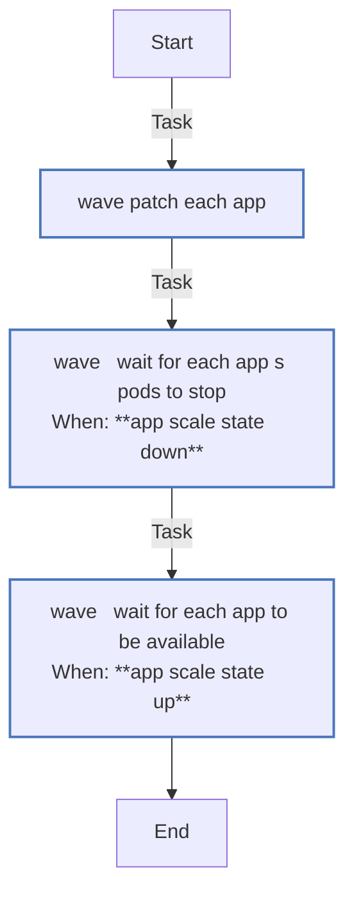

<!-- DOCSIBLE START -->

# 📃 Role overview

## app_scale

Description: Scale a Flux-managed cluster's apps to zero and back

<b>🧩 Argument Specifications in meta/argument_specs</b>

#### Key: main

**Description**: 
- Runs on the controller with kubectl. An app is a Deployment that a Flux Kustomization under app_scale_path applies; a group, the apps of one namespace.
- Down sets Flux's kustomize.toolkit.fluxcd.io/reconcile annotation to disabled on each app, which Flux then neither applies nor prunes, records its replicas and scales it to zero, in one patch; up restores the replicas and removes both annotations, and Flux takes the app back.
- Apps carrying app_scale_late_label stop after the others and start before them.
- Refuses a kubeconfig that names another API server, and a name that is no app or group.
- The defaults do nothing.

**Options**:

  - **app_scale_state**
    - **Required**: false
    - **Type**: str
    - **Default**: 
  
    - **Description**: down or up; empty does nothing.
  
      - **Choices**:
    
          - 
    
          - down
    
          - up
    
  
  
  

  - **app_scale_only**
    - **Required**: false
    - **Type**: list
    - **Default**: []
  
    - **Description**: The apps (Deployments' names) and groups (namespaces) to act on; empty means every app.
  
  
  

  - **app_scale_other_names**
    - **Required**: false
    - **Type**: list
    - **Default**: []
  
    - **Description**: Names another play acts on, accepted in app_scale_only and left to it.
  
  
  

  - **app_scale_kubeconfig**
    - **Required**: false
    - **Type**: str
    - **Default**: 
  
    - **Description**: The cluster's kubeconfig.
  
  
  

  - **app_scale_server**
    - **Required**: false
    - **Type**: str
    - **Default**: 
  
    - **Description**: The API server the kubeconfig must name.
  
  
  

  - **app_scale_path**
    - **Required**: false
    - **Type**: str
    - **Default**: 
  
    - **Description**: The apps are the Deployments the Flux Kustomizations whose path lies under this one apply.
  
  
  

  - **app_scale_late_label**
    - **Required**: false
    - **Type**: str
    - **Default**: 
  
    - **Description**: One label, key=value, of the apps that stop after the others and start before them.
  
  
  

  - **app_scale_annotation**
    - **Required**: false
    - **Type**: str
    - **Default**: 
  
    - **Description**: The annotation that records a stopped app's replicas.
  
  
  

  - **app_scale_timeout**
    - **Required**: false
    - **Type**: str
    - **Default**: 10m
  
    - **Description**: How long a real run waits for an app's pods to stop, or for it to be available again.
  
  
  

### Defaults

**These are static variables with lower priority**

#### File: defaults/main.yml

| Var          | Type         | Value       |
|--------------|--------------|-------------|
| [app_scale_state](defaults/main.yml#L6)   | str |  |    
| [app_scale_only](defaults/main.yml#L8)   | list | `[]` |    
| [app_scale_other_names](defaults/main.yml#L10)   | list | `[]` |    
| [app_scale_kubeconfig](defaults/main.yml#L12)   | str |  |    
| [app_scale_server](defaults/main.yml#L13)   | str |  |    
| [app_scale_path](defaults/main.yml#L15)   | str |  |    
| [app_scale_late_label](defaults/main.yml#L17)   | str |  |    
| [app_scale_annotation](defaults/main.yml#L19)   | str |  |    
| [app_scale_timeout](defaults/main.yml#L21)   | str | `10m` |    

### Tasks

#### File: tasks/main.yml

| Name | Module | Has Conditions | Tags |
| ---- | ------ | -------------- | -----|
| Check the role's inputs | ansible.builtin.assert | True | always |
| Scale the apps | block | True |  |
| Look for the kubeconfig | ansible.builtin.stat | False |  |
| Refuse to run without a kubeconfig | ansible.builtin.assert | False |  |
| Read the server the kubeconfig names | ansible.builtin.set_fact | False |  |
| Refuse another cluster's kubeconfig | ansible.builtin.assert | False |  |
| Read the Flux Kustomizations and the Deployments | ansible.builtin.command | False |  |
| Work out what to do | ansible.builtin.set_fact | False |  |
| Refuse a name that is no app or group | ansible.builtin.assert | False |  |
| Stop or start the apps, a wave at a time | ansible.builtin.include_tasks | True |  |
| Say what was done | ansible.builtin.debug | False |  |

#### File: tasks/wave.yml

| Name | Module | Has Conditions |
| ---- | ------ | -------------- |
| wave ¦ Patch each app | ansible.builtin.command | False |
| wave ¦ Wait for each app's pods to stop | ansible.builtin.command | True |
| wave ¦ Wait for each app to be available | ansible.builtin.command | True |

## Task Flow Graphs

### Graph for main.yml

```mermaid
flowchart TD
Start
classDef block stroke:#3498db,stroke-width:2px;
classDef task stroke:#4b76bb,stroke-width:2px;
classDef includeTasks stroke:#16a085,stroke-width:2px;
classDef importTasks stroke:#34495e,stroke-width:2px;
classDef includeRole stroke:#2980b9,stroke-width:2px;
classDef importRole stroke:#699ba7,stroke-width:2px;
classDef includeVars stroke:#8e44ad,stroke-width:2px;
classDef rescue stroke:#665352,stroke-width:2px;

  Start-->|Task| Check_the_role_s_inputs0[check the role s inputs<br>When: **app scale state   length   0**]:::task
  Check_the_role_s_inputs0-->|Block Start| Scale_the_apps1_block_start_0[[scale the apps<br>When: **app scale state   length   0**]]:::block
  Scale_the_apps1_block_start_0-->|Task| Look_for_the_kubeconfig0[look for the kubeconfig]:::task
  Look_for_the_kubeconfig0-->|Task| Refuse_to_run_without_a_kubeconfig1[refuse to run without a kubeconfig]:::task
  Refuse_to_run_without_a_kubeconfig1-->|Task| Read_the_server_the_kubeconfig_names2[read the server the kubeconfig names]:::task
  Read_the_server_the_kubeconfig_names2-->|Task| Refuse_another_cluster_s_kubeconfig3[refuse another cluster s kubeconfig]:::task
  Refuse_another_cluster_s_kubeconfig3-->|Task| Read_the_Flux_Kustomizations_and_the_Deployments4[read the flux kustomizations and the deployments]:::task
  Read_the_Flux_Kustomizations_and_the_Deployments4-->|Task| Work_out_what_to_do5[work out what to do]:::task
  Work_out_what_to_do5-->|Task| Refuse_a_name_that_is_no_app_or_group6[refuse a name that is no app or group]:::task
  Refuse_a_name_that_is_no_app_or_group6-->|Include task| Stop_or_start_the_apps__a_wave_at_a_time_wave_yml_7[stop or start the apps  a wave at a time<br>When: **not ansible check mode**<br>include_task: wave yml]:::includeTasks
  Stop_or_start_the_apps__a_wave_at_a_time_wave_yml_7-->|Task| Say_what_was_done8[say what was done]:::task
  Say_what_was_done8-.->|End of Block| Scale_the_apps1_block_start_0
  Say_what_was_done8-->End
```

### Graph for wave.yml

## Author Information
homeserver contributors

#### License

none

#### Minimum Ansible Version

2.21

#### Platforms

- **GenericLinux**: ['all']

#### Dependencies

No dependencies specified.
<!-- DOCSIBLE END -->
