<!-- DOCSIBLE START -->

# 📃 Role overview

## flux_bootstrap

Description: Hand a Kubernetes cluster to Flux, through the Flux Operator

<b>🧩 Argument Specifications in meta/argument_specs</b>

#### Key: main

**Description**: 
- Runs on the controller with kubectl. Installs or upgrades the Flux Operator, and keeps the Secret flux-system/sops-age (the age key), the ConfigMap flux-system/cluster-settings and the FluxInstance flux as configured, each compared with a server-side diff and applied server-side under one field manager, so a key removed from the settings disappears.
- Flux 2.9 and later fail a manifest naming a setting that does not exist (strict substitution, on by default), instead of giving it an empty string.
- Refuses an age key file that holds anything but one key, or that others can read.
- The defaults do nothing.

**Options**:

  - **flux_bootstrap_kubeconfig**
    - **Required**: false
    - **Type**: str
    - **Default**: 
  
    - **Description**: The cluster's kubeconfig.
  
  
  

  - **flux_bootstrap_operator_version**
    - **Required**: false
    - **Type**: str
    - **Default**: 
  
    - **Description**: The Flux Operator's release, such as v0.61.0.
  
  
  

  - **flux_bootstrap_operator_url**
    - **Required**: false
    - **Type**: str
    - **Default**: https://github.com/controlplaneio-fluxcd/flux-operator/releases/download
  
    - **Description**: Where the operator's releases are; <url>/<version>/install.yaml is applied.
  
  
  

  - **flux_bootstrap_instance**
    - **Required**: false
    - **Type**: dict
    - **Default**: {}
  
    - **Description**: The FluxInstance's Flux version (2.9.x), Git url, ref and path.
  
  
  

  - **flux_bootstrap_settings**
    - **Required**: false
    - **Type**: dict
    - **Default**: {}
  
    - **Description**: The cluster-settings ConfigMap's keys and values, all strings.
  
  
  

  - **flux_bootstrap_age_key_file**
    - **Required**: false
    - **Type**: str
    - **Default**: 
  
    - **Description**: The age private key file that becomes the Secret flux-system/sops-age. One key, mode 0600.
  
  
  

  - **flux_bootstrap_wait_timeout**
    - **Required**: false
    - **Type**: str
    - **Default**: 10m
  
    - **Description**: How long a real run waits for the operator and for the FluxInstance.
  
  
  

### Defaults

**These are static variables with lower priority**

#### File: defaults/main.yml

| Var          | Type         | Value       |
|--------------|--------------|-------------|
| [flux_bootstrap_kubeconfig](defaults/main.yml#L6)   | str |  |    
| [flux_bootstrap_operator_version](defaults/main.yml#L8)   | str |  |    
| [flux_bootstrap_operator_url](defaults/main.yml#L9)   | str | `https://github.com/controlplaneio-fluxcd/flux-operator/releases/download` |    
| [flux_bootstrap_instance](defaults/main.yml#L11)   | dict | `{}` |    
| [flux_bootstrap_settings](defaults/main.yml#L14)   | dict | `{}` |    
| [flux_bootstrap_age_key_file](defaults/main.yml#L17)   | str |  |    
| [flux_bootstrap_wait_timeout](defaults/main.yml#L19)   | str | `10m` |    

### Tasks

#### File: tasks/main.yml

| Name | Module | Has Conditions | Tags |
| ---- | ------ | -------------- | -----|
| Check the role's inputs | ansible.builtin.assert | True | always |
| Hand the cluster to Flux | block | True |  |
| Look at the age key file | ansible.builtin.stat | False |  |
| Count the keys and other lines in it | ansible.builtin.command | True |  |
| Refuse an age key file that is not one key, or that others can read | ansible.builtin.assert | False |  |
| Look for the kubeconfig | ansible.builtin.stat | False |  |
| Refuse to run without a kubeconfig | ansible.builtin.assert | False |  |
| Read the Flux Operator | ansible.builtin.command | True |  |
| Say what would be installed | ansible.builtin.debug | True |  |
| Keep the operator, the age key, the settings and the FluxInstance as configured | ansible.builtin.import_tasks | True |  |

#### File: tasks/objects.yml

| Name | Module | Has Conditions |
| ---- | ------ | -------------- |
| objects ¦ Work out whether the operator is the pinned release | ansible.builtin.set_fact | False |
| objects ¦ Install or upgrade the Flux Operator | ansible.builtin.command | True |
| objects ¦ Say the operator would be upgraded | ansible.builtin.debug | True |
| objects ¦ Wait for the operator | ansible.builtin.command | True |
| objects ¦ Render the age key as the Secret flux-system/sops-age | ansible.builtin.command | False |
| objects ¦ Render the settings and the FluxInstance | ansible.builtin.set_fact | False |
| objects ¦ Compare the age key's Secret with the cluster's | ansible.builtin.command | False |
| objects ¦ Compare the settings and the FluxInstance with the cluster's | ansible.builtin.command | False |
| objects ¦ Show what differs | ansible.builtin.debug | True |
| objects ¦ Apply the age key's Secret | ansible.builtin.command | True |
| objects ¦ Apply the settings and the FluxInstance | ansible.builtin.command | False |
| objects ¦ Wait for the FluxInstance to be ready | ansible.builtin.command | True |
| objects ¦ Read Flux's Kustomizations | ansible.builtin.command | True |
| objects ¦ Show Flux's Kustomizations | ansible.builtin.debug | True |

## Task Flow Graphs

### Graph for main.yml

```mermaid
flowchart TD
Start
classDef block stroke:#3498db,stroke-width:2px;
classDef task stroke:#4b76bb,stroke-width:2px;
classDef includeTasks stroke:#16a085,stroke-width:2px;
classDef importTasks stroke:#34495e,stroke-width:2px;
classDef includeRole stroke:#2980b9,stroke-width:2px;
classDef importRole stroke:#699ba7,stroke-width:2px;
classDef includeVars stroke:#8e44ad,stroke-width:2px;
classDef rescue stroke:#665352,stroke-width:2px;

  Start-->|Task| Check_the_role_s_inputs0[check the role s inputs<br>When: **flux bootstrap operator version   length   0**]:::task
  Check_the_role_s_inputs0-->|Block Start| Hand_the_cluster_to_Flux1_block_start_0[[hand the cluster to flux<br>When: **flux bootstrap operator version   length   0**]]:::block
  Hand_the_cluster_to_Flux1_block_start_0-->|Task| Look_at_the_age_key_file0[look at the age key file]:::task
  Look_at_the_age_key_file0-->|Task| Count_the_keys_and_other_lines_in_it1[count the keys and other lines in it<br>When: **flux bootstrap age key stat exists**]:::task
  Count_the_keys_and_other_lines_in_it1-->|Task| Refuse_an_age_key_file_that_is_not_one_key__or_that_others_can_read2[refuse an age key file that is not one key  or<br>that others can read]:::task
  Refuse_an_age_key_file_that_is_not_one_key__or_that_others_can_read2-->|Task| Look_for_the_kubeconfig3[look for the kubeconfig]:::task
  Look_for_the_kubeconfig3-->|Task| Refuse_to_run_without_a_kubeconfig4[refuse to run without a kubeconfig]:::task
  Refuse_to_run_without_a_kubeconfig4-->|Task| Read_the_Flux_Operator5[read the flux operator<br>When: **flux bootstrap kubeconfig file stat exists**]:::task
  Read_the_Flux_Operator5-->|Task| Say_what_would_be_installed6[say what would be installed<br>When: **ansible check mode and  flux bootstrap operator is<br>skipped or flux bootstrap operator rc    0**]:::task
  Say_what_would_be_installed6-->|Import task| Keep_the_operator__the_age_key__the_settings_and_the_FluxInstance_as_configured_objects_yml_7[/keep the operator  the age key  the settings and<br>the fluxinstance as configured<br>When: **flux bootstrap operator is not skipped and  flux<br>bootstrap operator rc    0 or not ansible check<br>mode**<br>import_task: objects yml/]:::importTasks
  Keep_the_operator__the_age_key__the_settings_and_the_FluxInstance_as_configured_objects_yml_7-.->|End of Block| Hand_the_cluster_to_Flux1_block_start_0
  Keep_the_operator__the_age_key__the_settings_and_the_FluxInstance_as_configured_objects_yml_7-->End
```

### Graph for objects.yml

```mermaid
flowchart TD
Start
classDef block stroke:#3498db,stroke-width:2px;
classDef task stroke:#4b76bb,stroke-width:2px;
classDef includeTasks stroke:#16a085,stroke-width:2px;
classDef importTasks stroke:#34495e,stroke-width:2px;
classDef includeRole stroke:#2980b9,stroke-width:2px;
classDef importRole stroke:#699ba7,stroke-width:2px;
classDef includeVars stroke:#8e44ad,stroke-width:2px;
classDef rescue stroke:#665352,stroke-width:2px;

  Start-->|Task| objects___Work_out_whether_the_operator_is_the_pinned_release0[objects   work out whether the operator is the<br>pinned release]:::task
  objects___Work_out_whether_the_operator_is_the_pinned_release0-->|Task| objects___Install_or_upgrade_the_Flux_Operator1[objects   install or upgrade the flux operator<br>When: **flux bootstrap operator current    flux bootstrap<br>operator version**]:::task
  objects___Install_or_upgrade_the_Flux_Operator1-->|Task| objects___Say_the_operator_would_be_upgraded2[objects   say the operator would be upgraded<br>When: **ansible check mode and flux bootstrap operator<br>current    flux bootstrap operator version**]:::task
  objects___Say_the_operator_would_be_upgraded2-->|Task| objects___Wait_for_the_operator3[objects   wait for the operator<br>When: **not ansible check mode**]:::task
  objects___Wait_for_the_operator3-->|Task| objects___Render_the_age_key_as_the_Secret_flux_system_sops_age4[objects   render the age key as the secret flux<br>system sops age]:::task
  objects___Render_the_age_key_as_the_Secret_flux_system_sops_age4-->|Task| objects___Render_the_settings_and_the_FluxInstance5[objects   render the settings and the fluxinstance]:::task
  objects___Render_the_settings_and_the_FluxInstance5-->|Task| objects___Compare_the_age_key_s_Secret_with_the_cluster_s6[objects   compare the age key s secret with the<br>cluster s]:::task
  objects___Compare_the_age_key_s_Secret_with_the_cluster_s6-->|Task| objects___Compare_the_settings_and_the_FluxInstance_with_the_cluster_s7[objects   compare the settings and the<br>fluxinstance with the cluster s]:::task
  objects___Compare_the_settings_and_the_FluxInstance_with_the_cluster_s7-->|Task| objects___Show_what_differs8[objects   show what differs<br>When: **flux bootstrap secret diff rc    1 or flux<br>bootstrap diffs results   selectattr  rc    eq   1<br>   list   length   0**]:::task
  objects___Show_what_differs8-->|Task| objects___Apply_the_age_key_s_Secret9[objects   apply the age key s secret<br>When: **flux bootstrap secret diff rc    1**]:::task
  objects___Apply_the_age_key_s_Secret9-->|Task| objects___Apply_the_settings_and_the_FluxInstance10[objects   apply the settings and the fluxinstance]:::task
  objects___Apply_the_settings_and_the_FluxInstance10-->|Task| objects___Wait_for_the_FluxInstance_to_be_ready11[objects   wait for the fluxinstance to be ready<br>When: **not ansible check mode**]:::task
  objects___Wait_for_the_FluxInstance_to_be_ready11-->|Task| objects___Read_Flux_s_Kustomizations12[objects   read flux s kustomizations<br>When: **not ansible check mode**]:::task
  objects___Read_Flux_s_Kustomizations12-->|Task| objects___Show_Flux_s_Kustomizations13[objects   show flux s kustomizations<br>When: **flux bootstrap kustomizations is not skipped**]:::task
  objects___Show_Flux_s_Kustomizations13-->End
```

## Author Information
homeserver contributors

#### License

none

#### Minimum Ansible Version

2.21

#### Platforms

- **GenericLinux**: ['all']

#### Dependencies

No dependencies specified.
<!-- DOCSIBLE END -->
