<!-- DOCSIBLE START -->

# 📃 Role overview

## haos_onboard

Description: Give a new Home Assistant its owner account before anyone else on the network can

<b>🧩 Argument Specifications in meta/argument_specs</b>

#### Key: main

**Description**: 
- Runs on the Proxmox host. Finds the Home Assistant OS VM's address through the QEMU guest agent, waits for Home Assistant itself to answer its onboarding API (the landing page Home Assistant OS shows while it prepares refuses it), and, while onboarding is still open, creates the owner account through it.
- Until then, whoever first reaches port 8123 could create that account, or upload and restore a backup without logging in. Both close once the account exists.
- Never prints the password. Does nothing once the account exists, so it never touches a Home Assistant restored from a backup or already set up.
- The defaults do nothing.

**Options**:

  - **haos_onboard_vmid**
    - **Required**: false
    - **Type**: int
    - **Default**: 0
  
    - **Description**: The Home Assistant OS VM's VMID; 0 means none.
  
  
  

  - **haos_onboard_mac**
    - **Required**: false
    - **Type**: str
    - **Default**: 
  
    - **Description**: Its MAC, which picks its address out of the guest agent's report.
  
  
  

  - **haos_onboard_address**
    - **Required**: false
    - **Type**: str
    - **Default**: 
  
    - **Description**: Its address, when known; then the guest agent is not asked.
  
  
  

  - **haos_onboard_port**
    - **Required**: false
    - **Type**: int
    - **Default**: 8123
  
    - **Description**: Home Assistant's port; a redirect from it is followed, and the account is created where Home Assistant answered.
  
  
  

  - **haos_onboard_name**
    - **Required**: false
    - **Type**: str
    - **Default**: 
  
    - **Description**: The owner's display name.
  
  
  

  - **haos_onboard_username**
    - **Required**: false
    - **Type**: str
    - **Default**: 
  
    - **Description**: The owner's username, lower case.
  
  
  

  - **haos_onboard_password**
    - **Required**: false
    - **Type**: str
    - **Default**: 
  
    - **Description**: The owner's password, at least 12 characters.
  
  
  

  - **haos_onboard_language**
    - **Required**: false
    - **Type**: str
    - **Default**: en
  
    - **Description**: The language Home Assistant names its default areas in.
  
  
  

  - **haos_onboard_agent_retries**
    - **Required**: false
    - **Type**: int
    - **Default**: 40
  
    - **Description**: How many times a real run asks the guest agent for the VM's address.
  
  
  

  - **haos_onboard_retries**
    - **Required**: false
    - **Type**: int
    - **Default**: 120
  
    - **Description**: How many times a real run asks Home Assistant's onboarding API before giving up.
  
  
  

  - **haos_onboard_delay**
    - **Required**: false
    - **Type**: int
    - **Default**: 15
  
    - **Description**: Seconds between those questions.
  
  
  

### Defaults

**These are static variables with lower priority**

#### File: defaults/main.yml

| Var          | Type         | Value       |
|--------------|--------------|-------------|
| [haos_onboard_vmid](defaults/main.yml#L5)   | int | `0` |    
| [haos_onboard_mac](defaults/main.yml#L7)   | str |  |    
| [haos_onboard_address](defaults/main.yml#L8)   | str |  |    
| [haos_onboard_port](defaults/main.yml#L9)   | int | `8123` |    
| [haos_onboard_name](defaults/main.yml#L11)   | str |  |    
| [haos_onboard_username](defaults/main.yml#L12)   | str |  |    
| [haos_onboard_password](defaults/main.yml#L13)   | str |  |    
| [haos_onboard_language](defaults/main.yml#L14)   | str | `en` |    
| [haos_onboard_agent_retries](defaults/main.yml#L17)   | int | `40` |    
| [haos_onboard_retries](defaults/main.yml#L18)   | int | `120` |    
| [haos_onboard_delay](defaults/main.yml#L19)   | int | `15` |    

### Tasks

#### File: tasks/main.yml

| Name | Module | Has Conditions | Tags |
| ---- | ------ | -------------- | -----|
| Check the role's inputs | ansible.builtin.assert | False | always |
| Give Home Assistant its owner account | block | True |  |
| Read the VM's state | ansible.builtin.command | False |  |
| Use what the run can ask | ansible.builtin.set_fact | False |  |
| Refuse a VM that is not running | ansible.builtin.assert | True |  |
| Ask the guest agent for the VM's address | ansible.builtin.command | True |  |
| Use the VM's address | ansible.builtin.set_fact | False |  |
| Wait for Home Assistant's onboarding API | ansible.builtin.uri | True |  |
| Work out whether onboarding is still open | ansible.builtin.set_fact | False |  |
| Say what a dry run would do | ansible.builtin.debug | True |  |
| Create the owner account | ansible.builtin.uri | True |  |
| Refuse an account Home Assistant did not create | ansible.builtin.assert | True |  |
| Check that onboarding is closed | ansible.builtin.uri | True |  |
| Refuse an onboarding still open | ansible.builtin.assert | True |  |
| Say where to log in | ansible.builtin.debug | True |  |

## Task Flow Graphs

### Graph for main.yml

```mermaid
flowchart TD
Start
classDef block stroke:#3498db,stroke-width:2px;
classDef task stroke:#4b76bb,stroke-width:2px;
classDef includeTasks stroke:#16a085,stroke-width:2px;
classDef importTasks stroke:#34495e,stroke-width:2px;
classDef includeRole stroke:#2980b9,stroke-width:2px;
classDef importRole stroke:#699ba7,stroke-width:2px;
classDef includeVars stroke:#8e44ad,stroke-width:2px;
classDef rescue stroke:#665352,stroke-width:2px;

  Start-->|Task| Check_the_role_s_inputs0[check the role s inputs]:::task
  Check_the_role_s_inputs0-->|Block Start| Give_Home_Assistant_its_owner_account1_block_start_0[[give home assistant its owner account<br>When: **haos onboard vmid   int   0**]]:::block
  Give_Home_Assistant_its_owner_account1_block_start_0-->|Task| Read_the_VM_s_state0[read the vm s state]:::task
  Read_the_VM_s_state0-->|Task| Use_what_the_run_can_ask1[use what the run can ask]:::task
  Use_what_the_run_can_ask1-->|Task| Refuse_a_VM_that_is_not_running2[refuse a vm that is not running<br>When: **not ansible check mode**]:::task
  Refuse_a_VM_that_is_not_running2-->|Task| Ask_the_guest_agent_for_the_VM_s_address3[ask the guest agent for the vm s address<br>When: **not haos onboard address and haos onboard running**]:::task
  Ask_the_guest_agent_for_the_VM_s_address3-->|Task| Use_the_VM_s_address4[use the vm s address]:::task
  Use_the_VM_s_address4-->|Task| Wait_for_Home_Assistant_s_onboarding_API5[wait for home assistant s onboarding api<br>When: **haos onboard host   length   0**]:::task
  Wait_for_Home_Assistant_s_onboarding_API5-->|Task| Work_out_whether_onboarding_is_still_open6[work out whether onboarding is still open]:::task
  Work_out_whether_onboarding_is_still_open6-->|Task| Say_what_a_dry_run_would_do7[say what a dry run would do<br>When: **ansible check mode and  haos onboard open or not<br>haos onboard answered**]:::task
  Say_what_a_dry_run_would_do7-->|Task| Create_the_owner_account8[create the owner account<br>When: **haos onboard open and not ansible check mode**]:::task
  Create_the_owner_account8-->|Task| Refuse_an_account_Home_Assistant_did_not_create9[refuse an account home assistant did not create<br>When: **haos onboard created is not skipped**]:::task
  Refuse_an_account_Home_Assistant_did_not_create9-->|Task| Check_that_onboarding_is_closed10[check that onboarding is closed<br>When: **haos onboard created is not skipped**]:::task
  Check_that_onboarding_is_closed10-->|Task| Refuse_an_onboarding_still_open11[refuse an onboarding still open<br>When: **haos onboard created is not skipped**]:::task
  Refuse_an_onboarding_still_open11-->|Task| Say_where_to_log_in12[say where to log in<br>When: **haos onboard created is not skipped**]:::task
  Say_where_to_log_in12-.->|End of Block| Give_Home_Assistant_its_owner_account1_block_start_0
  Say_where_to_log_in12-->End
```

## Author Information
homeserver contributors

#### License

none

#### Minimum Ansible Version

2.21

#### Platforms

- **Debian**: ['all']

#### Dependencies

No dependencies specified.
<!-- DOCSIBLE END -->
