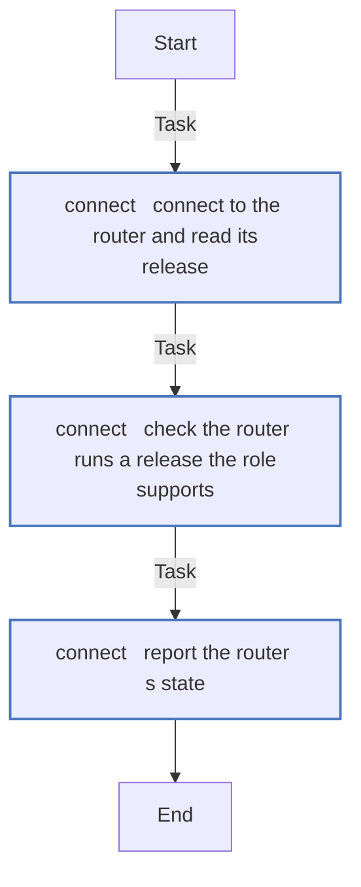
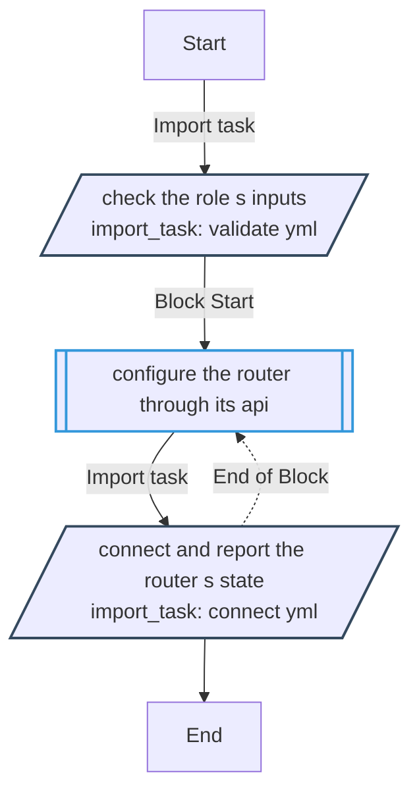
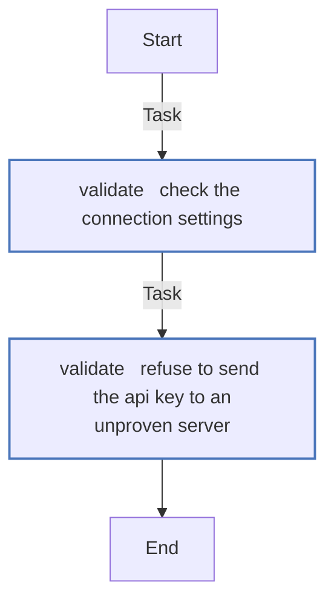

<!-- DOCSIBLE START -->

# 📃 Role overview

## opnsense

Description: Configure the OPNsense router through its API - read-only for now

<b>🧩 Argument Specifications in meta/argument_specs</b>

#### Key: main

**Description**: 
- Runs on the controller and calls the router's HTTPS API with an API key and secret; nothing goes over SSH.
- Today it only reads - it connects, checks the router runs a release it supports, and reports that release and the plugins installed.
- The key and secret go only to a server presenting the pinned certificate.

**Options**:

  - **opnsense_api_host**
    - **Required**: false
    - **Type**: str
    - **Default**: 
  
    - **Description**: The router's address.
  
  
  

  - **opnsense_api_port**
    - **Required**: false
    - **Type**: int
    - **Default**: 443
  
    - **Description**: HTTPS port of the router's web server.
  
  
  

  - **opnsense_api_key**
    - **Required**: false
    - **Type**: str
    - **Default**: 
  
    - **Description**: The key of the API key pair. Keep it in an ansible-vault file.
  
  
  

  - **opnsense_api_secret**
    - **Required**: false
    - **Type**: str
    - **Default**: 
  
    - **Description**: The secret of the API key pair. Keep it in an ansible-vault file.
  
  
  

  - **opnsense_validate_certs**
    - **Required**: false
    - **Type**: bool
    - **Default**: False
  
    - **Description**: Verify the router's certificate against the controller's trusted authorities.
  
  
  

  - **opnsense_api_cert_sha256**
    - **Required**: false
    - **Type**: str
    - **Default**: 
  
    - **Description**: SHA-256 fingerprint of the router's certificate; the key and secret go only to that server. Required while opnsense_validate_certs is off.
  
  
  

  - **opnsense_api_timeout**
    - **Required**: false
    - **Type**: int
    - **Default**: 60
  
    - **Description**: Seconds to wait for the connection and for each answer.
  
  
  

  - **opnsense_min_version**
    - **Required**: false
    - **Type**: str
    - **Default**: 26.7.2
  
    - **Description**: The oldest release the role runs against; an older router fails the run.
  
  
  

### Defaults

**These are static variables with lower priority**

#### File: defaults/main.yml

| Var          | Type         | Value       |
|--------------|--------------|-------------|
| [opnsense_api_host](defaults/main.yml#L7)   | str |  |    
| [opnsense_api_port](defaults/main.yml#L9)   | int | `443` |    
| [opnsense_api_key](defaults/main.yml#L11)   | str |  |    
| [opnsense_api_secret](defaults/main.yml#L12)   | str |  |    
| [opnsense_validate_certs](defaults/main.yml#L13)   | bool | `False` |    
| [opnsense_api_cert_sha256](defaults/main.yml#L17)   | str |  |    
| [opnsense_api_timeout](defaults/main.yml#L19)   | int | `60` |    
| [opnsense_min_version](defaults/main.yml#L22)   | str | `26.7.2` |    

### Tasks

#### File: tasks/connect.yml

| Name | Module | Has Conditions |
| ---- | ------ | -------------- |
| connect ¦ Connect to the router and read its release | opnsense_info | False |
| connect ¦ Check the router runs a release the role supports | ansible.builtin.assert | False |
| connect ¦ Report the router's state | ansible.builtin.debug | False |

#### File: tasks/main.yml

| Name | Module | Has Conditions | Tags |
| ---- | ------ | -------------- | -----|
| Check the role's inputs | ansible.builtin.import_tasks | False | always |
| Configure the router through its API | block | False |  |
| Connect and report the router's state | ansible.builtin.import_tasks | False |  |

#### File: tasks/validate.yml

| Name | Module | Has Conditions |
| ---- | ------ | -------------- |
| validate ¦ Check the connection settings | ansible.builtin.assert | False |
| validate ¦ Refuse to send the API key to an unproven server | ansible.builtin.assert | False |

## Task Flow Graphs

### Graph for connect.yml

### Graph for main.yml

### Graph for validate.yml

## Author Information
homeserver contributors

#### License

none

#### Minimum Ansible Version

2.21

#### Platforms

- **GenericLinux**: ['all']

#### Dependencies

No dependencies specified.
<!-- DOCSIBLE END -->
