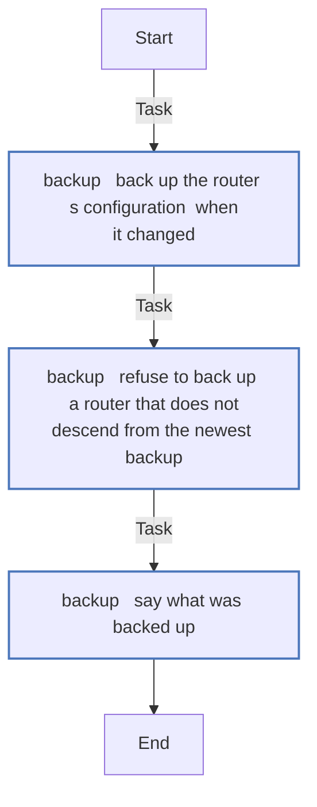
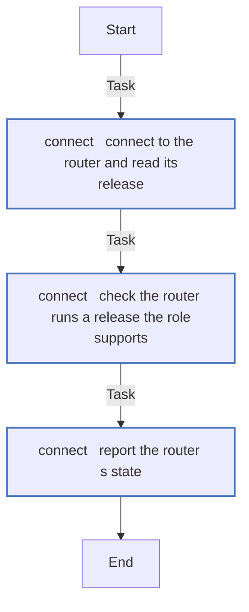
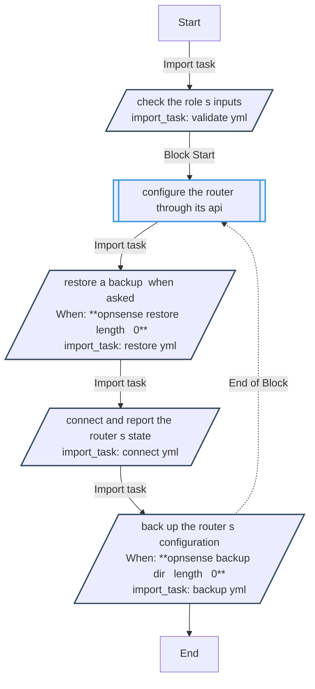
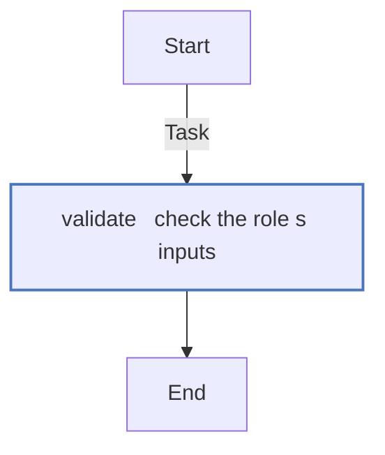

<!-- DOCSIBLE START -->

# 📃 Role overview

## opnsense

Description: Configure the OPNsense router through its API - its configuration backed up and restored

<b>🧩 Argument Specifications in meta/argument_specs</b>

#### Key: main

**Description**: 
- Runs on the controller and calls the router's HTTPS API with an API key and secret; nothing goes over SSH.
- It connects, checks the router runs a release it supports, and reports that release and the plugins installed.
- With opnsense_backup_dir, it backs up the router's configuration when it changed, encrypted in OPNsense's own format, and refuses a router that does not descend from the newest backup.
- With opnsense_restore, and only then, it restores a backup through the web UI, onto the router as it is known or onto a fresh install, which reboots into it.
- Nothing, neither the key pair nor a password, goes to a server presenting another certificate than the pinned one.

**Options**:

  - **opnsense_api_host**
    - **Required**: false
    - **Type**: str
    - **Default**: 
  
    - **Description**: The router's address.
  
  
  

  - **opnsense_api_port**
    - **Required**: false
    - **Type**: int
    - **Default**: 443
  
    - **Description**: HTTPS port of the router's web server.
  
  
  

  - **opnsense_api_key**
    - **Required**: false
    - **Type**: str
    - **Default**: 
  
    - **Description**: The key of the API key pair. Keep it in an ansible-vault file.
  
  
  

  - **opnsense_api_secret**
    - **Required**: false
    - **Type**: str
    - **Default**: 
  
    - **Description**: The secret of the API key pair. Keep it in an ansible-vault file.
  
  
  

  - **opnsense_validate_certs**
    - **Required**: false
    - **Type**: bool
    - **Default**: False
  
    - **Description**: Verify the router's certificate against the controller's trusted authorities.
  
  
  

  - **opnsense_api_cert_sha256**
    - **Required**: false
    - **Type**: str
    - **Default**: 
  
    - **Description**: SHA-256 fingerprint of the router's certificate; the key and secret go only to that server. Required while opnsense_validate_certs is off.
  
  
  

  - **opnsense_api_timeout**
    - **Required**: false
    - **Type**: int
    - **Default**: 60
  
    - **Description**: Seconds to wait for the connection and for each answer.
  
  
  

  - **opnsense_min_version**
    - **Required**: false
    - **Type**: str
    - **Default**: 26.7.2
  
    - **Description**: The oldest release the role runs against; an older router fails the run.
  
  
  

  - **opnsense_backup_dir**
    - **Required**: false
    - **Type**: str
    - **Default**: 
  
    - **Description**: Where the router's configuration is backed up, outside any repository; empty, nothing is backed up.
  
  
  

  - **opnsense_backup_password**
    - **Required**: false
    - **Type**: str
    - **Default**: 
  
    - **Description**: The password the backups are encrypted with. Keep it in an ansible-vault file.
  
  
  

  - **opnsense_backup_accept**
    - **Required**: false
    - **Type**: bool
    - **Default**: False
  
    - **Description**: Back the router's configuration up even when it does not descend from the newest backup.
  
  
  

  - **opnsense_restore**
    - **Required**: false
    - **Type**: str
    - **Default**: 
  
    - **Description**: What to restore - latest, or a backup's name; empty, nothing is restored.
  
  
  

  - **opnsense_gui_user**
    - **Required**: false
    - **Type**: str
    - **Default**: root
  
    - **Description**: The web UI user a restore logs in as.
  
  
  

  - **opnsense_gui_password**
    - **Required**: false
    - **Type**: str
    - **Default**: 
  
    - **Description**: That user's password. Keep it in an ansible-vault file.
  
  
  

  - **opnsense_bootstrap_host**
    - **Required**: false
    - **Type**: str
    - **Default**: 
  
    - **Description**: Where a fresh install answers; empty, the router's own address.
  
  
  

  - **opnsense_bootstrap_port**
    - **Required**: false
    - **Type**: int
    - **Default**: 443
  
    - **Description**: The HTTPS port a fresh install answers on.
  
  
  

  - **opnsense_bootstrap_cert_sha256**
    - **Required**: false
    - **Type**: str
    - **Default**: 
  
    - **Description**: The SHA-256 of the certificate the fresh install presents, once checked by hand.
  
  
  

  - **opnsense_restore_wait**
    - **Required**: false
    - **Type**: int
    - **Default**: 900
  
    - **Description**: Seconds to wait for the router to come back on its address after a restore.
  
  
  

  - **opnsense_restore_poll**
    - **Required**: false
    - **Type**: int
    - **Default**: 15
  
    - **Description**: Seconds between the questions while waiting.
  
  
  

### Defaults

**These are static variables with lower priority**

#### File: defaults/main.yml

| Var          | Type         | Value       |
|--------------|--------------|-------------|
| [opnsense_api_host](defaults/main.yml#L7)   | str |  |    
| [opnsense_api_port](defaults/main.yml#L9)   | int | `443` |    
| [opnsense_api_key](defaults/main.yml#L11)   | str |  |    
| [opnsense_api_secret](defaults/main.yml#L12)   | str |  |    
| [opnsense_validate_certs](defaults/main.yml#L13)   | bool | `False` |    
| [opnsense_api_cert_sha256](defaults/main.yml#L17)   | str |  |    
| [opnsense_api_timeout](defaults/main.yml#L19)   | int | `60` |    
| [opnsense_min_version](defaults/main.yml#L22)   | str | `26.7.2` |    
| [opnsense_backup_dir](defaults/main.yml#L27)   | str |  |    
| [opnsense_backup_password](defaults/main.yml#L29)   | str |  |    
| [opnsense_backup_accept](defaults/main.yml#L31)   | bool | `False` |    
| [opnsense_restore](defaults/main.yml#L35)   | str |  |    
| [opnsense_gui_user](defaults/main.yml#L38)   | str | `root` |    
| [opnsense_gui_password](defaults/main.yml#L39)   | str |  |    
| [opnsense_bootstrap_host](defaults/main.yml#L42)   | str |  |    
| [opnsense_bootstrap_port](defaults/main.yml#L43)   | int | `443` |    
| [opnsense_bootstrap_cert_sha256](defaults/main.yml#L46)   | str |  |    
| [opnsense_restore_wait](defaults/main.yml#L48)   | int | `900` |    
| [opnsense_restore_poll](defaults/main.yml#L49)   | int | `15` |    

### Tasks

#### File: tasks/backup.yml

| Name | Module | Has Conditions |
| ---- | ------ | -------------- |
| backup ¦ Back up the router's configuration, when it changed | opnsense_backup | False |
| backup ¦ Refuse to back up a router that does not descend from the newest backup | ansible.builtin.assert | False |
| backup ¦ Say what was backed up | ansible.builtin.debug | False |

#### File: tasks/connect.yml

| Name | Module | Has Conditions |
| ---- | ------ | -------------- |
| connect ¦ Connect to the router and read its release | opnsense_info | False |
| connect ¦ Check the router runs a release the role supports | ansible.builtin.assert | False |
| connect ¦ Report the router's state | ansible.builtin.debug | False |

#### File: tasks/main.yml

| Name | Module | Has Conditions | Tags |
| ---- | ------ | -------------- | -----|
| Check the role's inputs | ansible.builtin.import_tasks | False | always |
| Configure the router through its API | block | False |  |
| Restore a backup, when asked | ansible.builtin.import_tasks | True |  |
| Connect and report the router's state | ansible.builtin.import_tasks | False |  |
| Back up the router's configuration | ansible.builtin.import_tasks | True |  |

#### File: tasks/restore.yml

| Name | Module | Has Conditions |
| ---- | ------ | -------------- |
| restore ¦ List the backups | ansible.builtin.find | False |
| restore ¦ Choose the backup to restore, and where a fresh install answers | ansible.builtin.set_fact | False |
| restore ¦ Refuse a backup that is not there | ansible.builtin.assert | False |
| restore ¦ Ask the router at its address whether it is the one known | opnsense_info | False |
| restore ¦ Restore onto the router as it is known | block | True |
| restore ¦ Back the router's configuration up first, as it is | opnsense_backup | False |
| restore ¦ Say the router runs the backup already | ansible.builtin.debug | True |
| restore ¦ Restore the backup onto the router, which then reboots | opnsense_restore | True |
| restore ¦ Restore onto a fresh router | block | True |
| restore ¦ Read the certificate the fresh router presents, sending nothing else | opnsense_restore | True |
| restore ¦ Stop until the fresh router's certificate is pinned | ansible.builtin.assert | False |
| restore ¦ Restore the backup onto the fresh router, which then reboots | opnsense_restore | False |
| restore ¦ Note what was restored | ansible.builtin.set_fact | False |
| restore ¦ Stop for the console when the router's interfaces do not match the backup's | ansible.builtin.assert | False |
| restore ¦ Say what a real run would restore | ansible.builtin.debug | True |
| restore ¦ End a dry run that would restore | ansible.builtin.meta | True |
| restore ¦ Wait for the router to come back on its address | opnsense_info | True |
| restore ¦ Remember that the router runs a restored configuration | ansible.builtin.set_fact | False |

#### File: tasks/validate.yml

| Name | Module | Has Conditions |
| ---- | ------ | -------------- |
| validate ¦ Check the role's inputs | ansible.builtin.assert | False |

## Task Flow Graphs

### Graph for backup.yml

### Graph for connect.yml

### Graph for main.yml

### Graph for restore.yml

```mermaid
flowchart TD
Start
classDef block stroke:#3498db,stroke-width:2px;
classDef task stroke:#4b76bb,stroke-width:2px;
classDef includeTasks stroke:#16a085,stroke-width:2px;
classDef importTasks stroke:#34495e,stroke-width:2px;
classDef includeRole stroke:#2980b9,stroke-width:2px;
classDef importRole stroke:#699ba7,stroke-width:2px;
classDef includeVars stroke:#8e44ad,stroke-width:2px;
classDef rescue stroke:#665352,stroke-width:2px;

  Start-->|Task| restore___List_the_backups0[restore   list the backups]:::task
  restore___List_the_backups0-->|Task| restore___Choose_the_backup_to_restore__and_where_a_fresh_install_answers1[restore   choose the backup to restore  and where<br>a fresh install answers]:::task
  restore___Choose_the_backup_to_restore__and_where_a_fresh_install_answers1-->|Task| restore___Refuse_a_backup_that_is_not_there2[restore   refuse a backup that is not there]:::task
  restore___Refuse_a_backup_that_is_not_there2-->|Task| restore___Ask_the_router_at_its_address_whether_it_is_the_one_known3[restore   ask the router at its address whether it<br>is the one known]:::task
  restore___Ask_the_router_at_its_address_whether_it_is_the_one_known3-->|Block Start| restore___Restore_onto_the_router_as_it_is_known4_block_start_0[[restore   restore onto the router as it is known<br>When: **opnsense known version is defined**]]:::block
  restore___Restore_onto_the_router_as_it_is_known4_block_start_0-->|Task| restore___Back_the_router_s_configuration_up_first__as_it_is0[restore   back the router s configuration up first<br> as it is]:::task
  restore___Back_the_router_s_configuration_up_first__as_it_is0-->|Task| restore___Say_the_router_runs_the_backup_already1[restore   say the router runs the backup already<br>When: **opnsense before router id    opnsense restore<br>file   basename**]:::task
  restore___Say_the_router_runs_the_backup_already1-->|Task| restore___Restore_the_backup_onto_the_router__which_then_reboots2[restore   restore the backup onto the router <br>which then reboots<br>When: **opnsense before router id    opnsense restore<br>file   basename**]:::task
  restore___Restore_the_backup_onto_the_router__which_then_reboots2-.->|End of Block| restore___Restore_onto_the_router_as_it_is_known4_block_start_0
  restore___Restore_the_backup_onto_the_router__which_then_reboots2-->|Block Start| restore___Restore_onto_a_fresh_router5_block_start_0[[restore   restore onto a fresh router<br>When: **opnsense known version is not defined**]]:::block
  restore___Restore_onto_a_fresh_router5_block_start_0-->|Task| restore___Read_the_certificate_the_fresh_router_presents__sending_nothing_else0[restore   read the certificate the fresh router<br>presents  sending nothing else<br>When: **not opnsense bootstrap cert sha256**]:::task
  restore___Read_the_certificate_the_fresh_router_presents__sending_nothing_else0-->|Task| restore___Stop_until_the_fresh_router_s_certificate_is_pinned1[restore   stop until the fresh router s<br>certificate is pinned]:::task
  restore___Stop_until_the_fresh_router_s_certificate_is_pinned1-->|Task| restore___Restore_the_backup_onto_the_fresh_router__which_then_reboots2[restore   restore the backup onto the fresh router<br> which then reboots]:::task
  restore___Restore_the_backup_onto_the_fresh_router__which_then_reboots2-.->|End of Block| restore___Restore_onto_a_fresh_router5_block_start_0
  restore___Restore_the_backup_onto_the_fresh_router__which_then_reboots2-->|Task| restore___Note_what_was_restored6[restore   note what was restored]:::task
  restore___Note_what_was_restored6-->|Task| restore___Stop_for_the_console_when_the_router_s_interfaces_do_not_match_the_backup_s7[restore   stop for the console when the router s<br>interfaces do not match the backup s]:::task
  restore___Stop_for_the_console_when_the_router_s_interfaces_do_not_match_the_backup_s7-->|Task| restore___Say_what_a_real_run_would_restore8[restore   say what a real run would restore<br>When: **opnsense restore result would restore   default<br>false**]:::task
  restore___Say_what_a_real_run_would_restore8-->|Task| restore___End_a_dry_run_that_would_restore9[restore   end a dry run that would restore<br>When: **opnsense restore result would restore   default<br>false**]:::task
  restore___End_a_dry_run_that_would_restore9-->|Task| restore___Wait_for_the_router_to_come_back_on_its_address10[restore   wait for the router to come back on its<br>address<br>When: **opnsense restore result restored   default false**]:::task
  restore___Wait_for_the_router_to_come_back_on_its_address10-->|Task| restore___Remember_that_the_router_runs_a_restored_configuration11[restore   remember that the router runs a restored<br>configuration]:::task
  restore___Remember_that_the_router_runs_a_restored_configuration11-->End
```

### Graph for validate.yml

## Author Information
homeserver contributors

#### License

none

#### Minimum Ansible Version

2.21

#### Platforms

- **GenericLinux**: ['all']

#### Dependencies

No dependencies specified.
<!-- DOCSIBLE END -->
