<!-- DOCSIBLE START -->

# 📃 Role overview

## proxmox_apt

Description: Set a Proxmox VE node's package repositories and upgrade its packages

<b>🧩 Argument Specifications in meta/argument_specs</b>

#### Key: main

**Description**: 
- Writes deb822 repository files (<name>.sources) into apt's sources directory, as Proxmox VE 9 ships them, and disables the files named in proxmox_apt_disabled when they exist, with an Enabled line, which is what the web UI does to the enterprise repositories on a host without a subscription.
- Optionally refreshes the package lists and runs apt-get dist-upgrade, non-interactively, keeping configuration files that were changed on the node. In check mode the upgrade is only simulated.
- Records an upgrade of a kernel or of a package in proxmox_apt_reboot_packages in Debian's reboot-required flag file, which every boot empties, even when the upgrade fails, and says on every run whether that file exists. It never reboots the node.
- The defaults change nothing.

**Options**:

  - **proxmox_apt_sources_dir**
    - **Required**: false
    - **Type**: str
    - **Default**: /etc/apt/sources.list.d
  
    - **Description**: Where apt keeps its deb822 repository files.
  
  
  

  - **proxmox_apt_suite**
    - **Required**: false
    - **Type**: str
    - **Default**: 
  
    - **Description**: The Debian release for the repositories. Empty reads it from the node's /etc/os-release.
  
  
  

  - **proxmox_apt_signed_by**
    - **Required**: false
    - **Type**: str
    - **Default**: /usr/share/keyrings/proxmox-archive-keyring.gpg
  
    - **Description**: Signing key for entries that do not name their own.
  
  
  

  - **proxmox_apt_sources**
    - **Required**: false
    - **Type**: list
    - **Default**: []
  
    - **Description**: Repository files to write, each with name, uris and components; optional suites and signed_by.
  
  
  
    
  

  - **proxmox_apt_disabled**
    - **Required**: false
    - **Type**: list
    - **Default**: []
  
    - **Description**: Names of repository files to disable when they exist.
  
  
  

  - **proxmox_apt_upgrade**
    - **Required**: false
    - **Type**: bool
    - **Default**: False
  
    - **Description**: Refresh the package lists and dist-upgrade. In check mode, simulate only.
  
  
  

  - **proxmox_apt_reboot_packages**
    - **Required**: false
    - **Type**: list
    - **Default**: []
  
    - **Description**: Packages besides the kernel whose upgrade takes effect only at boot; an upgrade of one is recorded in the flag file.
  
  
  

  - **proxmox_apt_reboot_required_file**
    - **Required**: false
    - **Type**: str
    - **Default**: /run/reboot-required
  
    - **Description**: Debian's flag file for a pending reboot. Must be on a filesystem a boot empties.
  
  
  

### Defaults

**These are static variables with lower priority**

#### File: defaults/main.yml

| Var          | Type         | Value       |
|--------------|--------------|-------------|
| [proxmox_apt_sources_dir](defaults/main.yml#L6)   | str | `/etc/apt/sources.list.d` |    
| [proxmox_apt_suite](defaults/main.yml#L9)   | str |  |    
| [proxmox_apt_signed_by](defaults/main.yml#L11)   | str | `/usr/share/keyrings/proxmox-archive-keyring.gpg` |    
| [proxmox_apt_sources](defaults/main.yml#L15)   | list | `[]` |    
| [proxmox_apt_disabled](defaults/main.yml#L19)   | list | `[]` |    
| [proxmox_apt_upgrade](defaults/main.yml#L23)   | bool | `False` |    
| [proxmox_apt_reboot_packages](defaults/main.yml#L28)   | list | `[]` |    
| [proxmox_apt_reboot_required_file](defaults/main.yml#L31)   | str | `/run/reboot-required` |    

### Tasks

#### File: tasks/main.yml

| Name | Module | Has Conditions |
| ---- | ------ | -------------- |
| Check the role's inputs | ansible.builtin.assert | False |
| Read the node's Debian release | ansible.builtin.shell | True |
| Use the Debian release | ansible.builtin.set_fact | True |
| Refuse to write repositories for an unknown release | ansible.builtin.assert | True |
| Write the repository files | ansible.builtin.copy | False |
| Find the repository files to disable | ansible.builtin.stat | False |
| Disable the repositories that need a subscription | ansible.builtin.lineinfile | True |
| Refresh the package lists | ansible.builtin.command | True |
| Simulate the upgrade | ansible.builtin.command | True |
| Upgrade the packages, and record what needs a reboot | block | False |
| Upgrade the packages | ansible.builtin.command | True |
| Show what the upgrade changes | ansible.builtin.debug | True |
| Read whether a reboot was asked for | ansible.builtin.stat | False |
| Show whether a reboot is needed | ansible.builtin.debug | False |

## Task Flow Graphs

### Graph for main.yml

```mermaid
flowchart TD
Start
classDef block stroke:#3498db,stroke-width:2px;
classDef task stroke:#4b76bb,stroke-width:2px;
classDef includeTasks stroke:#16a085,stroke-width:2px;
classDef importTasks stroke:#34495e,stroke-width:2px;
classDef includeRole stroke:#2980b9,stroke-width:2px;
classDef importRole stroke:#699ba7,stroke-width:2px;
classDef includeVars stroke:#8e44ad,stroke-width:2px;
classDef rescue stroke:#665352,stroke-width:2px;

  Start-->|Task| Check_the_role_s_inputs0[check the role s inputs]:::task
  Check_the_role_s_inputs0-->|Task| Read_the_node_s_Debian_release1[read the node s debian release<br>When: **proxmox apt sources   length   0 and proxmox apt<br>suite   length    0**]:::task
  Read_the_node_s_Debian_release1-->|Task| Use_the_Debian_release2[use the debian release<br>When: **proxmox apt sources   length   0**]:::task
  Use_the_Debian_release2-->|Task| Refuse_to_write_repositories_for_an_unknown_release3[refuse to write repositories for an unknown<br>release<br>When: **proxmox apt sources   length   0**]:::task
  Refuse_to_write_repositories_for_an_unknown_release3-->|Task| Write_the_repository_files4[write the repository files]:::task
  Write_the_repository_files4-->|Task| Find_the_repository_files_to_disable5[find the repository files to disable]:::task
  Find_the_repository_files_to_disable5-->|Task| Disable_the_repositories_that_need_a_subscription6[disable the repositories that need a subscription<br>When: **item stat exists**]:::task
  Disable_the_repositories_that_need_a_subscription6-->|Task| Refresh_the_package_lists7[refresh the package lists<br>When: **proxmox apt upgrade**]:::task
  Refresh_the_package_lists7-->|Task| Simulate_the_upgrade8[simulate the upgrade<br>When: **proxmox apt upgrade and ansible check mode**]:::task
  Simulate_the_upgrade8-->|Block Start| Upgrade_the_packages__and_record_what_needs_a_reboot9_block_start_0[[upgrade the packages  and record what needs a<br>reboot]]:::block
  Upgrade_the_packages__and_record_what_needs_a_reboot9_block_start_0-->|Task| Upgrade_the_packages0[upgrade the packages<br>When: **proxmox apt upgrade**]:::task
  Upgrade_the_packages0-.->|End of Block| Upgrade_the_packages__and_record_what_needs_a_reboot9_block_start_0
  Upgrade_the_packages0-->|Task| Show_what_the_upgrade_changes10[show what the upgrade changes<br>When: **proxmox apt upgrade**]:::task
  Show_what_the_upgrade_changes10-->|Task| Read_whether_a_reboot_was_asked_for11[read whether a reboot was asked for]:::task
  Read_whether_a_reboot_was_asked_for11-->|Task| Show_whether_a_reboot_is_needed12[show whether a reboot is needed]:::task
  Show_whether_a_reboot_is_needed12-->End
```

## Author Information
homeserver contributors

#### License

none

#### Minimum Ansible Version

2.21

#### Platforms

- **Debian**: ['all']

#### Dependencies

No dependencies specified.
<!-- DOCSIBLE END -->
