<!-- DOCSIBLE START -->

# 📃 Role overview

## proxmox_backup

Description: Keep Proxmox VE's scheduled vzdump backup jobs as configured

<b>🧩 Argument Specifications in meta/argument_specs</b>

#### Key: main

**Description**: 
- Creates each job of proxmox_backup_jobs with pvesh under /cluster/backup, and corrects the settings it manages of one that exists. Never deletes a job, and never touches one that is not listed.
- Refuses a job whose storage does not exist, is disabled or does not hold backups, and a directory storage that is not a checked mount point, which would fill the node's root filesystem when its disk is missing. In check mode, a storage named in proxmox_backup_pending_storages is reported as pending.
- The defaults change nothing.

**Options**:

  - **proxmox_backup_jobs**
    - **Required**: false
    - **Type**: list
    - **Default**: []
  
    - **Description**: Jobs, each with id, schedule, storage and vmid (a list of VMIDs); optional mode (snapshot), compress (zstd), prune_backups, notes_template and enabled (true).
  
  
  
    
  

  - **proxmox_backup_pending_storages**
    - **Required**: false
    - **Type**: list
    - **Default**: []
  
    - **Description**: Storage ids an earlier role creates on a real run; reported as pending in check mode.
  
  
  

### Defaults

**These are static variables with lower priority**

#### File: defaults/main.yml

| Var          | Type         | Value       |
|--------------|--------------|-------------|
| [proxmox_backup_jobs](defaults/main.yml#L7)   | list | `[]` |    
| [proxmox_backup_pending_storages](defaults/main.yml#L11)   | list | `[]` |    

### Tasks

#### File: tasks/main.yml

| Name | Module | Has Conditions | Tags |
| ---- | ------ | -------------- | -----|
| Check the role's inputs | ansible.builtin.assert | False | always |
| Read the storage configuration | ansible.builtin.command | True |  |
| Read the backup jobs | ansible.builtin.command | True |  |
| Work out the wanted jobs and what their storage lacks | ansible.builtin.set_fact | True |  |
| Refuse a backup storage that cannot take the backups | ansible.builtin.assert | True |  |
| Show the backup jobs to create or correct | ansible.builtin.debug | True |  |
| Create the backup jobs | ansible.builtin.command | True |  |
| Correct the backup jobs' settings that drifted | ansible.builtin.command | True |  |

## Task Flow Graphs

### Graph for main.yml

```mermaid
flowchart TD
Start
classDef block stroke:#3498db,stroke-width:2px;
classDef task stroke:#4b76bb,stroke-width:2px;
classDef includeTasks stroke:#16a085,stroke-width:2px;
classDef importTasks stroke:#34495e,stroke-width:2px;
classDef includeRole stroke:#2980b9,stroke-width:2px;
classDef importRole stroke:#699ba7,stroke-width:2px;
classDef includeVars stroke:#8e44ad,stroke-width:2px;
classDef rescue stroke:#665352,stroke-width:2px;

  Start-->|Task| Check_the_role_s_inputs0[check the role s inputs]:::task
  Check_the_role_s_inputs0-->|Task| Read_the_storage_configuration1[read the storage configuration<br>When: **proxmox backup jobs   length   0**]:::task
  Read_the_storage_configuration1-->|Task| Read_the_backup_jobs2[read the backup jobs<br>When: **proxmox backup jobs   length   0**]:::task
  Read_the_backup_jobs2-->|Task| Work_out_the_wanted_jobs_and_what_their_storage_lacks3[work out the wanted jobs and what their storage<br>lacks<br>When: **proxmox backup jobs   length   0**]:::task
  Work_out_the_wanted_jobs_and_what_their_storage_lacks3-->|Task| Refuse_a_backup_storage_that_cannot_take_the_backups4[refuse a backup storage that cannot take the<br>backups<br>When: **proxmox backup jobs   length   0**]:::task
  Refuse_a_backup_storage_that_cannot_take_the_backups4-->|Task| Show_the_backup_jobs_to_create_or_correct5[show the backup jobs to create or correct<br>When: **proxmox backup jobs   length   0**]:::task
  Show_the_backup_jobs_to_create_or_correct5-->|Task| Create_the_backup_jobs6[create the backup jobs<br>When: **proxmox backup plan item key      create**]:::task
  Create_the_backup_jobs6-->|Task| Correct_the_backup_jobs__settings_that_drifted7[correct the backup jobs  settings that drifted<br>When: **proxmox backup plan item key  is not string**]:::task
  Correct_the_backup_jobs__settings_that_drifted7-->End
```

## Author Information
homeserver contributors

#### License

none

#### Minimum Ansible Version

2.21

#### Platforms

- **Debian**: ['all']

#### Dependencies

No dependencies specified.
<!-- DOCSIBLE END -->
