<!-- DOCSIBLE START -->

# 📃 Role overview

## proxmox_gpu

Description: Find the GPU a Proxmox VE host can pass to a VM, keep its PCI resource mapping, and keep the host's drivers off it

<b>🧩 Argument Specifications in meta/argument_specs</b>

#### Key: main

**Description**: 
- Reads the host's PCI devices, and from sysfs which one is its console, whether its IOMMU is on, and the driver holding each, and chooses the GPU to pass (proxmox_gpu_select). auto takes the one GPU that can be passed alone and is not the console; none found means no GPU, and more than one is refused. An address takes that GPU, and one no longer in the host means no GPU, so a VM that had it can still start.
- Refuses a GPU it is asked for by address that is not a GPU, whose IOMMU group holds other devices than the card's own (a VM would take them from the host too), with the IOMMU off, of a vendor not in proxmox_gpu_vendors, or that a guest not in proxmox_gpu_guests uses (a VM's hostpci, by address or through another mapping, or a container's DRM nodes). auto leaves such a GPU alone.
- Creates or corrects the PCI resource mapping proxmox_gpu_mapping to the GPU's address, ids and IOMMU group, keeping other nodes' entries, then has Proxmox check it. Never deletes one.
- With proxmox_gpu_vfio, writes a modprobe.d file that has vfio-pci claim the GPU's devices before any driver, rebuilds the initramfs until a build with that file has succeeded, and says while a host driver still holds the GPU that the host must reboot. Never reboots. Without it, leaves the file and the initramfs alone.
- Sets proxmox_gpu_selected to the GPU chosen ({} for none), its address, ids and the drivers that claim it.

**Options**:

  - **proxmox_gpu_select**
    - **Required**: false
    - **Type**: str
    - **Default**: 
  
    - **Description**: auto, none (or empty), or the GPU's PCI address (0000:01:00.0, 01:00.0, or 01:00 for the slot).
  
  
  

  - **proxmox_gpu_select_name**
    - **Required**: false
    - **Type**: str
    - **Default**: proxmox_gpu_select
  
    - **Description**: What messages call the setting proxmox_gpu_select comes from.
  
  
  

  - **proxmox_gpu_vendors**
    - **Required**: false
    - **Type**: list
    - **Default**: []
  
    - **Description**: PCI vendor ids (8086, 1002, 10de) auto may take and an address may name. Empty, any.
  
  
  

  - **proxmox_gpu_guests**
    - **Required**: false
    - **Type**: list
    - **Default**: []
  
    - **Description**: VMIDs the GPU is meant for, whose own use of it never counts as another guest's.
  
  
  

  - **proxmox_gpu_mapping**
    - **Required**: false
    - **Type**: str
    - **Default**: 
  
    - **Description**: The PCI resource mapping kept for the GPU. Empty, none.
  
  
  

  - **proxmox_gpu_mapping_description**
    - **Required**: false
    - **Type**: str
    - **Default**: 
  
    - **Description**: The mapping's description when the role creates it.
  
  
  

  - **proxmox_gpu_vfio**
    - **Required**: false
    - **Type**: bool
    - **Default**: False
  
    - **Description**: Keep the host's drivers off the GPU from its next boot (vfio-pci by id, softdep, initramfs).
  
  
  

  - **proxmox_gpu_modprobe_file**
    - **Required**: false
    - **Type**: str
    - **Default**: /etc/modprobe.d/proxmox-gpu.conf
  
    - **Description**: The modprobe.d file that does it, removed with no GPU, left alone when proxmox_gpu_vfio is off.
  
  
  

  - **proxmox_gpu_state_dir**
    - **Required**: false
    - **Type**: str
    - **Default**: /var/lib/proxmox-gpu
  
    - **Description**: Where the role records the file the initramfs was last built with.
  
  
  

  - **proxmox_gpu_sysfs**
    - **Required**: false
    - **Type**: str
    - **Default**: /sys
  
    - **Description**: Where the host's sysfs is.
  
  
  

  - **proxmox_gpu_pve_dir**
    - **Required**: false
    - **Type**: str
    - **Default**: /etc/pve
  
    - **Description**: Proxmox's configuration directory, read for the guests' devices.
  
  
  

  - **proxmox_gpu_node**
    - **Required**: false
    - **Type**: str
    - **Default**: 
  
    - **Description**: The node's name in Proxmox. Empty means the host's short hostname.
  
  
  

#### Key: detect

**Description**: 
- What main does first, alone and read-only, for a play that only needs to know which GPU the VM has. It sets proxmox_gpu_selected as main does, and refuses the same GPUs.

**Options**:

  - **proxmox_gpu_select**
    - **Required**: false
    - **Type**: str
    - **Default**: 
  
    - **Description**: auto, none (or empty), or the GPU's PCI address.
  
  
  

  - **proxmox_gpu_select_name**
    - **Required**: false
    - **Type**: str
    - **Default**: proxmox_gpu_select
  
    - **Description**: What messages call the setting proxmox_gpu_select comes from.
  
  
  

  - **proxmox_gpu_vendors**
    - **Required**: false
    - **Type**: list
    - **Default**: []
  
    - **Description**: PCI vendor ids auto may take and an address may name. Empty, any.
  
  
  

  - **proxmox_gpu_guests**
    - **Required**: false
    - **Type**: list
    - **Default**: []
  
    - **Description**: VMIDs the GPU is meant for, whose own use of it never counts as another guest's.
  
  
  

  - **proxmox_gpu_mapping**
    - **Required**: false
    - **Type**: str
    - **Default**: 
  
    - **Description**: The PCI resource mapping kept for the GPU, checked to be well formed.
  
  
  

  - **proxmox_gpu_sysfs**
    - **Required**: false
    - **Type**: str
    - **Default**: /sys
  
    - **Description**: Where the host's sysfs is.
  
  
  

  - **proxmox_gpu_pve_dir**
    - **Required**: false
    - **Type**: str
    - **Default**: /etc/pve
  
    - **Description**: Proxmox's configuration directory, read for the guests' devices.
  
  
  

  - **proxmox_gpu_node**
    - **Required**: false
    - **Type**: str
    - **Default**: 
  
    - **Description**: The node's name in Proxmox. Empty means the host's short hostname.
  
  
  

### Defaults

**These are static variables with lower priority**

#### File: defaults/main.yml

| Var          | Type         | Value       |
|--------------|--------------|-------------|
| [proxmox_gpu_select](defaults/main.yml#L7)   | str |  |    
| [proxmox_gpu_select_name](defaults/main.yml#L9)   | str | `proxmox_gpu_select` |    
| [proxmox_gpu_vendors](defaults/main.yml#L11)   | list | `[]` |    
| [proxmox_gpu_guests](defaults/main.yml#L14)   | list | `[]` |    
| [proxmox_gpu_mapping](defaults/main.yml#L18)   | str |  |    
| [proxmox_gpu_mapping_description](defaults/main.yml#L20)   | str |  |    
| [proxmox_gpu_vfio](defaults/main.yml#L25)   | bool | `False` |    
| [proxmox_gpu_modprobe_file](defaults/main.yml#L26)   | str | `/etc/modprobe.d/proxmox-gpu.conf` |    
| [proxmox_gpu_state_dir](defaults/main.yml#L28)   | str | `/var/lib/proxmox-gpu` |    
| [proxmox_gpu_sysfs](defaults/main.yml#L32)   | str | `/sys` |    
| [proxmox_gpu_pve_dir](defaults/main.yml#L33)   | str | `/etc/pve` |    
| [proxmox_gpu_node](defaults/main.yml#L35)   | str |  |    

### Tasks

#### File: tasks/detect.yml

| Name | Module | Has Conditions | Tags |
| ---- | ------ | -------------- | -----|
| detect ¦ Check the role's inputs | ansible.builtin.assert | False |  |
| detect ¦ Note whether to look at all | ansible.builtin.set_fact | False |  |
| detect ¦ Find the node's name | ansible.builtin.command | True |  |
| detect ¦ Use the node's name | ansible.builtin.set_fact | True |  |
| detect ¦ Read the host's PCI devices | ansible.builtin.command | True |  |
| detect ¦ Read each device's console flag, driver and modalias, and the DRM nodes | ansible.builtin.command | True |  |
| detect ¦ Read which devices the guests are given | ansible.builtin.command | True |  |
| detect ¦ Read the PCI resource mappings | ansible.builtin.command | True |  |
| detect ¦ Choose the GPU | ansible.builtin.set_fact | True |  |
| detect ¦ Refuse a GPU that cannot be passed, or a choice between several | ansible.builtin.assert | True |  |
| detect ¦ Ask which drivers claim each of its devices | ansible.builtin.command | True |  |
| detect ¦ Keep the GPU chosen | ansible.builtin.set_fact | True |  |
| detect ¦ Say which GPU a VM gets | ansible.builtin.debug | True |  |

#### File: tasks/main.yml

| Name | Module | Has Conditions |
| ---- | ------ | -------------- |
| Find the GPU | ansible.builtin.import_tasks | False |
| Work out what the mapping needs | ansible.builtin.set_fact | True |
| Show what the mapping needs | ansible.builtin.debug | True |
| Create or correct the mapping | ansible.builtin.command | True |
| Read the mapping as Proxmox checks it | ansible.builtin.command | True |
| Refuse a mapping Proxmox finds invalid | ansible.builtin.assert | True |
| Keep the host's drivers off the GPU | block | True |
| Write the modprobe.d file that does it | ansible.builtin.copy | True |
| Remove that file without a GPU to pass | ansible.builtin.file | True |
| Read what the initramfs was last built with | ansible.builtin.slurp | False |
| Rebuild the initramfs | ansible.builtin.command | True |
| Make the directory for the record | ansible.builtin.file | True |
| Record what the initramfs was built with | ansible.builtin.copy | True |
| Remove the record without a GPU to pass | ansible.builtin.file | True |
| Say whether the host must reboot for vfio-pci to hold the GPU | ansible.builtin.debug | True |

## Task Flow Graphs

### Graph for detect.yml

```mermaid
flowchart TD
Start
classDef block stroke:#3498db,stroke-width:2px;
classDef task stroke:#4b76bb,stroke-width:2px;
classDef includeTasks stroke:#16a085,stroke-width:2px;
classDef importTasks stroke:#34495e,stroke-width:2px;
classDef includeRole stroke:#2980b9,stroke-width:2px;
classDef importRole stroke:#699ba7,stroke-width:2px;
classDef includeVars stroke:#8e44ad,stroke-width:2px;
classDef rescue stroke:#665352,stroke-width:2px;

  Start-->|Task| detect___Check_the_role_s_inputs0[detect   check the role s inputs]:::task
  detect___Check_the_role_s_inputs0-->|Task| detect___Note_whether_to_look_at_all1[detect   note whether to look at all]:::task
  detect___Note_whether_to_look_at_all1-->|Task| detect___Find_the_node_s_name2[detect   find the node s name<br>When: **proxmox gpu looking and proxmox gpu node   length <br>  0**]:::task
  detect___Find_the_node_s_name2-->|Task| detect___Use_the_node_s_name3[detect   use the node s name<br>When: **proxmox gpu looking**]:::task
  detect___Use_the_node_s_name3-->|Task| detect___Read_the_host_s_PCI_devices4[detect   read the host s pci devices<br>When: **proxmox gpu looking**]:::task
  detect___Read_the_host_s_PCI_devices4-->|Task| detect___Read_each_device_s_console_flag__driver_and_modalias__and_the_DRM_nodes5[detect   read each device s console flag  driver<br>and modalias  and the drm nodes<br>When: **proxmox gpu looking**]:::task
  detect___Read_each_device_s_console_flag__driver_and_modalias__and_the_DRM_nodes5-->|Task| detect___Read_which_devices_the_guests_are_given6[detect   read which devices the guests are given<br>When: **proxmox gpu looking**]:::task
  detect___Read_which_devices_the_guests_are_given6-->|Task| detect___Read_the_PCI_resource_mappings7[detect   read the pci resource mappings<br>When: **proxmox gpu looking**]:::task
  detect___Read_the_PCI_resource_mappings7-->|Task| detect___Choose_the_GPU8[detect   choose the gpu<br>When: **proxmox gpu looking**]:::task
  detect___Choose_the_GPU8-->|Task| detect___Refuse_a_GPU_that_cannot_be_passed__or_a_choice_between_several9[detect   refuse a gpu that cannot be passed  or a<br>choice between several<br>When: **proxmox gpu looking**]:::task
  detect___Refuse_a_GPU_that_cannot_be_passed__or_a_choice_between_several9-->|Task| detect___Ask_which_drivers_claim_each_of_its_devices10[detect   ask which drivers claim each of its<br>devices<br>When: **proxmox gpu choice gpu modaliases item    default <br>     length   0**]:::task
  detect___Ask_which_drivers_claim_each_of_its_devices10-->|Task| detect___Keep_the_GPU_chosen11[detect   keep the gpu chosen<br>When: **proxmox gpu looking**]:::task
  detect___Keep_the_GPU_chosen11-->|Task| detect___Say_which_GPU_a_VM_gets12[detect   say which gpu a vm gets<br>When: **proxmox gpu looking**]:::task
  detect___Say_which_GPU_a_VM_gets12-->End
```

### Graph for main.yml

```mermaid
flowchart TD
Start
classDef block stroke:#3498db,stroke-width:2px;
classDef task stroke:#4b76bb,stroke-width:2px;
classDef includeTasks stroke:#16a085,stroke-width:2px;
classDef importTasks stroke:#34495e,stroke-width:2px;
classDef includeRole stroke:#2980b9,stroke-width:2px;
classDef importRole stroke:#699ba7,stroke-width:2px;
classDef includeVars stroke:#8e44ad,stroke-width:2px;
classDef rescue stroke:#665352,stroke-width:2px;

  Start-->|Import task| Find_the_GPU_detect_yml_0[/find the gpu<br>import_task: detect yml/]:::importTasks
  Find_the_GPU_detect_yml_0-->|Task| Work_out_what_the_mapping_needs1[work out what the mapping needs<br>When: **proxmox gpu selected   length   0 and proxmox gpu<br>mapping   length   0**]:::task
  Work_out_what_the_mapping_needs1-->|Task| Show_what_the_mapping_needs2[show what the mapping needs<br>When: **proxmox gpu selected   length   0 and proxmox gpu<br>mapping   length   0**]:::task
  Show_what_the_mapping_needs2-->|Task| Create_or_correct_the_mapping3[create or correct the mapping<br>When: **proxmox gpu selected   length   0 and proxmox gpu<br>mapping   length   0 and proxmox gpu mapping plan<br>action in   create    set**]:::task
  Create_or_correct_the_mapping3-->|Task| Read_the_mapping_as_Proxmox_checks_it4[read the mapping as proxmox checks it<br>When: **not ansible check mode and proxmox gpu selected  <br>length   0 and proxmox gpu mapping   length   0**]:::task
  Read_the_mapping_as_Proxmox_checks_it4-->|Task| Refuse_a_mapping_Proxmox_finds_invalid5[refuse a mapping proxmox finds invalid<br>When: **proxmox gpu checked is not skipped and proxmox gpu<br>checked stdout is defined**]:::task
  Refuse_a_mapping_Proxmox_finds_invalid5-->|Block Start| Keep_the_host_s_drivers_off_the_GPU6_block_start_0[[keep the host s drivers off the gpu<br>When: **proxmox gpu vfio**]]:::block
  Keep_the_host_s_drivers_off_the_GPU6_block_start_0-->|Task| Write_the_modprobe_d_file_that_does_it0[write the modprobe d file that does it<br>When: **wanted   length   0**]:::task
  Write_the_modprobe_d_file_that_does_it0-->|Task| Remove_that_file_without_a_GPU_to_pass1[remove that file without a gpu to pass<br>When: **wanted   length    0**]:::task
  Remove_that_file_without_a_GPU_to_pass1-->|Task| Read_what_the_initramfs_was_last_built_with2[read what the initramfs was last built with]:::task
  Read_what_the_initramfs_was_last_built_with2-->|Task| Rebuild_the_initramfs3[rebuild the initramfs<br>When: **built     wanted**]:::task
  Rebuild_the_initramfs3-->|Task| Make_the_directory_for_the_record4[make the directory for the record<br>When: **wanted   length   0**]:::task
  Make_the_directory_for_the_record4-->|Task| Record_what_the_initramfs_was_built_with5[record what the initramfs was built with<br>When: **wanted   length   0**]:::task
  Record_what_the_initramfs_was_built_with5-->|Task| Remove_the_record_without_a_GPU_to_pass6[remove the record without a gpu to pass<br>When: **wanted   length    0**]:::task
  Remove_the_record_without_a_GPU_to_pass6-.->|End of Block| Keep_the_host_s_drivers_off_the_GPU6_block_start_0
  Remove_the_record_without_a_GPU_to_pass6-->|Task| Say_whether_the_host_must_reboot_for_vfio_pci_to_hold_the_GPU7[say whether the host must reboot for vfio pci to<br>hold the gpu<br>When: **proxmox gpu vfio and  held   length   0**]:::task
  Say_whether_the_host_must_reboot_for_vfio_pci_to_hold_the_GPU7-->End
```

## Author Information
homeserver contributors

#### License

none

#### Minimum Ansible Version

2.21

#### Platforms

- **Debian**: ['all']

#### Dependencies

No dependencies specified.
<!-- DOCSIBLE END -->
