<!-- DOCSIBLE START -->

# 📃 Role overview

## proxmox_node_exporter

Description: Put Prometheus's node exporter on a Proxmox VE node, for the addresses that scrape it alone

<b>🧩 Argument Specifications in meta/argument_specs</b>

#### Key: main

**Description**: 
- Installs Debian's prometheus-node-exporter, without its recommended collectors, and keeps it enabled and running on port 9100. Upgrades are left to apt's, with every other package.
- Only the node itself and proxmox_node_exporter_scrapers may connect, through systemd's IP filter on the exporter's unit (IPAddressDeny=any, IPAddressAllow=), in a drop-in written before the package, whose scripts start the exporter at once. A change to the addresses restarts it.
- The defaults change nothing.

**Options**:

  - **proxmox_node_exporter_scrapers**
    - **Required**: false
    - **Type**: list
    - **Default**: []
  
    - **Description**: The IPv4 addresses that may scrape the exporter, such as the nodes a Prometheus runs on. Empty, nothing is installed or changed.
  
  
  

  - **proxmox_node_exporter_systemd_dir**
    - **Required**: false
    - **Type**: str
    - **Default**: /etc/systemd/system
  
    - **Description**: Where systemd reads the exporter's drop-in.
  
  
  

### Defaults

**These are static variables with lower priority**

#### File: defaults/main.yml

| Var          | Type         | Value       |
|--------------|--------------|-------------|
| [proxmox_node_exporter_scrapers](defaults/main.yml#L7)   | list | `[]` |    
| [proxmox_node_exporter_systemd_dir](defaults/main.yml#L10)   | str | `/etc/systemd/system` |    

### Tasks

#### File: tasks/main.yml

| Name | Module | Has Conditions | Tags |
| ---- | ------ | -------------- | -----|
| Check the role's inputs | ansible.builtin.assert | False | always |
| Do nothing without addresses to serve | ansible.builtin.meta | True |  |
| Read whether the exporter is installed | ansible.builtin.command | False |  |
| Create the exporter's drop-in directory | ansible.builtin.file | False |  |
| Let only the scrapers and the node connect | ansible.builtin.template | False |  |
| Reload systemd's unit files | ansible.builtin.command | True |  |
| Install the exporter | ansible.builtin.command | True |  |
| Read whether the exporter is enabled and running | ansible.builtin.command | False |  |
| Work out what the exporter needs | ansible.builtin.set_fact | False |  |
| Enable the exporter at boot | ansible.builtin.command | True |  |
| Start or restart the exporter | ansible.builtin.command | True |  |
| Say what the exporter would need | ansible.builtin.debug | True |  |

## Task Flow Graphs

### Graph for main.yml

```mermaid
flowchart TD
Start
classDef block stroke:#3498db,stroke-width:2px;
classDef task stroke:#4b76bb,stroke-width:2px;
classDef includeTasks stroke:#16a085,stroke-width:2px;
classDef importTasks stroke:#34495e,stroke-width:2px;
classDef includeRole stroke:#2980b9,stroke-width:2px;
classDef importRole stroke:#699ba7,stroke-width:2px;
classDef includeVars stroke:#8e44ad,stroke-width:2px;
classDef rescue stroke:#665352,stroke-width:2px;

  Start-->|Task| Check_the_role_s_inputs0[check the role s inputs]:::task
  Check_the_role_s_inputs0-->|Task| Do_nothing_without_addresses_to_serve1[do nothing without addresses to serve<br>When: **proxmox node exporter scrapers   length    0**]:::task
  Do_nothing_without_addresses_to_serve1-->|Task| Read_whether_the_exporter_is_installed2[read whether the exporter is installed]:::task
  Read_whether_the_exporter_is_installed2-->|Task| Create_the_exporter_s_drop_in_directory3[create the exporter s drop in directory]:::task
  Create_the_exporter_s_drop_in_directory3-->|Task| Let_only_the_scrapers_and_the_node_connect4[let only the scrapers and the node connect]:::task
  Let_only_the_scrapers_and_the_node_connect4-->|Task| Reload_systemd_s_unit_files5[reload systemd s unit files<br>When: **proxmox node exporter dropin is changed or proxmox<br>node exporter package stdout   trim     installed**]:::task
  Reload_systemd_s_unit_files5-->|Task| Install_the_exporter6[install the exporter<br>When: **proxmox node exporter package stdout   trim    <br>installed**]:::task
  Install_the_exporter6-->|Task| Read_whether_the_exporter_is_enabled_and_running7[read whether the exporter is enabled and running]:::task
  Read_whether_the_exporter_is_enabled_and_running7-->|Task| Work_out_what_the_exporter_needs8[work out what the exporter needs]:::task
  Work_out_what_the_exporter_needs8-->|Task| Enable_the_exporter_at_boot9[enable the exporter at boot<br>When: **proxmox node exporter enable**]:::task
  Enable_the_exporter_at_boot9-->|Task| Start_or_restart_the_exporter10[start or restart the exporter<br>When: **proxmox node exporter restart   length   0**]:::task
  Start_or_restart_the_exporter10-->|Task| Say_what_the_exporter_would_need11[say what the exporter would need<br>When: **ansible check mode and proxmox node exporter<br>install or proxmox node exporter enable or proxmox<br>node exporter restart   length   0**]:::task
  Say_what_the_exporter_would_need11-->End
```

## Author Information
homeserver contributors

#### License

none

#### Minimum Ansible Version

2.21

#### Platforms

- **Debian**: ['all']

#### Dependencies

No dependencies specified.
<!-- DOCSIBLE END -->
