<!-- DOCSIBLE START -->

# 📃 Role overview

## proxmox_notes

Description: Keep a marked block of text in the Notes of a Proxmox VE node and of its VMs, leaving the rest as it is

<b>🧩 Argument Specifications in meta/argument_specs</b>

#### Key: main

**Description**: 
- Writes proxmox_notes_text, between the HTML comments <!-- <marker>:begin key=value ... --> and <!-- <marker>:end -->, in the Notes of the node (proxmox_notes_node) and of each VM of proxmox_notes_vmids, with qm set --description and pvenode config set --description. The web UI renders Notes as Markdown and hides the comments, so the metadata the begin marker carries is for tools to read back.
- A block already there is replaced from marker to marker, and every other line of the Notes stays as it is, as typed (never expanded). A marker is a line of its own from the first column, outside any fenced code block. A marker without its partner, two blocks, Notes that end inside a fenced code block and Notes longer than Proxmox takes (8192 characters for a VM, 65536 for the node) are refused.
- Notes are compared as Proxmox gives them back (trailing whitespace trimmed), so a second run changes nothing. They apply to a running VM at once, never as a pending change. Each write passes the digest of the configuration as read, so Proxmox refuses it if the configuration changed since.
- A dry run says what it would write. A VM that does not exist yet is stamped once created in a dry run, and refused in a real one.
- The defaults change nothing.

**Options**:

  - **proxmox_notes_marker**
    - **Required**: false
    - **Type**: str
    - **Default**: 
  
    - **Description**: The word that marks the role's block, such as the project's name: a lower-case word of letters, digits and hyphens.
  
  
  

  - **proxmox_notes_metadata**
    - **Required**: false
    - **Type**: dict
    - **Default**: {}
  
    - **Description**: The key=value pairs the begin marker carries, hidden in the web UI: lower-case keys, one-word values of letters, digits and . _ + -.
  
  
  

  - **proxmox_notes_text**
    - **Required**: false
    - **Type**: str
    - **Default**: 
  
    - **Description**: The block's text, Markdown as the web UI renders it, holding no HTML comment. Empty, nothing is written.
  
  
  

  - **proxmox_notes_node**
    - **Required**: false
    - **Type**: bool
    - **Default**: False
  
    - **Description**: Whether the block goes in the node's own Notes.
  
  
  

  - **proxmox_notes_vmids**
    - **Required**: false
    - **Type**: list
    - **Default**: []
  
    - **Description**: The VMs whose Notes hold the block.
  
  
  

  - **proxmox_notes_skip_reason**
    - **Required**: false
    - **Type**: str
    - **Default**: 
  
    - **Description**: What to say when there is no block to write (proxmox_notes_text empty) for Notes the role was given: why, such as "this run was narrowed with --limit". Empty, nothing is said.
  
  
  

### Defaults

**These are static variables with lower priority**

#### File: defaults/main.yml

| Var          | Type         | Value       |
|--------------|--------------|-------------|
| [proxmox_notes_marker](defaults/main.yml#L6)   | str |  |    
| [proxmox_notes_metadata](defaults/main.yml#L9)   | dict | `{}` |    
| [proxmox_notes_text](defaults/main.yml#L11)   | str |  |    
| [proxmox_notes_node](defaults/main.yml#L13)   | bool | `False` |    
| [proxmox_notes_vmids](defaults/main.yml#L15)   | list | `[]` |    
| [proxmox_notes_skip_reason](defaults/main.yml#L18)   | str |  |    

### Tasks

#### File: tasks/main.yml

| Name | Module | Has Conditions | Tags |
| ---- | ------ | -------------- | -----|
| Check the role's inputs | ansible.builtin.assert | False | always |
| Say why nothing is written | ansible.builtin.debug | True |  |
| Do nothing without a block to write, or Notes to write it in | ansible.builtin.meta | True |  |
| Find the node's name | ansible.builtin.command | False |  |
| Read the node's VMs | ansible.builtin.command | True |  |
| Read the Notes of each VM | ansible.builtin.command | False |  |
| Read the node's Notes | ansible.builtin.command | True |  |
| Work out what to write | ansible.builtin.set_fact | False |  |
| Refuse Notes whose block cannot be written | ansible.builtin.assert | False |  |
| Refuse a VM that does not exist | ansible.builtin.assert | True |  |
| Write the block in each VM's Notes | ansible.builtin.command | False |  |
| Write the block in the node's Notes | ansible.builtin.command | False |  |
| Refuse a write Proxmox did not take | ansible.builtin.assert | False |  |
| Say what would be written | ansible.builtin.debug | True |  |

## Task Flow Graphs

### Graph for main.yml

```mermaid
flowchart TD
Start
classDef block stroke:#3498db,stroke-width:2px;
classDef task stroke:#4b76bb,stroke-width:2px;
classDef includeTasks stroke:#16a085,stroke-width:2px;
classDef importTasks stroke:#34495e,stroke-width:2px;
classDef includeRole stroke:#2980b9,stroke-width:2px;
classDef importRole stroke:#699ba7,stroke-width:2px;
classDef includeVars stroke:#8e44ad,stroke-width:2px;
classDef rescue stroke:#665352,stroke-width:2px;

  Start-->|Task| Check_the_role_s_inputs0[check the role s inputs]:::task
  Check_the_role_s_inputs0-->|Task| Say_why_nothing_is_written1[say why nothing is written<br>When: **not proxmox notes text   proxmox notes has text<br>and proxmox notes skip reason   length   0 and <br>proxmox notes node or proxmox notes vmids   length<br>  0**]:::task
  Say_why_nothing_is_written1-->|Task| Do_nothing_without_a_block_to_write__or_Notes_to_write_it_in2[do nothing without a block to write  or notes to<br>write it in<br>When: **not proxmox notes text   proxmox notes has text or<br> not proxmox notes node and proxmox notes vmids  <br>length    0**]:::task
  Do_nothing_without_a_block_to_write__or_Notes_to_write_it_in2-->|Task| Find_the_node_s_name3[find the node s name]:::task
  Find_the_node_s_name3-->|Task| Read_the_node_s_VMs4[read the node s vms<br>When: **proxmox notes vmids   length   0**]:::task
  Read_the_node_s_VMs4-->|Task| Read_the_Notes_of_each_VM5[read the notes of each vm]:::task
  Read_the_Notes_of_each_VM5-->|Task| Read_the_node_s_Notes6[read the node s notes<br>When: **proxmox notes node**]:::task
  Read_the_node_s_Notes6-->|Task| Work_out_what_to_write7[work out what to write]:::task
  Work_out_what_to_write7-->|Task| Refuse_Notes_whose_block_cannot_be_written8[refuse notes whose block cannot be written]:::task
  Refuse_Notes_whose_block_cannot_be_written8-->|Task| Refuse_a_VM_that_does_not_exist9[refuse a vm that does not exist<br>When: **not ansible check mode**]:::task
  Refuse_a_VM_that_does_not_exist9-->|Task| Write_the_block_in_each_VM_s_Notes10[write the block in each vm s notes]:::task
  Write_the_block_in_each_VM_s_Notes10-->|Task| Write_the_block_in_the_node_s_Notes11[write the block in the node s notes]:::task
  Write_the_block_in_the_node_s_Notes11-->|Task| Refuse_a_write_Proxmox_did_not_take12[refuse a write proxmox did not take]:::task
  Refuse_a_write_Proxmox_did_not_take12-->|Task| Say_what_would_be_written13[say what would be written<br>When: **ansible check mode and  would   length   0**]:::task
  Say_what_would_be_written13-->End
```

## Author Information
homeserver contributors

#### License

none

#### Minimum Ansible Version

2.21

#### Platforms

- **Debian**: ['all']

#### Dependencies

No dependencies specified.
<!-- DOCSIBLE END -->
