<!-- DOCSIBLE START -->

# 📃 Role overview

## proxmox_storage

Description: Add NFS shares to Proxmox VE as qcow2 VM-disk storage, and check that existing storage can hold VM disks

<b>🧩 Argument Specifications in meta/argument_specs</b>

#### Key: main

**Description**: 
- Adds one NFS storage per entry of proxmox_storage_nfs with pvesm, and corrects the content, format, mount options and enabled state of one that already exists.
- Refuses a storage id that exists with another type, server or export, rather than replacing it, and an export that another storage id already mounts, as a renamed id leaves behind until the old one is removed by hand. An id Proxmox would reject and an export listed twice are refused before anything runs, in check mode too.
- Checks that each storage in proxmox_storage_local already exists, is enabled, holds images and is active on the node. Any type passes; it is meant for the installer's own storage. It never creates or changes one.
- Optionally sets the node's start-on-boot delay so VMs wait for the NFS server after a power cut.
- The defaults change nothing.

**Options**:

  - **proxmox_storage_nfs_server**
    - **Required**: false
    - **Type**: str
    - **Default**: 
  
    - **Description**: NFS server for entries that do not name their own.
  
  
  

  - **proxmox_storage_nfs**
    - **Required**: false
    - **Type**: list
    - **Default**: []
  
    - **Description**: Storages, each with id and export; optional server, content, format, nfs_options, enabled.
  
  
  
    
  

  - **proxmox_storage_local**
    - **Required**: false
    - **Type**: list
    - **Default**: []
  
    - **Description**: Ids of storage of any type the node must already have, enabled and with images in its content. Checked, never created.
  
  
  

  - **proxmox_storage_nfs_options**
    - **Required**: false
    - **Type**: str
    - **Default**: 
  
    - **Description**: NFS mount options for entries that do not set their own. Empty leaves Proxmox's defaults.
  
  
  

  - **proxmox_storage_format**
    - **Required**: false
    - **Type**: str
    - **Default**: qcow2
    - **Description**: 
  
  
      - **Choices**:
    
          - qcow2
    
          - raw
    
  
  
  

  - **proxmox_storage_content**
    - **Required**: false
    - **Type**: list
    - **Default**: ['images']
    - **Description**: 
  
  
  
  

  - **proxmox_storage_enabled**
    - **Required**: false
    - **Type**: bool
    - **Default**: True
    - **Description**: 
  
  
  
  

  - **proxmox_storage_node**
    - **Required**: false
    - **Type**: str
    - **Default**: 
  
    - **Description**: The node's name in Proxmox. Empty means the host's short hostname.
  
  
  

  - **proxmox_storage_startall_delay**
    - **Required**: false
    - **Type**: int
    - **Default**: none
  
    - **Description**: Start-on-boot delay in seconds (0-300). Unset or null leaves the node's setting alone.
  
  
  

### Defaults

**These are static variables with lower priority**

#### File: defaults/main.yml

| Var          | Type         | Value       |
|--------------|--------------|-------------|
| [proxmox_storage_nfs_server](defaults/main.yml#L6)   | str |  |    
| [proxmox_storage_nfs](defaults/main.yml#L8)   | list | `[]` |    
| [proxmox_storage_local](defaults/main.yml#L13)   | list | `[]` |    
| [proxmox_storage_nfs_options](defaults/main.yml#L17)   | str |  |    
| [proxmox_storage_format](defaults/main.yml#L20)   | str | `qcow2` |    
| [proxmox_storage_content](defaults/main.yml#L21)   | list | `[]` |    
| [proxmox_storage_content.**0**](defaults/main.yml#L21)   | str | `images` |    
| [proxmox_storage_enabled](defaults/main.yml#L22)   | bool | `True` |    
| [proxmox_storage_node](defaults/main.yml#L25)   | str |  |    
| [proxmox_storage_startall_delay](defaults/main.yml#L29)   | NoneType | `None` |    

### Tasks

#### File: tasks/main.yml

| Name | Module | Has Conditions |
| ---- | ------ | -------------- |
| Check the role's inputs | ansible.builtin.assert | False |
| Read the storage configuration | ansible.builtin.command | True |
| Work out the wanted settings and what each storage needs | ansible.builtin.set_fact | True |
| Work out what the node's own storage lacks | ansible.builtin.set_fact | True |
| Refuse a storage that cannot hold VM disks | ansible.builtin.assert | True |
| Refuse a storage id that already points somewhere else | ansible.builtin.assert | True |
| Refuse an export that another storage id already mounts | ansible.builtin.assert | True |
| Show what will be added or corrected, and what was checked | ansible.builtin.debug | True |
| Add the NFS storages | ansible.builtin.command | True |
| Correct storage settings that drifted | ansible.builtin.command | True |
| Find the node's name | ansible.builtin.command | True |
| Use the node's name | ansible.builtin.set_fact | True |
| Read the node configuration | ansible.builtin.command | True |
| Show the start-on-boot delay, current and wanted | ansible.builtin.debug | True |
| Set the node's start-on-boot delay | ansible.builtin.command | True |
| Read each enabled storage's status on the node | ansible.builtin.command | True |
| Check each enabled storage is mounted and active | ansible.builtin.assert | True |

## Task Flow Graphs

### Graph for main.yml

```mermaid
flowchart TD
Start
classDef block stroke:#3498db,stroke-width:2px;
classDef task stroke:#4b76bb,stroke-width:2px;
classDef includeTasks stroke:#16a085,stroke-width:2px;
classDef importTasks stroke:#34495e,stroke-width:2px;
classDef includeRole stroke:#2980b9,stroke-width:2px;
classDef importRole stroke:#699ba7,stroke-width:2px;
classDef includeVars stroke:#8e44ad,stroke-width:2px;
classDef rescue stroke:#665352,stroke-width:2px;

  Start-->|Task| Check_the_role_s_inputs0[check the role s inputs]:::task
  Check_the_role_s_inputs0-->|Task| Read_the_storage_configuration1[read the storage configuration<br>When: **proxmox storage nfs   length   0 or proxmox<br>storage local   length   0**]:::task
  Read_the_storage_configuration1-->|Task| Work_out_the_wanted_settings_and_what_each_storage_needs2[work out the wanted settings and what each storage<br>needs<br>When: **proxmox storage nfs   length   0**]:::task
  Work_out_the_wanted_settings_and_what_each_storage_needs2-->|Task| Work_out_what_the_node_s_own_storage_lacks3[work out what the node s own storage lacks<br>When: **proxmox storage local   length   0**]:::task
  Work_out_what_the_node_s_own_storage_lacks3-->|Task| Refuse_a_storage_that_cannot_hold_VM_disks4[refuse a storage that cannot hold vm disks<br>When: **proxmox storage local   length   0**]:::task
  Refuse_a_storage_that_cannot_hold_VM_disks4-->|Task| Refuse_a_storage_id_that_already_points_somewhere_else5[refuse a storage id that already points somewhere<br>else<br>When: **proxmox storage nfs   length   0**]:::task
  Refuse_a_storage_id_that_already_points_somewhere_else5-->|Task| Refuse_an_export_that_another_storage_id_already_mounts6[refuse an export that another storage id already<br>mounts<br>When: **proxmox storage nfs   length   0**]:::task
  Refuse_an_export_that_another_storage_id_already_mounts6-->|Task| Show_what_will_be_added_or_corrected__and_what_was_checked7[show what will be added or corrected  and what was<br>checked<br>When: **proxmox storage nfs   length   0 or proxmox<br>storage local   length   0**]:::task
  Show_what_will_be_added_or_corrected__and_what_was_checked7-->|Task| Add_the_NFS_storages8[add the nfs storages<br>When: **proxmox storage plan item id      add**]:::task
  Add_the_NFS_storages8-->|Task| Correct_storage_settings_that_drifted9[correct storage settings that drifted<br>When: **proxmox storage plan item id      correct**]:::task
  Correct_storage_settings_that_drifted9-->|Task| Find_the_node_s_name10[find the node s name<br>When: **proxmox storage node   length    0 and not ansible<br>check mode or proxmox storage startall delay is<br>not none**]:::task
  Find_the_node_s_name10-->|Task| Use_the_node_s_name11[use the node s name<br>When: **not ansible check mode or proxmox storage startall<br>delay is not none**]:::task
  Use_the_node_s_name11-->|Task| Read_the_node_configuration12[read the node configuration<br>When: **proxmox storage startall delay is not none**]:::task
  Read_the_node_configuration12-->|Task| Show_the_start_on_boot_delay__current_and_wanted13[show the start on boot delay  current and wanted<br>When: **proxmox storage startall delay is not none**]:::task
  Show_the_start_on_boot_delay__current_and_wanted13-->|Task| Set_the_node_s_start_on_boot_delay14[set the node s start on boot delay<br>When: **proxmox storage startall delay is not none and <br>proxmox storage node config stdout   from json <br>get  startall onboot delay   0    int    proxmox<br>storage startall delay   int**]:::task
  Set_the_node_s_start_on_boot_delay14-->|Task| Read_each_enabled_storage_s_status_on_the_node15[read each enabled storage s status on the node<br>When: **not ansible check mode and item disable    0**]:::task
  Read_each_enabled_storage_s_status_on_the_node15-->|Task| Check_each_enabled_storage_is_mounted_and_active16[check each enabled storage is mounted and active<br>When: **not ansible check mode**]:::task
  Check_each_enabled_storage_is_mounted_and_active16-->End
```

## Author Information
homeserver contributors

#### License

none

#### Minimum Ansible Version

2.21

#### Platforms

- **Debian**: ['all']

#### Dependencies

No dependencies specified.
<!-- DOCSIBLE END -->
