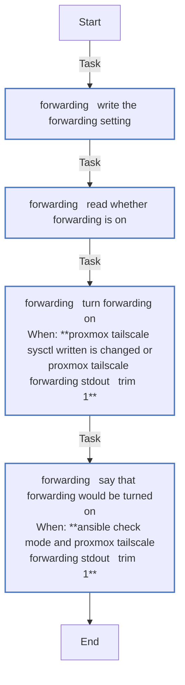
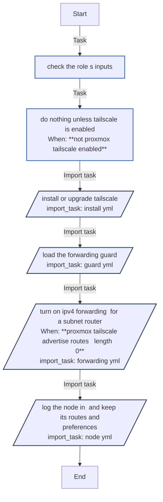
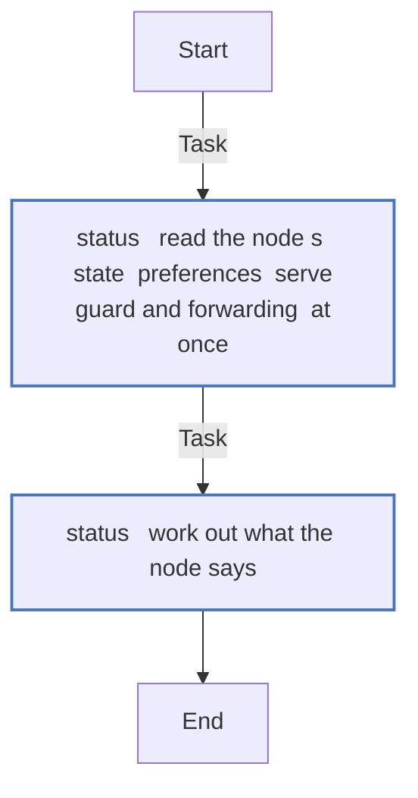

<!-- DOCSIBLE START -->

# 📃 Role overview

## proxmox_tailscale

Description: Join a Proxmox VE node to a tailnet, and with routes make it the LAN's subnet router, behind a guard

<b>🧩 Argument Specifications in meta/argument_specs</b>

#### Key: main

**Description**: 
- Installs Tailscale from its own Debian repository, and with proxmox_tailscale_upgrade upgrades it on every run. Tailscale's own updater is meant to be turned off in proxmox_tailscale_settings.
- Loads a fail-closed nftables guard, its own table in its own unit, which tailscaled requires. Tailnet clients reach the guarded hosts only on the allowed ports, and nothing else outside the advertised prefixes, of which a node without routes has none; the LAN starts no connection into the tailnet, whatever the tailnet's policy says.
- Logs the node in once with a tagged one-off auth key and keeps the given preferences with tailscale set. With routes, it also turns on IPv4 forwarding and advertises them; without, the node is a tailnet device of its own.
- Reports what only the tailnet's admin console can fix, such as a route not yet approved. It never logs the node out, changes its tags or restarts tailscaled itself.
- The defaults change nothing.

**Options**:

  - **proxmox_tailscale_enabled**
    - **Required**: false
    - **Type**: bool
    - **Default**: False
  
    - **Description**: Run Tailscale on the node. False, the role does nothing; true without routes, the node joins the tailnet alone.
  
  
  

  - **proxmox_tailscale_advertise_routes**
    - **Required**: false
    - **Type**: list
    - **Default**: []
  
    - **Description**: The LAN prefixes to advertise, IPv4, in CIDR form, which need proxmox_tailscale_enabled. Empty, the node advertises none.
  
  
  

  - **proxmox_tailscale_tags**
    - **Required**: false
    - **Type**: list
    - **Default**: []
  
    - **Description**: The tags the node joins with, each tag:<name>. At least one is required once the role is enabled.
  
  
  

  - **proxmox_tailscale_auth_key**
    - **Required**: false
    - **Type**: str
    - **Default**: 
  
    - **Description**: A one-off auth key, read only while the node is logged out.
  
  
  

  - **proxmox_tailscale_settings**
    - **Required**: false
    - **Type**: dict
    - **Default**: {}
  
    - **Description**: Preferences kept with tailscale set, by its flag names, each a boolean or a string.
  
  
  

  - **proxmox_tailscale_upgrade**
    - **Required**: false
    - **Type**: bool
    - **Default**: False
  
    - **Description**: Upgrade Tailscale on every run. False leaves an installed release alone, though an upgrade of the whole node still upgrades it.
  
  
  

  - **proxmox_tailscale_guard_hosts**
    - **Required**: false
    - **Type**: list
    - **Default**: []
  
    - **Description**: IPv4 addresses of LAN hosts that tailnet clients may reach only on proxmox_tailscale_guard_allow.
  
  
  

  - **proxmox_tailscale_guard_allow**
    - **Required**: false
    - **Type**: list
    - **Default**: []
  
    - **Description**: The ports still reachable on the guarded hosts, each tcp/<port> or udp/<port>.
  
  
  

  - **proxmox_tailscale_suite**
    - **Required**: false
    - **Type**: str
    - **Default**: 
  
    - **Description**: The Debian release for Tailscale's repository. Empty reads it from the node's /etc/os-release.
  
  
  

  - **proxmox_tailscale_repository**
    - **Required**: false
    - **Type**: str
    - **Default**: https://pkgs.tailscale.com/stable/debian
  
    - **Description**: Tailscale's Debian repository, which also serves its signing key.
  
  
  

  - **proxmox_tailscale_keyring**
    - **Required**: false
    - **Type**: str
    - **Default**: /usr/share/keyrings/tailscale-archive-keyring.gpg
  
    - **Description**: Where the repository's signing key goes.
  
  
  

  - **proxmox_tailscale_sources_dir**
    - **Required**: false
    - **Type**: str
    - **Default**: /etc/apt/sources.list.d
  
    - **Description**: Where apt keeps its deb822 repository files.
  
  
  

  - **proxmox_tailscale_sysctl_file**
    - **Required**: false
    - **Type**: str
    - **Default**: /etc/sysctl.d/99-tailscale.conf
  
    - **Description**: The file that turns on IPv4 forwarding at boot.
  
  
  

  - **proxmox_tailscale_guard_file**
    - **Required**: false
    - **Type**: str
    - **Default**: /etc/nftables.d/tailnet-guard.nft
  
    - **Description**: The guard's nftables table.
  
  
  

  - **proxmox_tailscale_systemd_dir**
    - **Required**: false
    - **Type**: str
    - **Default**: /etc/systemd/system
  
    - **Description**: Where the guard's unit and tailscaled's drop-in go.
  
  
  

#### Key: status

**Description**: 
- Reads tailscale status, get and serve status, the guard's nftables table and the node's IPv4 forwarding, and records in proxmox_tailscale_status_state what they say against this configuration, with what only the tailnet's admin console can fix, worked out as the main entry point reports it.
- tailscale status lists every device and login on the tailnet, and is read under no_log; only the node's own entry is kept. Never fails, and a node that does not answer is recorded as such.

**Options**:

  - **proxmox_tailscale_advertise_routes**
    - **Required**: false
    - **Type**: list
    - **Default**: []
  
    - **Description**: The LAN prefixes to advertise, IPv4, in CIDR form, which need proxmox_tailscale_enabled. Empty, the node advertises none.
  
  
  

  - **proxmox_tailscale_tags**
    - **Required**: false
    - **Type**: list
    - **Default**: []
  
    - **Description**: The tags the node joins with, each tag:<name>. At least one is required once the role is enabled.
  
  
  

  - **proxmox_tailscale_settings**
    - **Required**: false
    - **Type**: dict
    - **Default**: {}
  
    - **Description**: Preferences kept with tailscale set, by its flag names, each a boolean or a string.
  
  
  

  - **proxmox_tailscale_guard_hosts**
    - **Required**: false
    - **Type**: list
    - **Default**: []
  
    - **Description**: IPv4 addresses of LAN hosts that tailnet clients may reach only on proxmox_tailscale_guard_allow.
  
  
  

  - **proxmox_tailscale_guard_allow**
    - **Required**: false
    - **Type**: list
    - **Default**: []
  
    - **Description**: The ports still reachable on the guarded hosts, each tcp/<port> or udp/<port>.
  
  
  

### Defaults

**These are static variables with lower priority**

#### File: defaults/main.yml

| Var          | Type         | Value       |
|--------------|--------------|-------------|
| [proxmox_tailscale_enabled](defaults/main.yml#L7)   | bool | `False` |    
| [proxmox_tailscale_advertise_routes](defaults/main.yml#L10)   | list | `[]` |    
| [proxmox_tailscale_tags](defaults/main.yml#L12)   | list | `[]` |    
| [proxmox_tailscale_auth_key](defaults/main.yml#L14)   | str |  |    
| [proxmox_tailscale_settings](defaults/main.yml#L16)   | dict | `{}` |    
| [proxmox_tailscale_upgrade](defaults/main.yml#L19)   | bool | `False` |    
| [proxmox_tailscale_guard_hosts](defaults/main.yml#L22)   | list | `[]` |    
| [proxmox_tailscale_guard_allow](defaults/main.yml#L24)   | list | `[]` |    
| [proxmox_tailscale_suite](defaults/main.yml#L27)   | str |  |    
| [proxmox_tailscale_repository](defaults/main.yml#L29)   | str | `https://pkgs.tailscale.com/stable/debian` |    
| [proxmox_tailscale_keyring](defaults/main.yml#L31)   | str | `/usr/share/keyrings/tailscale-archive-keyring.gpg` |    
| [proxmox_tailscale_sources_dir](defaults/main.yml#L33)   | str | `/etc/apt/sources.list.d` |    
| [proxmox_tailscale_sysctl_file](defaults/main.yml#L35)   | str | `/etc/sysctl.d/99-tailscale.conf` |    
| [proxmox_tailscale_guard_file](defaults/main.yml#L37)   | str | `/etc/nftables.d/tailnet-guard.nft` |    
| [proxmox_tailscale_systemd_dir](defaults/main.yml#L39)   | str | `/etc/systemd/system` |    

### Tasks

#### File: tasks/forwarding.yml

| Name | Module | Has Conditions |
| ---- | ------ | -------------- |
| forwarding ¦ Write the forwarding setting | ansible.builtin.copy | False |
| forwarding ¦ Read whether forwarding is on | ansible.builtin.command | False |
| forwarding ¦ Turn forwarding on | ansible.builtin.command | True |
| forwarding ¦ Say that forwarding would be turned on | ansible.builtin.debug | True |

#### File: tasks/guard.yml

| Name | Module | Has Conditions |
| ---- | ------ | -------------- |
| guard ¦ Read whether Debian's nftables service is enabled and running | ansible.builtin.command | False |
| guard ¦ Refuse Debian's nftables service | ansible.builtin.assert | False |
| guard ¦ Create the guard's directories | ansible.builtin.file | False |
| guard ¦ Write the guard's table | ansible.builtin.template | False |
| guard ¦ Write the guard's unit, and make tailscaled require it | ansible.builtin.template | False |
| guard ¦ Reload systemd's unit files | ansible.builtin.command | True |
| guard ¦ Read whether the guard is enabled, running and loaded | ansible.builtin.command | False |
| guard ¦ Work out what the guard needs | ansible.builtin.set_fact | False |
| guard ¦ Enable the guard at boot | ansible.builtin.command | True |
| guard ¦ Load the guard | ansible.builtin.command | True |
| guard ¦ Say what loading the guard would do | ansible.builtin.debug | True |

#### File: tasks/install.yml

| Name | Module | Has Conditions |
| ---- | ------ | -------------- |
| install ¦ Read the node's Debian release | ansible.builtin.shell | True |
| install ¦ Use the Debian release | ansible.builtin.set_fact | False |
| install ¦ Refuse to write a repository for an unknown release | ansible.builtin.assert | False |
| install ¦ Download Tailscale's signing key, once | ansible.builtin.get_url | False |
| install ¦ Write Tailscale's repository file | ansible.builtin.copy | False |
| install ¦ Refresh the package lists | ansible.builtin.command | False |
| install ¦ Simulate installing or upgrading Tailscale | ansible.builtin.command | True |
| install ¦ Install or upgrade Tailscale | ansible.builtin.command | False |
| install ¦ Show what installing or upgrading changes | ansible.builtin.debug | False |

#### File: tasks/main.yml

| Name | Module | Has Conditions | Tags |
| ---- | ------ | -------------- | -----|
| Check the role's inputs | ansible.builtin.assert | False | always |
| Do nothing unless Tailscale is enabled | ansible.builtin.meta | True |  |
| Install or upgrade Tailscale | ansible.builtin.import_tasks | False |  |
| Load the forwarding guard | ansible.builtin.import_tasks | False |  |
| Turn on IPv4 forwarding, for a subnet router | ansible.builtin.import_tasks | True |  |
| Log the node in, and keep its routes and preferences | ansible.builtin.import_tasks | False |  |

#### File: tasks/node.yml

| Name | Module | Has Conditions |
| ---- | ------ | -------------- |
| node ¦ Work out the flags for tailscale up and tailscale set | ansible.builtin.set_fact | False |
| node ¦ Read whether tailscaled is enabled and running | ansible.builtin.command | False |
| node ¦ Work out what tailscaled needs | ansible.builtin.set_fact | False |
| node ¦ Enable tailscaled at boot | ansible.builtin.command | True |
| node ¦ Start tailscaled | ansible.builtin.command | True |
| node ¦ Say what tailscaled needs | ansible.builtin.debug | True |
| node ¦ Read the node's state | ansible.builtin.command | False |
| node ¦ Keep the node's backend state | ansible.builtin.set_fact | False |
| node ¦ Refuse a node Tailscale cannot log in or bring up | ansible.builtin.assert | False |
| node ¦ Read whether tailscaled has the interface the guard filters | ansible.builtin.command | True |
| node ¦ Refuse a tailscaled the guard cannot see | ansible.builtin.assert | True |
| node ¦ Refuse to log in without an auth key | ansible.builtin.assert | False |
| node ¦ Log in, or bring the node back up | block | True |
| node ¦ Make a private file for the auth key | ansible.builtin.tempfile | True |
| node ¦ Write the auth key into it | ansible.builtin.copy | True |
| node ¦ Run tailscale up | ansible.builtin.command | False |
| node ¦ Say what logging in would do | ansible.builtin.debug | True |
| node ¦ Read the node's preferences | ansible.builtin.command | True |
| node ¦ Work out which preferences differ | ansible.builtin.set_fact | True |
| node ¦ Set the node's routes and preferences | ansible.builtin.command | True |
| node ¦ Say which preferences differ | ansible.builtin.debug | True |
| node ¦ Read the node's state after the changes | ansible.builtin.command | True |
| node ¦ Read Tailscale Serve's configuration | ansible.builtin.command | True |
| node ¦ Say what the admin console must fix, and record it | block | True |
| node ¦ Report what the admin console must fix | ansible.builtin.debug | False |
| node ¦ Record what the admin console must fix | ansible.builtin.set_stats | False |

#### File: tasks/status.yml

| Name | Module | Has Conditions |
| ---- | ------ | -------------- |
| status ¦ Read the node's state, preferences, Serve, guard and forwarding, at once | tailscale_read | False |
| status ¦ Work out what the node says | ansible.builtin.set_fact | False |

## Task Flow Graphs

### Graph for forwarding.yml

### Graph for guard.yml

```mermaid
flowchart TD
Start
classDef block stroke:#3498db,stroke-width:2px;
classDef task stroke:#4b76bb,stroke-width:2px;
classDef includeTasks stroke:#16a085,stroke-width:2px;
classDef importTasks stroke:#34495e,stroke-width:2px;
classDef includeRole stroke:#2980b9,stroke-width:2px;
classDef importRole stroke:#699ba7,stroke-width:2px;
classDef includeVars stroke:#8e44ad,stroke-width:2px;
classDef rescue stroke:#665352,stroke-width:2px;

  Start-->|Task| guard___Read_whether_Debian_s_nftables_service_is_enabled_and_running0[guard   read whether debian s nftables service is<br>enabled and running]:::task
  guard___Read_whether_Debian_s_nftables_service_is_enabled_and_running0-->|Task| guard___Refuse_Debian_s_nftables_service1[guard   refuse debian s nftables service]:::task
  guard___Refuse_Debian_s_nftables_service1-->|Task| guard___Create_the_guard_s_directories2[guard   create the guard s directories]:::task
  guard___Create_the_guard_s_directories2-->|Task| guard___Write_the_guard_s_table3[guard   write the guard s table]:::task
  guard___Write_the_guard_s_table3-->|Task| guard___Write_the_guard_s_unit__and_make_tailscaled_require_it4[guard   write the guard s unit  and make<br>tailscaled require it]:::task
  guard___Write_the_guard_s_unit__and_make_tailscaled_require_it4-->|Task| guard___Reload_systemd_s_unit_files5[guard   reload systemd s unit files<br>When: **proxmox tailscale guard units results   selectattr<br> changed     list   length   0**]:::task
  guard___Reload_systemd_s_unit_files5-->|Task| guard___Read_whether_the_guard_is_enabled__running_and_loaded6[guard   read whether the guard is enabled  running<br>and loaded]:::task
  guard___Read_whether_the_guard_is_enabled__running_and_loaded6-->|Task| guard___Work_out_what_the_guard_needs7[guard   work out what the guard needs]:::task
  guard___Work_out_what_the_guard_needs7-->|Task| guard___Enable_the_guard_at_boot8[guard   enable the guard at boot<br>When: **proxmox tailscale guard enable**]:::task
  guard___Enable_the_guard_at_boot8-->|Task| guard___Load_the_guard9[guard   load the guard<br>When: **proxmox tailscale guard load   length   0**]:::task
  guard___Load_the_guard9-->|Task| guard___Say_what_loading_the_guard_would_do10[guard   say what loading the guard would do<br>When: **ansible check mode and proxmox tailscale guard<br>enable or proxmox tailscale guard load   length  <br>0**]:::task
  guard___Say_what_loading_the_guard_would_do10-->End
```

### Graph for install.yml

```mermaid
flowchart TD
Start
classDef block stroke:#3498db,stroke-width:2px;
classDef task stroke:#4b76bb,stroke-width:2px;
classDef includeTasks stroke:#16a085,stroke-width:2px;
classDef importTasks stroke:#34495e,stroke-width:2px;
classDef includeRole stroke:#2980b9,stroke-width:2px;
classDef importRole stroke:#699ba7,stroke-width:2px;
classDef includeVars stroke:#8e44ad,stroke-width:2px;
classDef rescue stroke:#665352,stroke-width:2px;

  Start-->|Task| install___Read_the_node_s_Debian_release0[install   read the node s debian release<br>When: **proxmox tailscale suite   length    0**]:::task
  install___Read_the_node_s_Debian_release0-->|Task| install___Use_the_Debian_release1[install   use the debian release]:::task
  install___Use_the_Debian_release1-->|Task| install___Refuse_to_write_a_repository_for_an_unknown_release2[install   refuse to write a repository for an<br>unknown release]:::task
  install___Refuse_to_write_a_repository_for_an_unknown_release2-->|Task| install___Download_Tailscale_s_signing_key__once3[install   download tailscale s signing key  once]:::task
  install___Download_Tailscale_s_signing_key__once3-->|Task| install___Write_Tailscale_s_repository_file4[install   write tailscale s repository file]:::task
  install___Write_Tailscale_s_repository_file4-->|Task| install___Refresh_the_package_lists5[install   refresh the package lists]:::task
  install___Refresh_the_package_lists5-->|Task| install___Simulate_installing_or_upgrading_Tailscale6[install   simulate installing or upgrading<br>tailscale<br>When: **ansible check mode**]:::task
  install___Simulate_installing_or_upgrading_Tailscale6-->|Task| install___Install_or_upgrade_Tailscale7[install   install or upgrade tailscale]:::task
  install___Install_or_upgrade_Tailscale7-->|Task| install___Show_what_installing_or_upgrading_changes8[install   show what installing or upgrading<br>changes]:::task
  install___Show_what_installing_or_upgrading_changes8-->End
```

### Graph for main.yml

### Graph for node.yml

```mermaid
flowchart TD
Start
classDef block stroke:#3498db,stroke-width:2px;
classDef task stroke:#4b76bb,stroke-width:2px;
classDef includeTasks stroke:#16a085,stroke-width:2px;
classDef importTasks stroke:#34495e,stroke-width:2px;
classDef includeRole stroke:#2980b9,stroke-width:2px;
classDef importRole stroke:#699ba7,stroke-width:2px;
classDef includeVars stroke:#8e44ad,stroke-width:2px;
classDef rescue stroke:#665352,stroke-width:2px;

  Start-->|Task| node___Work_out_the_flags_for_tailscale_up_and_tailscale_set0[node   work out the flags for tailscale up and<br>tailscale set]:::task
  node___Work_out_the_flags_for_tailscale_up_and_tailscale_set0-->|Task| node___Read_whether_tailscaled_is_enabled_and_running1[node   read whether tailscaled is enabled and<br>running]:::task
  node___Read_whether_tailscaled_is_enabled_and_running1-->|Task| node___Work_out_what_tailscaled_needs2[node   work out what tailscaled needs]:::task
  node___Work_out_what_tailscaled_needs2-->|Task| node___Enable_tailscaled_at_boot3[node   enable tailscaled at boot<br>When: **proxmox tailscale daemon enable**]:::task
  node___Enable_tailscaled_at_boot3-->|Task| node___Start_tailscaled4[node   start tailscaled<br>When: **proxmox tailscale daemon start**]:::task
  node___Start_tailscaled4-->|Task| node___Say_what_tailscaled_needs5[node   say what tailscaled needs<br>When: **ansible check mode and proxmox tailscale daemon<br>enable or proxmox tailscale daemon start**]:::task
  node___Say_what_tailscaled_needs5-->|Task| node___Read_the_node_s_state6[node   read the node s state]:::task
  node___Read_the_node_s_state6-->|Task| node___Keep_the_node_s_backend_state7[node   keep the node s backend state]:::task
  node___Keep_the_node_s_backend_state7-->|Task| node___Refuse_a_node_Tailscale_cannot_log_in_or_bring_up8[node   refuse a node tailscale cannot log in or<br>bring up]:::task
  node___Refuse_a_node_Tailscale_cannot_log_in_or_bring_up8-->|Task| node___Read_whether_tailscaled_has_the_interface_the_guard_filters9[node   read whether tailscaled has the interface<br>the guard filters<br>When: **proxmox tailscale status rc    0**]:::task
  node___Read_whether_tailscaled_has_the_interface_the_guard_filters9-->|Task| node___Refuse_a_tailscaled_the_guard_cannot_see10[node   refuse a tailscaled the guard cannot see<br>When: **proxmox tailscale interface is not skipped**]:::task
  node___Refuse_a_tailscaled_the_guard_cannot_see10-->|Task| node___Refuse_to_log_in_without_an_auth_key11[node   refuse to log in without an auth key]:::task
  node___Refuse_to_log_in_without_an_auth_key11-->|Block Start| node___Log_in__or_bring_the_node_back_up12_block_start_0[[node   log in  or bring the node back up<br>When: **proxmox tailscale backend in   needslogin   <br>stopped   and not ansible check mode**]]:::block
  node___Log_in__or_bring_the_node_back_up12_block_start_0-->|Task| node___Make_a_private_file_for_the_auth_key0[node   make a private file for the auth key<br>When: **proxmox tailscale backend     needslogin**]:::task
  node___Make_a_private_file_for_the_auth_key0-->|Task| node___Write_the_auth_key_into_it1[node   write the auth key into it<br>When: **proxmox tailscale backend     needslogin**]:::task
  node___Write_the_auth_key_into_it1-->|Task| node___Run_tailscale_up2[node   run tailscale up]:::task
  node___Run_tailscale_up2-.->|End of Block| node___Log_in__or_bring_the_node_back_up12_block_start_0
  node___Run_tailscale_up2-->|Task| node___Say_what_logging_in_would_do13[node   say what logging in would do<br>When: **ansible check mode and proxmox tailscale backend<br>in   needslogin    stopped**]:::task
  node___Say_what_logging_in_would_do13-->|Task| node___Read_the_node_s_preferences14[node   read the node s preferences<br>When: **not ansible check mode or proxmox tailscale<br>backend     running**]:::task
  node___Read_the_node_s_preferences14-->|Task| node___Work_out_which_preferences_differ15[node   work out which preferences differ<br>When: **proxmox tailscale prefs is not skipped**]:::task
  node___Work_out_which_preferences_differ15-->|Task| node___Set_the_node_s_routes_and_preferences16[node   set the node s routes and preferences<br>When: **proxmox tailscale differ   default       length  <br>0**]:::task
  node___Set_the_node_s_routes_and_preferences16-->|Task| node___Say_which_preferences_differ17[node   say which preferences differ<br>When: **proxmox tailscale differ   default       length  <br>0**]:::task
  node___Say_which_preferences_differ17-->|Task| node___Read_the_node_s_state_after_the_changes18[node   read the node s state after the changes<br>When: **proxmox tailscale status rc    0**]:::task
  node___Read_the_node_s_state_after_the_changes18-->|Task| node___Read_Tailscale_Serve_s_configuration19[node   read tailscale serve s configuration<br>When: **proxmox tailscale status rc    0**]:::task
  node___Read_Tailscale_Serve_s_configuration19-->|Block Start| node___Say_what_the_admin_console_must_fix__and_record_it20_block_start_0[[node   say what the admin console must fix  and<br>record it<br>When: **proxmox tailscale status after is not skipped**]]:::block
  node___Say_what_the_admin_console_must_fix__and_record_it20_block_start_0-->|Task| node___Report_what_the_admin_console_must_fix0[node   report what the admin console must fix]:::task
  node___Report_what_the_admin_console_must_fix0-->|Task| node___Record_what_the_admin_console_must_fix1[node   record what the admin console must fix]:::task
  node___Record_what_the_admin_console_must_fix1-.->|End of Block| node___Say_what_the_admin_console_must_fix__and_record_it20_block_start_0
  node___Record_what_the_admin_console_must_fix1-->End
```

### Graph for status.yml

## Author Information
homeserver contributors

#### License

none

#### Minimum Ansible Version

2.21

#### Platforms

- **Debian**: ['all']

#### Dependencies

No dependencies specified.
<!-- DOCSIBLE END -->
