<!-- DOCSIBLE START -->

# 📃 Role overview

## proxmox_vm

Description: Create Proxmox VE VMs and keep the settings it manages as configured

<b>🧩 Argument Specifications in meta/argument_specs</b>

#### Key: main

**Description**: 
- Downloads the ISOs of proxmox_vm_isos, creates each VM of proxmox_vm_vms with qm, every option given, and on later runs corrects its cores, memory, CPU type, ballooning, start-on-boot, startup order, watchdog, agent, tags, PCI devices and CD-ROM, adds a configured disk it lacks and grows a disk configured larger. Starts a stopped VM marked start.
- Never moves, shrinks or detaches a disk, never deletes a VM or an ISO, and never restarts a VM; a setting that waits for a restart is reported.
- Refuses a VMID that belongs to another VM, a missing VM whose VMID still has disks or backups, a disk storage that does not exist or holds no images, and disks whose provisioned sizes would add up to more than a thin LVM, ZFS, directory or BTRFS storage holds, less proxmox_vm_host_headroom_gib on all but thin LVM. Warns when the VMs' memory would exceed the node's.
- The defaults change nothing.

**Options**:

  - **proxmox_vm_vms**
    - **Required**: false
    - **Type**: list
    - **Default**: []
  
    - **Description**: VMs, each with vmid, name, cores, memory_mib, disks ({slot, storage, size_gib, serial, format, backup}) and net ({bridge, mac}); optional machine, bios, efidisk_storage, cpu, scsihw, iso, boot, watchdog, onboot, startup, tags, hostpci and start.
  
  
  
    
  

  - **proxmox_vm_isos**
    - **Required**: false
    - **Type**: list
    - **Default**: []
  
    - **Description**: ISOs to download, each with storage, filename, url and sha256 (the file's SHA-256, which Proxmox checks before keeping the download). Never deleted.
  
  
  
    
  

  - **proxmox_vm_pending_storages**
    - **Required**: false
    - **Type**: list
    - **Default**: []
  
    - **Description**: Storage ids an earlier role creates on a real run; reported as pending in check mode.
  
  
  

  - **proxmox_vm_pending_storages_hint**
    - **Required**: false
    - **Type**: str
    - **Default**: 
  
    - **Description**: What creates the pending storages, such as the play to run first: shown beside them in check mode, and when one is missing on a real run.
  
  
  

  - **proxmox_vm_allow_overcommit**
    - **Required**: false
    - **Type**: bool
    - **Default**: False
  
    - **Description**: Let the disks on a thin LVM, ZFS, directory or BTRFS storage add up to more than it holds.
  
  
  

  - **proxmox_vm_host_headroom_gib**
    - **Required**: false
    - **Type**: int
    - **Default**: 0
  
    - **Description**: GiB of a ZFS, directory or BTRFS storage's size kept out of the disk budget, for the host's own files that share its pool or filesystem.
  
  
  

  - **proxmox_vm_ignore_existing_volumes**
    - **Required**: false
    - **Type**: bool
    - **Default**: False
  
    - **Description**: Create a missing VM even though its VMID still has disks or backups.
  
  
  

  - **proxmox_vm_node**
    - **Required**: false
    - **Type**: str
    - **Default**: 
  
    - **Description**: The node's name in Proxmox. Empty means the host's short hostname.
  
  
  

### Defaults

**These are static variables with lower priority**

#### File: defaults/main.yml

| Var          | Type         | Value       |
|--------------|--------------|-------------|
| [proxmox_vm_vms](defaults/main.yml#L9)   | list | `[]` |    
| [proxmox_vm_isos](defaults/main.yml#L11)   | list | `[]` |    
| [proxmox_vm_pending_storages](defaults/main.yml#L14)   | list | `[]` |    
| [proxmox_vm_pending_storages_hint](defaults/main.yml#L17)   | str |  |    
| [proxmox_vm_allow_overcommit](defaults/main.yml#L20)   | bool | `False` |    
| [proxmox_vm_host_headroom_gib](defaults/main.yml#L24)   | int | `0` |    
| [proxmox_vm_ignore_existing_volumes](defaults/main.yml#L27)   | bool | `False` |    
| [proxmox_vm_node](defaults/main.yml#L29)   | str |  |    

### Tasks

#### File: tasks/main.yml

| Name | Module | Has Conditions | Tags |
| ---- | ------ | -------------- | -----|
| Check the role's inputs | ansible.builtin.assert | False | always |
| Create and correct the VMs | block | True |  |
| Find the node's name | ansible.builtin.command | True |  |
| Use the node's name | ansible.builtin.set_fact | False |  |
| Read the storage configuration | ansible.builtin.command | False |  |
| Refuse an ISO storage that cannot hold ISOs | ansible.builtin.assert | False |  |
| Read the ISO storages' content | ansible.builtin.command | False |  |
| Work out the ISOs to download | ansible.builtin.set_fact | False |  |
| Show the ISOs to download | ansible.builtin.debug | True |  |
| Download the missing ISOs | ansible.builtin.command | False |  |
| Read each download's result | ansible.builtin.command | False |  |
| Refuse a download that failed | ansible.builtin.assert | False |  |
| Read the node's VMs | ansible.builtin.command | False |  |
| Read the node's containers | ansible.builtin.command | False |  |
| Work out which VMs exist | ansible.builtin.set_fact | False |  |
| Read each existing VM's configuration | ansible.builtin.command | False |  |
| Read the other VMs' configuration | ansible.builtin.command | False |  |
| Read each existing VM's pending changes | ansible.builtin.command | False |  |
| Read the node's storages | ansible.builtin.command | False |  |
| Read the volumes each missing VM's VMID still has | ansible.builtin.command | False |  |
| Work out the storages whose space is budgeted | ansible.builtin.set_fact | False |  |
| Read the volumes on each budgeted storage | ansible.builtin.command | False |  |
| Read each budgeted storage's size | ansible.builtin.command | False |  |
| Read the node's memory | ansible.builtin.command | False |  |
| Work out what to create, correct, grow and start | ansible.builtin.set_fact | False |  |
| Refuse what the role will not do | ansible.builtin.assert | False |  |
| Show what each VM needs | ansible.builtin.debug | False |  |
| Warn about the node's memory and the VMs' MACs | ansible.builtin.debug | True |  |
| Create the VMs | ansible.builtin.command | False |  |
| Correct the VMs' settings | ansible.builtin.command | False |  |
| Grow the disks | ansible.builtin.command | False |  |
| Start the VMs | ansible.builtin.command | False |  |
| Read the VMs' configuration and pending changes again | ansible.builtin.command | True |  |
| Show each VM's MAC, and what waits for a restart | ansible.builtin.debug | False |  |
| Show the old ISOs no VM uses | ansible.builtin.debug | True |  |

## Task Flow Graphs

### Graph for main.yml

```mermaid
flowchart TD
Start
classDef block stroke:#3498db,stroke-width:2px;
classDef task stroke:#4b76bb,stroke-width:2px;
classDef includeTasks stroke:#16a085,stroke-width:2px;
classDef importTasks stroke:#34495e,stroke-width:2px;
classDef includeRole stroke:#2980b9,stroke-width:2px;
classDef importRole stroke:#699ba7,stroke-width:2px;
classDef includeVars stroke:#8e44ad,stroke-width:2px;
classDef rescue stroke:#665352,stroke-width:2px;

  Start-->|Task| Check_the_role_s_inputs0[check the role s inputs]:::task
  Check_the_role_s_inputs0-->|Block Start| Create_and_correct_the_VMs1_block_start_0[[create and correct the vms<br>When: **proxmox vm vms   length   0 or proxmox vm isos  <br>length   0**]]:::block
  Create_and_correct_the_VMs1_block_start_0-->|Task| Find_the_node_s_name0[find the node s name<br>When: **proxmox vm node   length    0**]:::task
  Find_the_node_s_name0-->|Task| Use_the_node_s_name1[use the node s name]:::task
  Use_the_node_s_name1-->|Task| Read_the_storage_configuration2[read the storage configuration]:::task
  Read_the_storage_configuration2-->|Task| Refuse_an_ISO_storage_that_cannot_hold_ISOs3[refuse an iso storage that cannot hold isos]:::task
  Refuse_an_ISO_storage_that_cannot_hold_ISOs3-->|Task| Read_the_ISO_storages__content4[read the iso storages  content]:::task
  Read_the_ISO_storages__content4-->|Task| Work_out_the_ISOs_to_download5[work out the isos to download]:::task
  Work_out_the_ISOs_to_download5-->|Task| Show_the_ISOs_to_download6[show the isos to download<br>When: **proxmox vm iso missing   length   0**]:::task
  Show_the_ISOs_to_download6-->|Task| Download_the_missing_ISOs7[download the missing isos]:::task
  Download_the_missing_ISOs7-->|Task| Read_each_download_s_result8[read each download s result]:::task
  Read_each_download_s_result8-->|Task| Refuse_a_download_that_failed9[refuse a download that failed]:::task
  Refuse_a_download_that_failed9-->|Task| Read_the_node_s_VMs10[read the node s vms]:::task
  Read_the_node_s_VMs10-->|Task| Read_the_node_s_containers11[read the node s containers]:::task
  Read_the_node_s_containers11-->|Task| Work_out_which_VMs_exist12[work out which vms exist]:::task
  Work_out_which_VMs_exist12-->|Task| Read_each_existing_VM_s_configuration13[read each existing vm s configuration]:::task
  Read_each_existing_VM_s_configuration13-->|Task| Read_the_other_VMs__configuration14[read the other vms  configuration]:::task
  Read_the_other_VMs__configuration14-->|Task| Read_each_existing_VM_s_pending_changes15[read each existing vm s pending changes]:::task
  Read_each_existing_VM_s_pending_changes15-->|Task| Read_the_node_s_storages16[read the node s storages]:::task
  Read_the_node_s_storages16-->|Task| Read_the_volumes_each_missing_VM_s_VMID_still_has17[read the volumes each missing vm s vmid still has]:::task
  Read_the_volumes_each_missing_VM_s_VMID_still_has17-->|Task| Work_out_the_storages_whose_space_is_budgeted18[work out the storages whose space is budgeted]:::task
  Work_out_the_storages_whose_space_is_budgeted18-->|Task| Read_the_volumes_on_each_budgeted_storage19[read the volumes on each budgeted storage]:::task
  Read_the_volumes_on_each_budgeted_storage19-->|Task| Read_each_budgeted_storage_s_size20[read each budgeted storage s size]:::task
  Read_each_budgeted_storage_s_size20-->|Task| Read_the_node_s_memory21[read the node s memory]:::task
  Read_the_node_s_memory21-->|Task| Work_out_what_to_create__correct__grow_and_start22[work out what to create  correct  grow and start]:::task
  Work_out_what_to_create__correct__grow_and_start22-->|Task| Refuse_what_the_role_will_not_do23[refuse what the role will not do]:::task
  Refuse_what_the_role_will_not_do23-->|Task| Show_what_each_VM_needs24[show what each vm needs]:::task
  Show_what_each_VM_needs24-->|Task| Warn_about_the_node_s_memory_and_the_VMs__MACs25[warn about the node s memory and the vms  macs<br>When: **proxmox vm plan warnings   length   0**]:::task
  Warn_about_the_node_s_memory_and_the_VMs__MACs25-->|Task| Create_the_VMs26[create the vms]:::task
  Create_the_VMs26-->|Task| Correct_the_VMs__settings27[correct the vms  settings]:::task
  Correct_the_VMs__settings27-->|Task| Grow_the_disks28[grow the disks]:::task
  Grow_the_disks28-->|Task| Start_the_VMs29[start the vms]:::task
  Start_the_VMs29-->|Task| Read_the_VMs__configuration_and_pending_changes_again30[read the vms  configuration and pending changes<br>again<br>When: **not ansible check mode**]:::task
  Read_the_VMs__configuration_and_pending_changes_again30-->|Task| Show_each_VM_s_MAC__and_what_waits_for_a_restart31[show each vm s mac  and what waits for a restart]:::task
  Show_each_VM_s_MAC__and_what_waits_for_a_restart31-->|Task| Show_the_old_ISOs_no_VM_uses32[show the old isos no vm uses<br>When: **unused   length   0**]:::task
  Show_the_old_ISOs_no_VM_uses32-.->|End of Block| Create_and_correct_the_VMs1_block_start_0
  Show_the_old_ISOs_no_VM_uses32-->End
```

## Author Information
homeserver contributors

#### License

none

#### Minimum Ansible Version

2.21

#### Platforms

- **Debian**: ['all']

#### Dependencies

No dependencies specified.
<!-- DOCSIBLE END -->
