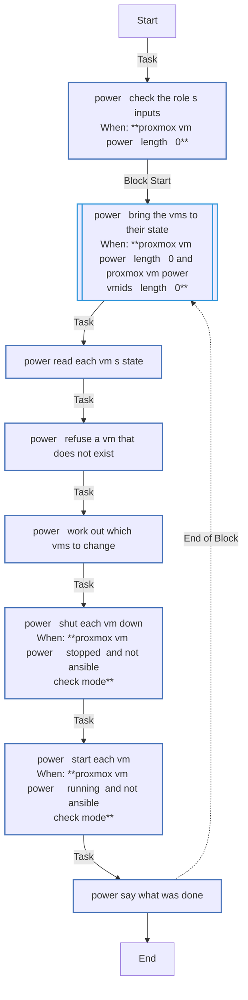

<!-- DOCSIBLE START -->

# 📃 Role overview

## proxmox_vm

Description: Create Proxmox VE VMs and keep the settings it manages as configured

<b>🧩 Argument Specifications in meta/argument_specs</b>

#### Key: main

**Description**: 
- Downloads the ISOs of proxmox_vm_isos and the images of proxmox_vm_imports (checking each file's sha256), creates each VM of proxmox_vm_vms with qm, every option given, a disk with import_from imported from its image and grown to its size, and on later runs corrects its cores, memory, CPU type, ballooning, start-on-boot, startup order, watchdog, agent, tags, PCI and USB devices and CD-ROM, adds a configured disk it lacks and grows a disk configured larger. Starts a stopped VM marked start.
- Never moves, shrinks or detaches a disk, never deletes a VM or an ISO, and never restarts a VM; a setting that waits for a restart is reported.
- Refuses a VMID that belongs to another VM, a missing VM whose VMID still has disks or backups, a disk storage that does not exist or holds no images, and disks whose provisioned sizes would add up to more than a thin LVM, ZFS, directory or BTRFS storage holds, less proxmox_vm_host_headroom_gib on all but thin LVM. Warns when the VMs' memory would exceed the node's.
- The defaults change nothing.

**Options**:

  - **proxmox_vm_vms**
    - **Required**: false
    - **Type**: list
    - **Default**: []
  
    - **Description**: VMs, each with vmid, name, cores, memory_mib, disks ({slot, storage, size_gib, serial, format, backup, import_from}) and net ({bridge, mac}); optional machine, bios, efidisk_storage, cpu, scsihw, iso, boot, watchdog, onboot, startup, tags, hostpci, usb, import_working_storage and start.
  
  
  
    
  

  - **proxmox_vm_isos**
    - **Required**: false
    - **Type**: list
    - **Default**: []
  
    - **Description**: ISOs to download, each with storage, filename, url and sha256 (the file's SHA-256, which Proxmox checks before keeping the download). Never deleted.
  
  
  
    
  

  - **proxmox_vm_imports**
    - **Required**: false
    - **Type**: list
    - **Default**: []
  
    - **Description**: Images a disk is imported from, downloaded as import content, each with storage, filename, url and sha256 (checked the same way). Never deleted.
  
  
  
    
  

  - **proxmox_vm_pending_storages**
    - **Required**: false
    - **Type**: list
    - **Default**: []
  
    - **Description**: Storage ids an earlier role creates on a real run; reported as pending in check mode.
  
  
  

  - **proxmox_vm_pending_storages_hint**
    - **Required**: false
    - **Type**: str
    - **Default**: 
  
    - **Description**: What creates the pending storages, such as the play to run first: shown beside them in check mode, and when one is missing on a real run.
  
  
  

  - **proxmox_vm_allow_overcommit**
    - **Required**: false
    - **Type**: bool
    - **Default**: False
  
    - **Description**: Let the disks on a thin LVM, ZFS, directory or BTRFS storage add up to more than it holds.
  
  
  

  - **proxmox_vm_host_headroom_gib**
    - **Required**: false
    - **Type**: int
    - **Default**: 0
  
    - **Description**: GiB of a ZFS, directory or BTRFS storage's size kept out of the disk budget, for the host's own files that share its pool or filesystem.
  
  
  

  - **proxmox_vm_ignore_existing_volumes**
    - **Required**: false
    - **Type**: bool
    - **Default**: False
  
    - **Description**: Create a missing VM even though its VMID still has disks or backups.
  
  
  

  - **proxmox_vm_rebuild_command**
    - **Required**: false
    - **Type**: str
    - **Default**: 
  
    - **Description**: How to run the role again with proxmox_vm_ignore_existing_volumes, named when a missing VM is refused over its old volumes. Empty means the play again with -e proxmox_vm_ignore_existing_volumes=true.
  
  
  

  - **proxmox_vm_node**
    - **Required**: false
    - **Type**: str
    - **Default**: 
  
    - **Description**: The node's name in Proxmox. Empty means the host's short hostname.
  
  
  

  - **proxmox_vm_power**
    - **Required**: false
    - **Type**: str
    - **Default**: 
  
    - **Description**: For the power entry point, stopped or running; empty does nothing.
  
      - **Choices**:
    
          - 
    
          - stopped
    
          - running
    
  
  
  

  - **proxmox_vm_power_vmids**
    - **Required**: false
    - **Type**: list
    - **Default**: []
  
    - **Description**: For the power entry point, the VMs to shut down or start.
  
  
  

  - **proxmox_vm_power_timeout**
    - **Required**: false
    - **Type**: int
    - **Default**: 180
  
    - **Description**: For the power entry point, how many seconds a VM's own shutdown may take before the run fails.
  
  
  

#### Key: power

**Description**: 
- Shuts each VM of proxmox_vm_power_vmids down with qm shutdown (the guest's own shutdown, never a forced stop), or starts it with qm start; a VM already as asked is left alone. Refuses a VMID that does not exist.
- Changes nothing else. The main entry point starts a stopped VM marked start, and the host one marked onboot.

**Options**:

  - **proxmox_vm_power**
    - **Required**: false
    - **Type**: str
    - **Default**: 
  
    - **Description**: For the power entry point, stopped or running; empty does nothing.
  
      - **Choices**:
    
          - 
    
          - stopped
    
          - running
    
  
  
  

  - **proxmox_vm_power_vmids**
    - **Required**: false
    - **Type**: list
    - **Default**: []
  
    - **Description**: For the power entry point, the VMs to shut down or start.
  
  
  

  - **proxmox_vm_power_timeout**
    - **Required**: false
    - **Type**: int
    - **Default**: 180
  
    - **Description**: For the power entry point, how many seconds a VM's own shutdown may take before the run fails.
  
  
  

### Defaults

**These are static variables with lower priority**

#### File: defaults/main.yml

| Var          | Type         | Value       |
|--------------|--------------|-------------|
| [proxmox_vm_vms](defaults/main.yml#L10)   | list | `[]` |    
| [proxmox_vm_isos](defaults/main.yml#L13)   | list | `[]` |    
| [proxmox_vm_imports](defaults/main.yml#L16)   | list | `[]` |    
| [proxmox_vm_pending_storages](defaults/main.yml#L19)   | list | `[]` |    
| [proxmox_vm_pending_storages_hint](defaults/main.yml#L22)   | str |  |    
| [proxmox_vm_allow_overcommit](defaults/main.yml#L25)   | bool | `False` |    
| [proxmox_vm_host_headroom_gib](defaults/main.yml#L29)   | int | `0` |    
| [proxmox_vm_ignore_existing_volumes](defaults/main.yml#L32)   | bool | `False` |    
| [proxmox_vm_rebuild_command](defaults/main.yml#L35)   | str |  |    
| [proxmox_vm_node](defaults/main.yml#L37)   | str |  |    
| [proxmox_vm_power](defaults/main.yml#L40)   | str |  |    
| [proxmox_vm_power_vmids](defaults/main.yml#L41)   | list | `[]` |    
| [proxmox_vm_power_timeout](defaults/main.yml#L42)   | int | `180` |    

### Tasks

#### File: tasks/main.yml

| Name | Module | Has Conditions | Tags |
| ---- | ------ | -------------- | -----|
| Check the role's inputs | ansible.builtin.assert | False | always |
| Create and correct the VMs | block | True |  |
| Find the node's name | ansible.builtin.command | True |  |
| Use the node's name | ansible.builtin.set_fact | False |  |
| Read the storage configuration | ansible.builtin.command | False |  |
| List the ISOs and images | ansible.builtin.set_fact | False |  |
| Refuse a storage that cannot hold them | ansible.builtin.assert | False |  |
| Read their storages' content | ansible.builtin.command | False |  |
| Work out the ISOs and images to download | ansible.builtin.set_fact | False |  |
| Show the ISOs and images to download | ansible.builtin.debug | True |  |
| Download the missing ISOs and images | ansible.builtin.command | False |  |
| Read each download's result | ansible.builtin.command | False |  |
| Refuse a download that failed | ansible.builtin.assert | False |  |
| Read the node's VMs | ansible.builtin.command | False |  |
| Read the node's containers | ansible.builtin.command | False |  |
| Work out which VMs exist | ansible.builtin.set_fact | False |  |
| Read each existing VM's configuration | ansible.builtin.command | False |  |
| Read the other VMs' configuration | ansible.builtin.command | False |  |
| Read each existing VM's pending changes | ansible.builtin.command | False |  |
| Read the node's storages | ansible.builtin.command | False |  |
| Read the volumes each missing VM's VMID still has | ansible.builtin.command | False |  |
| Work out the storages whose space is budgeted | ansible.builtin.set_fact | False |  |
| Read the volumes on each budgeted storage | ansible.builtin.command | False |  |
| Read each budgeted storage's size | ansible.builtin.command | False |  |
| Read the node's memory | ansible.builtin.command | False |  |
| Work out what to create, correct, grow and start | ansible.builtin.set_fact | False |  |
| Refuse what the role will not do | ansible.builtin.assert | False |  |
| Show what each VM needs | ansible.builtin.debug | False |  |
| Warn about the node's memory and the VMs' MACs | ansible.builtin.debug | True |  |
| Create the VMs | ansible.builtin.command | False |  |
| Read the created VMs' configuration | ansible.builtin.command | False |  |
| Grow the created VMs' imported disks to their size | ansible.builtin.command | False |  |
| Correct the VMs' settings | ansible.builtin.command | False |  |
| Grow the disks | ansible.builtin.command | False |  |
| Start the VMs | ansible.builtin.command | False |  |
| Read the VMs' configuration and pending changes again | ansible.builtin.command | True |  |
| Show each VM's MAC, and what waits for a restart | ansible.builtin.debug | False |  |
| Show the old ISOs and images no VM uses | ansible.builtin.debug | True |  |

#### File: tasks/power.yml

| Name | Module | Has Conditions | Tags |
| ---- | ------ | -------------- | -----|
| power ¦ Check the role's inputs | ansible.builtin.assert | True |  |
| power ¦ Bring the VMs to their state | block | True |  |
| power ¦ Read each VM's state | ansible.builtin.command | False |  |
| power ¦ Refuse a VM that does not exist | ansible.builtin.assert | False |  |
| power ¦ Work out which VMs to change | ansible.builtin.set_fact | False |  |
| power ¦ Shut each VM down | ansible.builtin.command | True |  |
| power ¦ Start each VM | ansible.builtin.command | True |  |
| power ¦ Say what was done | ansible.builtin.debug | False |  |

## Task Flow Graphs

### Graph for main.yml

```mermaid
flowchart TD
Start
classDef block stroke:#3498db,stroke-width:2px;
classDef task stroke:#4b76bb,stroke-width:2px;
classDef includeTasks stroke:#16a085,stroke-width:2px;
classDef importTasks stroke:#34495e,stroke-width:2px;
classDef includeRole stroke:#2980b9,stroke-width:2px;
classDef importRole stroke:#699ba7,stroke-width:2px;
classDef includeVars stroke:#8e44ad,stroke-width:2px;
classDef rescue stroke:#665352,stroke-width:2px;

  Start-->|Task| Check_the_role_s_inputs0[check the role s inputs]:::task
  Check_the_role_s_inputs0-->|Block Start| Create_and_correct_the_VMs1_block_start_0[[create and correct the vms<br>When: **proxmox vm vms   length   0 or proxmox vm isos  <br>length   0 or proxmox vm imports   length   0**]]:::block
  Create_and_correct_the_VMs1_block_start_0-->|Task| Find_the_node_s_name0[find the node s name<br>When: **proxmox vm node   length    0**]:::task
  Find_the_node_s_name0-->|Task| Use_the_node_s_name1[use the node s name]:::task
  Use_the_node_s_name1-->|Task| Read_the_storage_configuration2[read the storage configuration]:::task
  Read_the_storage_configuration2-->|Task| List_the_ISOs_and_images3[list the isos and images]:::task
  List_the_ISOs_and_images3-->|Task| Refuse_a_storage_that_cannot_hold_them4[refuse a storage that cannot hold them]:::task
  Refuse_a_storage_that_cannot_hold_them4-->|Task| Read_their_storages__content5[read their storages  content]:::task
  Read_their_storages__content5-->|Task| Work_out_the_ISOs_and_images_to_download6[work out the isos and images to download]:::task
  Work_out_the_ISOs_and_images_to_download6-->|Task| Show_the_ISOs_and_images_to_download7[show the isos and images to download<br>When: **proxmox vm file missing   length   0**]:::task
  Show_the_ISOs_and_images_to_download7-->|Task| Download_the_missing_ISOs_and_images8[download the missing isos and images]:::task
  Download_the_missing_ISOs_and_images8-->|Task| Read_each_download_s_result9[read each download s result]:::task
  Read_each_download_s_result9-->|Task| Refuse_a_download_that_failed10[refuse a download that failed]:::task
  Refuse_a_download_that_failed10-->|Task| Read_the_node_s_VMs11[read the node s vms]:::task
  Read_the_node_s_VMs11-->|Task| Read_the_node_s_containers12[read the node s containers]:::task
  Read_the_node_s_containers12-->|Task| Work_out_which_VMs_exist13[work out which vms exist]:::task
  Work_out_which_VMs_exist13-->|Task| Read_each_existing_VM_s_configuration14[read each existing vm s configuration]:::task
  Read_each_existing_VM_s_configuration14-->|Task| Read_the_other_VMs__configuration15[read the other vms  configuration]:::task
  Read_the_other_VMs__configuration15-->|Task| Read_each_existing_VM_s_pending_changes16[read each existing vm s pending changes]:::task
  Read_each_existing_VM_s_pending_changes16-->|Task| Read_the_node_s_storages17[read the node s storages]:::task
  Read_the_node_s_storages17-->|Task| Read_the_volumes_each_missing_VM_s_VMID_still_has18[read the volumes each missing vm s vmid still has]:::task
  Read_the_volumes_each_missing_VM_s_VMID_still_has18-->|Task| Work_out_the_storages_whose_space_is_budgeted19[work out the storages whose space is budgeted]:::task
  Work_out_the_storages_whose_space_is_budgeted19-->|Task| Read_the_volumes_on_each_budgeted_storage20[read the volumes on each budgeted storage]:::task
  Read_the_volumes_on_each_budgeted_storage20-->|Task| Read_each_budgeted_storage_s_size21[read each budgeted storage s size]:::task
  Read_each_budgeted_storage_s_size21-->|Task| Read_the_node_s_memory22[read the node s memory]:::task
  Read_the_node_s_memory22-->|Task| Work_out_what_to_create__correct__grow_and_start23[work out what to create  correct  grow and start]:::task
  Work_out_what_to_create__correct__grow_and_start23-->|Task| Refuse_what_the_role_will_not_do24[refuse what the role will not do]:::task
  Refuse_what_the_role_will_not_do24-->|Task| Show_what_each_VM_needs25[show what each vm needs]:::task
  Show_what_each_VM_needs25-->|Task| Warn_about_the_node_s_memory_and_the_VMs__MACs26[warn about the node s memory and the vms  macs<br>When: **proxmox vm plan warnings   length   0**]:::task
  Warn_about_the_node_s_memory_and_the_VMs__MACs26-->|Task| Create_the_VMs27[create the vms]:::task
  Create_the_VMs27-->|Task| Read_the_created_VMs__configuration28[read the created vms  configuration]:::task
  Read_the_created_VMs__configuration28-->|Task| Grow_the_created_VMs__imported_disks_to_their_size29[grow the created vms  imported disks to their size]:::task
  Grow_the_created_VMs__imported_disks_to_their_size29-->|Task| Correct_the_VMs__settings30[correct the vms  settings]:::task
  Correct_the_VMs__settings30-->|Task| Grow_the_disks31[grow the disks]:::task
  Grow_the_disks31-->|Task| Start_the_VMs32[start the vms]:::task
  Start_the_VMs32-->|Task| Read_the_VMs__configuration_and_pending_changes_again33[read the vms  configuration and pending changes<br>again<br>When: **not ansible check mode**]:::task
  Read_the_VMs__configuration_and_pending_changes_again33-->|Task| Show_each_VM_s_MAC__and_what_waits_for_a_restart34[show each vm s mac  and what waits for a restart]:::task
  Show_each_VM_s_MAC__and_what_waits_for_a_restart34-->|Task| Show_the_old_ISOs_and_images_no_VM_uses35[show the old isos and images no vm uses<br>When: **unused   length   0**]:::task
  Show_the_old_ISOs_and_images_no_VM_uses35-.->|End of Block| Create_and_correct_the_VMs1_block_start_0
  Show_the_old_ISOs_and_images_no_VM_uses35-->End
```

### Graph for power.yml

## Author Information
homeserver contributors

#### License

none

#### Minimum Ansible Version

2.21

#### Platforms

- **Debian**: ['all']

#### Dependencies

No dependencies specified.
<!-- DOCSIBLE END -->
