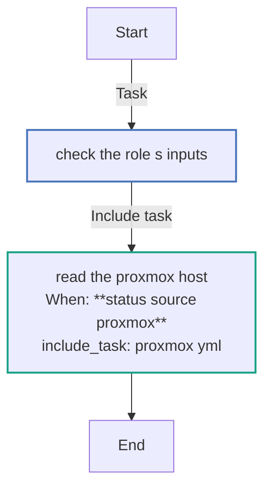
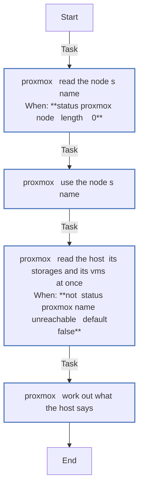
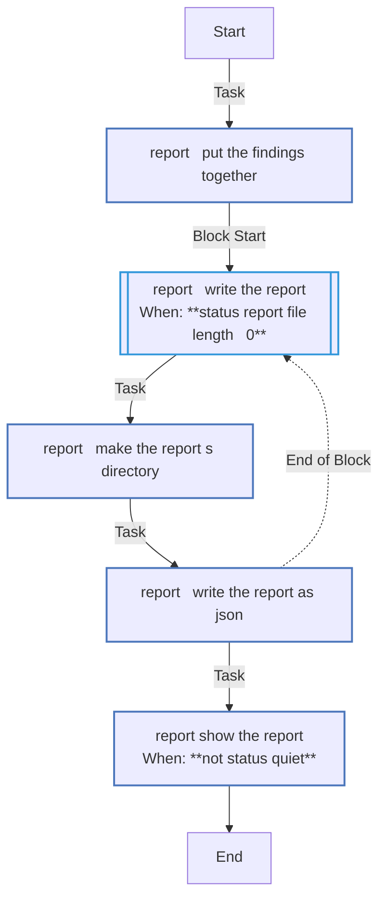

<!-- DOCSIBLE START -->

# 📃 Role overview

## status

Description: Read the homeserver's machines without changing them, and report what runs and what needs doing

<b>🧩 Argument Specifications in meta/argument_specs</b>

#### Key: main

**Description**: 
- Reads the host the play runs on, as status_source names it, and leaves what it found in the fact status_found for the report entry point. Every command goes through the role's module status_read, which runs them at once and refuses any that is not on its read list.
- On the Proxmox host (proxmox) it reads the host, its storages and the VMs of status_vms; every other VM is only counted.
- A host that does not answer is recorded as such, not a failure, so the report can say so.
- Refuses a section name that is not one of the report's.
- The defaults read nothing.

**Options**:

  - **status_source**
    - **Required**: false
    - **Type**: str
    - **Default**: 
  
    - **Description**: What the host is; empty reads nothing.
  
      - **Choices**:
    
          - 
    
          - proxmox
    
  
  
  

  - **status_types**
    - **Required**: false
    - **Type**: list
    - **Default**: []
  
    - **Description**: The report's sections to read and show; empty means every one.
  
  
  

  - **status_vms**
    - **Required**: false
    - **Type**: list
    - **Default**: []
  
    - **Description**: The VMs this setup makes; every other VM on the host is only counted.
  
  
  
    
  

  - **status_setup**
    - **Required**: false
    - **Type**: dict
    - **Default**: {}
  
    - **Description**: What this setup has, as {nas, cluster, home_assistant}, for the report's first line.
  
  
  

  - **status_proxmox_node**
    - **Required**: false
    - **Type**: str
    - **Default**: 
  
    - **Description**: The Proxmox node's name; empty takes the host's short hostname.
  
  
  

  - **status_budget_storages**
    - **Required**: false
    - **Type**: list
    - **Default**: []
  
    - **Description**: Storages whose disk budget the report shows.
  
  
  

  - **status_storage_headroom_gib**
    - **Required**: false
    - **Type**: int
    - **Default**: 0
  
    - **Description**: GiB of a ZFS, directory or BTRFS storage kept out of its budget for the host's own files.
  
  
  

  - **status_reboot_required_file**
    - **Required**: false
    - **Type**: str
    - **Default**: 
  
    - **Description**: The file that says the host waits for a reboot; empty does not look.
  
  
  

  - **status_parallel**
    - **Required**: false
    - **Type**: int
    - **Default**: 8
  
    - **Description**: How many reads run at once on a host.
  
  
  

  - **status_timeout**
    - **Required**: false
    - **Type**: int
    - **Default**: 30
  
    - **Description**: Seconds each read may take.
  
  
  

  - **status_hosts**
    - **Required**: false
    - **Type**: list
    - **Default**: []
  
    - **Description**: The report entry point's hosts, whose findings it puts together.
  
  
  

  - **status_report_file**
    - **Required**: false
    - **Type**: str
    - **Default**: 
  
    - **Description**: Where the report entry point writes the report, as JSON; empty writes none.
  
  
  

  - **status_color**
    - **Required**: false
    - **Type**: bool
    - **Default**: False
  
    - **Description**: Whether the report entry point shows the report in colour.
  
  
  

  - **status_quiet**
    - **Required**: false
    - **Type**: bool
    - **Default**: False
  
    - **Description**: Whether the report entry point shows no report.
  
  
  

#### Key: report

**Description**: 
- Puts together what each host of status_hosts found (its status_found), ranks what needs attention, writes the report to status_report_file as JSON, mode 0600, and shows it as text, unless status_quiet.
- Writes the report in a dry run too, since make status runs as one and takes its exit code from the file.

**Options**:

  - **status_types**
    - **Required**: false
    - **Type**: list
    - **Default**: []
  
    - **Description**: The report's sections to show; empty means every one.
  
  
  

  - **status_setup**
    - **Required**: false
    - **Type**: dict
    - **Default**: {}
  
    - **Description**: What this setup has, as {nas, cluster, home_assistant}, for the report's first line.
  
  
  

  - **status_hosts**
    - **Required**: false
    - **Type**: list
    - **Default**: []
  
    - **Description**: The hosts whose findings the report puts together.
  
  
  

  - **status_report_file**
    - **Required**: false
    - **Type**: str
    - **Default**: 
  
    - **Description**: Where the report is written, as JSON; empty writes none.
  
  
  

  - **status_color**
    - **Required**: false
    - **Type**: bool
    - **Default**: False
  
    - **Description**: Whether the report is shown in colour.
  
  
  

  - **status_quiet**
    - **Required**: false
    - **Type**: bool
    - **Default**: False
  
    - **Description**: Whether no report is shown.
  
  
  

### Defaults

**These are static variables with lower priority**

#### File: defaults/main.yml

| Var          | Type         | Value       |
|--------------|--------------|-------------|
| [status_source](defaults/main.yml#L6)   | str |  |    
| [status_types](defaults/main.yml#L8)   | list | `[]` |    
| [status_vms](defaults/main.yml#L11)   | list | `[]` |    
| [status_setup](defaults/main.yml#L13)   | dict | `{}` |    
| [status_proxmox_node](defaults/main.yml#L15)   | str |  |    
| [status_budget_storages](defaults/main.yml#L17)   | list | `[]` |    
| [status_storage_headroom_gib](defaults/main.yml#L19)   | int | `0` |    
| [status_reboot_required_file](defaults/main.yml#L21)   | str |  |    
| [status_parallel](defaults/main.yml#L23)   | int | `8` |    
| [status_timeout](defaults/main.yml#L24)   | int | `30` |    
| [status_hosts](defaults/main.yml#L27)   | list | `[]` |    
| [status_report_file](defaults/main.yml#L28)   | str |  |    
| [status_color](defaults/main.yml#L29)   | bool | `False` |    
| [status_quiet](defaults/main.yml#L30)   | bool | `False` |    

### Tasks

#### File: tasks/main.yml

| Name | Module | Has Conditions | Tags |
| ---- | ------ | -------------- | -----|
| Check the role's inputs | ansible.builtin.assert | False | always |
| Read the Proxmox host | ansible.builtin.include_tasks | True |  |

#### File: tasks/proxmox.yml

| Name | Module | Has Conditions |
| ---- | ------ | -------------- |
| proxmox ¦ Read the node's name | status_read | True |
| proxmox ¦ Use the node's name | ansible.builtin.set_fact | False |
| proxmox ¦ Read the host, its storages and its VMs, at once | status_read | True |
| proxmox ¦ Work out what the host says | ansible.builtin.set_fact | False |

#### File: tasks/report.yml

| Name | Module | Has Conditions |
| ---- | ------ | -------------- |
| report ¦ Put the findings together | ansible.builtin.set_fact | False |
| report ¦ Write the report | block | True |
| report ¦ Make the report's directory | ansible.builtin.file | False |
| report ¦ Write the report as JSON | ansible.builtin.copy | False |
| report ¦ Show the report | ansible.builtin.debug | True |

## Task Flow Graphs

### Graph for main.yml

### Graph for proxmox.yml

### Graph for report.yml

## Author Information
homeserver contributors

#### License

none

#### Minimum Ansible Version

2.21

#### Platforms

- **GenericLinux**: ['all']

#### Dependencies

No dependencies specified.
<!-- DOCSIBLE END -->
