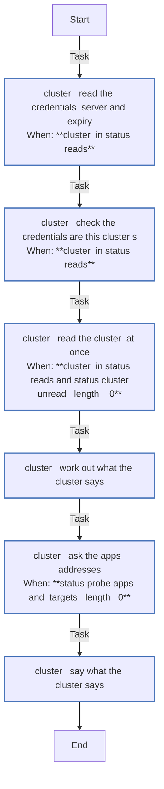
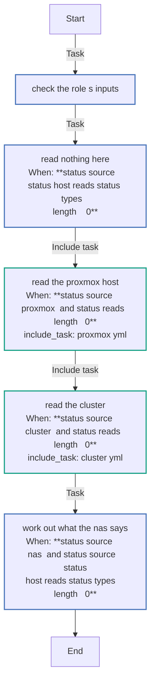
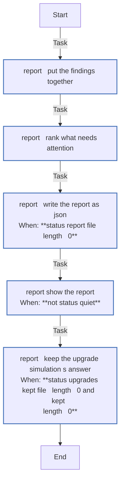

<!-- DOCSIBLE START -->

# 📃 Role overview

## status

Description: Read the homeserver's machines without changing them, and report what runs and what needs doing

<b>🧩 Argument Specifications in meta/argument_specs</b>

#### Key: main

**Description**: 
- Reads the host the play runs on, as status_source names it, and leaves what it found in the fact status_found for the report entry point. Every command goes through the role's module status_read, which runs them at once and refuses any that is not on its read list.
- On the Proxmox host (proxmox) it reads the host, its storages and the VMs of status_vms; every other VM is shown as Proxmox sees it, and never judged. It reads them through Proxmox's API on the host's own loopback, with the API token status_proxmox_token_id and status_proxmox_token_secret, sent only on a connection serving the node's own certificate, but for a storage's VM disks and its backups, which Proxmox lists only to a token that may change them (pvesh, as root). Without a token the host is not read. The upgrade simulation is answered from status_upgrades_kept_file while nothing under status_upgrades_state_paths has changed.
- For the cluster (cluster), on this machine, it reads the nodes, the apps (each Ingress's Service, then the Deployment it selects, and every Deployment a Flux Kustomization under status_cluster_apps_path applies), Flux, the certificates, the nodes' kubelet statistics, Alertmanager's alerts, etcd's state and the newest commit of the branch Flux syncs. It reads the credentials under no_log, keeping only the server the kubeconfig names and when each client certificate expires, and reports another cluster's credentials rather than use them. It never reads a Secret. With status_tailnet_dns, it also reads where this machine's Tailscale sends the apps' domain, in the same pass.
- For the NAS (nas) it reads nothing itself, and works out what status_nas_state says, the result of truenas_info with its status option, which roles/truenas's status entry point reads in one login - the ports, the pools' health, capacity and last scrub, each disk's temperature, state and errors, TrueNAS's alerts, the snapshot tasks' last runs, the NFS and SMB services, who has the NFS shares mounted, named by status_nas_known_clients, the services that run though status_nas_services keeps them stopped, the NAS's clock against this machine's, and each Time Machine backup, judged by the Macs of status_nas_macs.
- Unless status_probe_apps is off, asks from this machine the addresses of the apps it found (the cluster's, and an app on a VM of its own) with the role's module status_probe, checking no certificate and sending no credentials.
- Reads only the sources the sections of status_types need (the filter status_host_reads); on the Proxmox host it says what its Tailscale says first, in the fact status_early.
- A host that does not answer is recorded as such, not a failure, so the report can say so.
- Refuses a section name that is not one of the report's.
- The defaults read nothing.

**Options**:

  - **status_source**
    - **Required**: false
    - **Type**: str
    - **Default**: 
  
    - **Description**: What the host is; empty reads nothing.
  
      - **Choices**:
    
          - 
    
          - proxmox
    
          - cluster
    
          - nas
    
  
  
  

  - **status_types**
    - **Required**: false
    - **Type**: list
    - **Default**: []
  
    - **Description**: The report's sections to read and show; empty means every one.
  
  
  

  - **status_vms**
    - **Required**: false
    - **Type**: list
    - **Default**: []
  
    - **Description**: The VMs this setup makes; every other VM on the host is shown as Proxmox sees it, and never judged.
  
  
  
    
  

  - **status_setup**
    - **Required**: false
    - **Type**: dict
    - **Default**: {}
  
    - **Description**: What this setup has, as {nas, cluster, home_assistant}, for the report's first line.
  
  
  

  - **status_proxmox_node**
    - **Required**: false
    - **Type**: str
    - **Default**: 
  
    - **Description**: The Proxmox node's name; empty takes the host's short hostname.
  
  
  

  - **status_budget_storages**
    - **Required**: false
    - **Type**: list
    - **Default**: []
  
    - **Description**: Storages whose disk budget the report shows.
  
  
  

  - **status_storage_headroom_gib**
    - **Required**: false
    - **Type**: int
    - **Default**: 0
  
    - **Description**: GiB of a ZFS, directory or BTRFS storage kept out of its budget for the host's own files.
  
  
  

  - **status_reboot_required_file**
    - **Required**: false
    - **Type**: str
    - **Default**: 
  
    - **Description**: The file that says the host waits for a reboot; empty does not look.
  
  
  

  - **status_proxmox_run_dir**
    - **Required**: false
    - **Type**: str
    - **Default**: 
    - **Description**: 
   - The directory where Proxmox keeps a <vmid>.pid for each VM running on the node, which says whose day's history to read.
   - Empty reads /cluster/resources first instead.
  
  
  
  

  - **status_proxmox_api_url**
    - **Required**: false
    - **Type**: str
    - **Default**: 
    - **Description**: 
   - Where Proxmox's API answers on the host itself, its api2/json root on the loopback address, which the Proxmox host's reads go to; empty makes none, and the host is not read.
  
  
  
  

  - **status_proxmox_token_id**
    - **Required**: false
    - **Type**: str
    - **Default**: 
  
    - **Description**: The Proxmox API token's id, <user>@<realm>!<name>.
  
  
  

  - **status_proxmox_token_secret**
    - **Required**: false
    - **Type**: str
    - **Default**: 
  
    - **Description**: The Proxmox API token's secret; empty makes no API read, and the host is not read.
  
  
  

  - **status_proxmox_api_cert_files**
    - **Required**: false
    - **Type**: list
    - **Default**: []
    - **Description**: 
   - The files that may hold the certificate the API serves, the first that exists taken; the token goes only to a connection serving that certificate, the node's own.
  
  
  
  

  - **status_backup_jobs**
    - **Required**: false
    - **Type**: list
    - **Default**: []
  
    - **Description**: The backup jobs this setup has, as roles/proxmox_backup takes them ({id, schedule, storage, vmid}), checked against the host's; empty with VMs to back up says nothing is backed up.
  
  
  
    
  

  - **status_cluster_kubeconfig**
    - **Required**: false
    - **Type**: str
    - **Default**: 
  
    - **Description**: The kubeconfig the cluster is read with.
  
  
  

  - **status_cluster_talosconfig**
    - **Required**: false
    - **Type**: str
    - **Default**: 
  
    - **Description**: The talosconfig etcd's state is read with; a missing file reads none.
  
  
  

  - **status_cluster_server**
    - **Required**: false
    - **Type**: str
    - **Default**: 
  
    - **Description**: The API server the kubeconfig must name; another is reported and not read. Empty checks nothing.
  
  
  

  - **status_cluster_nodes**
    - **Required**: false
    - **Type**: list
    - **Default**: []
  
    - **Description**: The cluster's nodes, whose kubelet statistics give their memory and disks.
  
  
  
    
  

  - **status_cluster_apps_path**
    - **Required**: false
    - **Type**: str
    - **Default**: 
  
    - **Description**: The path in the repository under which Flux's Kustomizations apply the apps.
  
  
  

  - **status_cluster_annotation**
    - **Required**: false
    - **Type**: str
    - **Default**: 
  
    - **Description**: The annotation in which just suspend records an app's replicas, which marks it suspended.
  
  
  

  - **status_cluster_database_label**
    - **Required**: false
    - **Type**: str
    - **Default**: 
  
    - **Description**: The label (key=value) of an app's database, listed under the app.
  
  
  

  - **status_cluster_volumes**
    - **Required**: false
    - **Type**: dict
    - **Default**: {}
  
    - **Description**: The nodes' own volumes to show, as {mount path, name}.
  
  
  

  - **status_cluster_settings**
    - **Required**: false
    - **Type**: dict
    - **Default**: {}
  
    - **Description**: The ConfigMap of the cluster's settings, as {namespace, name, allowlist}, allowlist the key of Traefik's allowed range; empty reads none.
  
  
  

  - **status_cluster_alertmanager**
    - **Required**: false
    - **Type**: dict
    - **Default**: {}
  
    - **Description**: Alertmanager's pod, as {namespace, pod}, whose firing alerts amtool lists; empty reads none.
  
  
  

  - **status_cluster_flux_url**
    - **Required**: false
    - **Type**: str
    - **Default**: 
  
    - **Description**: The repository Flux syncs; empty does not compare its branch with what Flux applied.
  
  
  

  - **status_cluster_flux_ref**
    - **Required**: false
    - **Type**: str
    - **Default**: 
  
    - **Description**: The branch Flux syncs, as refs/heads/<name>.
  
  
  

  - **status_cluster_pins**
    - **Required**: false
    - **Type**: dict
    - **Default**: {}
  
    - **Description**: The versions the configuration pins, as {talos, kubernetes}, compared with what the nodes run.
  
  
  

  - **status_cluster_request_timeout**
    - **Required**: false
    - **Type**: int
    - **Default**: 10
  
    - **Description**: Seconds kubectl waits for the API server on each read.
  
  
  

  - **status_tailnet_dns**
    - **Required**: false
    - **Type**: bool
    - **Default**: False
  
    - **Description**: Whether the cluster's play also reads this machine's view of the tailnet's DNS (tailscale dns status --json), which says where the tailnet sends the apps' domain; worth it only when the Proxmox host routes the LAN to the tailnet.
  
  
  

  - **status_cluster_snapshot_dir**
    - **Required**: false
    - **Type**: str
    - **Default**: 
  
    - **Description**: The directory of the cluster's etcd snapshots, each named <anything>-<UTC time>.db (etcd-20261021T093000Z.db), whose newest the backups section shows; empty shows none.
  
  
  

  - **status_nas_state**
    - **Required**: false
    - **Type**: dict
    - **Default**: {}
  
    - **Description**: What truenas_info returned with its status option, or its failure; the NAS's findings.
  
  
  

  - **status_nas_static_address**
    - **Required**: false
    - **Type**: str
    - **Default**: 
  
    - **Description**: The address the NAS is to answer at, its static one, the first it is tried at; one that answered at another, its bootstrap lease, has lost it, which the report says and makes a thing to do. Empty compares none.
  
  
  

  - **status_nas_release**
    - **Required**: false
    - **Type**: str
    - **Default**: 
  
    - **Description**: The TrueNAS release (major.minor) the NAS's configuration is written for; empty compares none.
  
  
  

  - **status_nas_macs**
    - **Required**: false
    - **Type**: list
    - **Default**: []
  
    - **Description**: The Macs that back up to the NAS with Time Machine, which each Time Machine share on it is judged by: a retired Mac's share is only listed, unless still enabled, a thing to do, an active Mac's disabled share is a problem and a missing one a thing to do, and a share none names is only listed. Empty judges none.
  
  
  
    
  

  - **status_nas_services**
    - **Required**: false
    - **Type**: dict
    - **Default**: {}
  
    - **Description**: The NAS's services as its configuration keeps them, {name: {enabled, state}} as roles/truenas takes them: one that runs while it is to be stopped is a problem. Empty judges none.
  
  
  

  - **status_nas_known_clients**
    - **Required**: false
    - **Type**: dict
    - **Default**: {}
  
    - **Description**: The machines of this setup, {address: name}, by which the report names who has the NAS's NFS shares mounted: any other address is a problem. Empty judges none, and each client is shown by its address.
  
  
  

  - **status_tailscale_state**
    - **Required**: false
    - **Type**: dict
    - **Default**: {}
  
    - **Description**: The Proxmox host's Tailscale, as roles/proxmox_tailscale's status entry point records it in proxmox_tailscale_status_state; empty when it is off.
  
  
  

  - **status_upgrades_kept_file**
    - **Required**: false
    - **Type**: str
    - **Default**: 
    - **Description**: 
   - The file on this machine that keeps the Proxmox host's upgrade simulation's last answer and its key, which answers the next run while the key is the same; empty keeps none, and the simulation always runs.
  
  
  
  

  - **status_upgrades_state_paths**
    - **Required**: false
    - **Type**: list
    - **Default**: []
    - **Description**: 
   - The files and directories on the Proxmox host whose names, sizes, times and inodes key the simulation's answer (dpkg's status and journal, the package lists, apt's configuration), through symbolic links.
  
  
  
  

  - **status_parallel**
    - **Required**: false
    - **Type**: int
    - **Default**: None
  
    - **Description**: How many reads run at once on a host; null runs one per CPU, 8 at most.
  
  
  

  - **status_timeout**
    - **Required**: false
    - **Type**: int
    - **Default**: 30
  
    - **Description**: Seconds each read may take.
  
  
  

  - **status_hosts**
    - **Required**: false
    - **Type**: list
    - **Default**: []
  
    - **Description**: The report entry point's hosts, whose findings it puts together.
  
  
  

  - **status_report_file**
    - **Required**: false
    - **Type**: str
    - **Default**: 
  
    - **Description**: Where the report entry point writes the report, as JSON; empty writes none.
  
  
  

  - **status_color**
    - **Required**: false
    - **Type**: bool
    - **Default**: False
  
    - **Description**: Whether the report entry point shows the report in colour.
  
  
  

  - **status_quiet**
    - **Required**: false
    - **Type**: bool
    - **Default**: False
  
    - **Description**: Whether the report entry point shows no report.
  
  
  

  - **status_mask**
    - **Required**: false
    - **Type**: bool
    - **Default**: False
  
    - **Description**: Whether every IPv4 and IPv6 address in the report entry point's text reads <addr>, for a report pasted where others read it; the report's file keeps them.
  
  
  

  - **status_read_at**
    - **Required**: false
    - **Type**: str
    - **Default**: 
  
    - **Description**: When the report was read, as its first line says it; empty takes now.
  
  
  

  - **status_now**
    - **Required**: false
    - **Type**: int
    - **Default**: 0
  
    - **Description**: When the report was read, in seconds since the epoch, which its ages count from; 0 takes now.
  
  
  

  - **status_probe_apps**
    - **Required**: false
    - **Type**: bool
    - **Default**: True
  
    - **Description**: Whether the main entry point asks each app's addresses from this machine, a DNS lookup and one GET per URL: the cluster's apps, and an app on a VM of its own.
  
  
  

  - **status_probe_timeout**
    - **Required**: false
    - **Type**: int
    - **Default**: 5
  
    - **Description**: Seconds each lookup and each request may take.
  
  
  

  - **status_admin**
    - **Required**: false
    - **Type**: list
    - **Default**: []
  
    - **Description**: The admin pages the report lists, each {name, url}; tailscale_node marks the page the Proxmox host serves itself, which its tailnet name reaches too.
  
  
  
    
  

  - **status_commands**
    - **Required**: false
    - **Type**: dict
    - **Default**: {}
  
    - **Description**: The commands the report suggests, by purpose: upgrade, proxmox_token, pveproxy, reboot, resume (with {names}), talos_upgrade, credentials, allowlist, secrets, nas, nas_release, nas_network, nas_clock, nas_disk_heat, nas_disk_errors, nas_clients, time_machine, time_machine_quota, backup, backup_target, etcd_snapshot, tailscale, tailscale_login, split_dns. One left out is suggested by text alone.
  
  
  

#### Key: report

**Description**: 
- Puts together what each host of status_hosts found (its status_found), ranks what needs attention, writes the report to status_report_file as JSON, mode 0600, and shows it as text, unless status_quiet.
- Keeps the Proxmox host's upgrade simulation's fresh answer and its key in status_upgrades_kept_file, mode 0600, which the main entry point hands back to the host on the next run.
- Writes the report in a dry run too, since just status runs as one and takes its exit code from the file.
- What each host found includes what its apps' addresses answered, which the main entry point asks.

**Options**:

  - **status_types**
    - **Required**: false
    - **Type**: list
    - **Default**: []
  
    - **Description**: The report's sections to show; empty means every one.
  
  
  

  - **status_setup**
    - **Required**: false
    - **Type**: dict
    - **Default**: {}
  
    - **Description**: What this setup has, as {nas, cluster, home_assistant}, for the report's first line.
  
  
  

  - **status_hosts**
    - **Required**: false
    - **Type**: list
    - **Default**: []
  
    - **Description**: The hosts whose findings the report puts together.
  
  
  

  - **status_report_file**
    - **Required**: false
    - **Type**: str
    - **Default**: 
  
    - **Description**: Where the report is written, as JSON; empty writes none.
  
  
  

  - **status_upgrades_kept_file**
    - **Required**: false
    - **Type**: str
    - **Default**: 
    - **Description**: 
   - The file on this machine, an absolute path, that keeps the upgrade simulation's fresh answer and key, as the main entry point reads it; empty keeps none.
  
  
  
  

  - **status_color**
    - **Required**: false
    - **Type**: bool
    - **Default**: False
  
    - **Description**: Whether the report is shown in colour.
  
  
  

  - **status_quiet**
    - **Required**: false
    - **Type**: bool
    - **Default**: False
  
    - **Description**: Whether no report is shown.
  
  
  

  - **status_mask**
    - **Required**: false
    - **Type**: bool
    - **Default**: False
  
    - **Description**: Whether every IPv4 and IPv6 address in the text reads <addr>, for a report pasted where others read it; the report's file keeps them.
  
  
  

  - **status_read_at**
    - **Required**: false
    - **Type**: str
    - **Default**: 
  
    - **Description**: When the report was read, as its first line says it; empty takes now.
  
  
  

  - **status_now**
    - **Required**: false
    - **Type**: int
    - **Default**: 0
  
    - **Description**: When the report was read, in seconds since the epoch, which its ages count from; 0 takes now.
  
  
  

  - **status_admin**
    - **Required**: false
    - **Type**: list
    - **Default**: []
  
    - **Description**: The admin pages the report lists, each {name, url}; tailscale_node marks the page the Proxmox host serves itself, which its tailnet name reaches too.
  
  
  
    
  

  - **status_commands**
    - **Required**: false
    - **Type**: dict
    - **Default**: {}
  
    - **Description**: The commands the report suggests, by purpose: upgrade, proxmox_token, pveproxy, reboot, resume (with {names}), talos_upgrade, credentials, allowlist, secrets, nas, nas_release, nas_network, nas_clock, nas_disk_heat, nas_disk_errors, nas_clients, time_machine, time_machine_quota, backup, backup_target, etcd_snapshot, tailscale, tailscale_login, split_dns. One left out is suggested by text alone.
  
  
  

### Defaults

**These are static variables with lower priority**

#### File: defaults/main.yml

| Var          | Type         | Value       |
|--------------|--------------|-------------|
| [status_source](defaults/main.yml#L7)   | str |  |    
| [status_types](defaults/main.yml#L9)   | list | `[]` |    
| [status_vms](defaults/main.yml#L14)   | list | `[]` |    
| [status_setup](defaults/main.yml#L16)   | dict | `{}` |    
| [status_proxmox_node](defaults/main.yml#L18)   | str |  |    
| [status_budget_storages](defaults/main.yml#L20)   | list | `[]` |    
| [status_storage_headroom_gib](defaults/main.yml#L22)   | int | `0` |    
| [status_reboot_required_file](defaults/main.yml#L24)   | str |  |    
| [status_proxmox_run_dir](defaults/main.yml#L27)   | str |  |    
| [status_proxmox_api_url](defaults/main.yml#L31)   | str |  |    
| [status_proxmox_token_id](defaults/main.yml#L32)   | str |  |    
| [status_proxmox_token_secret](defaults/main.yml#L33)   | str |  |    
| [status_proxmox_api_cert_files](defaults/main.yml#L34)   | list | `[]` |    
| [status_backup_jobs](defaults/main.yml#L38)   | list | `[]` |    
| [status_cluster_kubeconfig](defaults/main.yml#L41)   | str |  |    
| [status_cluster_talosconfig](defaults/main.yml#L42)   | str |  |    
| [status_cluster_server](defaults/main.yml#L43)   | str |  |    
| [status_cluster_nodes](defaults/main.yml#L45)   | list | `[]` |    
| [status_cluster_apps_path](defaults/main.yml#L48)   | str |  |    
| [status_cluster_annotation](defaults/main.yml#L49)   | str |  |    
| [status_cluster_database_label](defaults/main.yml#L50)   | str |  |    
| [status_cluster_volumes](defaults/main.yml#L52)   | dict | `{}` |    
| [status_cluster_settings](defaults/main.yml#L55)   | dict | `{}` |    
| [status_cluster_alertmanager](defaults/main.yml#L57)   | dict | `{}` |    
| [status_cluster_flux_url](defaults/main.yml#L59)   | str |  |    
| [status_cluster_flux_ref](defaults/main.yml#L60)   | str |  |    
| [status_cluster_pins](defaults/main.yml#L62)   | dict | `{}` |    
| [status_cluster_request_timeout](defaults/main.yml#L64)   | int | `10` |    
| [status_tailnet_dns](defaults/main.yml#L67)   | bool | `False` |    
| [status_cluster_snapshot_dir](defaults/main.yml#L70)   | str |  |    
| [status_nas_state](defaults/main.yml#L73)   | dict | `{}` |    
| [status_nas_static_address](defaults/main.yml#L76)   | str |  |    
| [status_nas_release](defaults/main.yml#L77)   | str |  |    
| [status_nas_macs](defaults/main.yml#L82)   | list | `[]` |    
| [status_nas_services](defaults/main.yml#L85)   | dict | `{}` |    
| [status_nas_known_clients](defaults/main.yml#L88)   | dict | `{}` |    
| [status_tailscale_state](defaults/main.yml#L90)   | dict | `{}` |    
| [status_upgrades_kept_file](defaults/main.yml#L94)   | str |  |    
| [status_upgrades_state_paths](defaults/main.yml#L95)   | list | `[]` |    
| [status_parallel](defaults/main.yml#L97)   | NoneType | `None` |    
| [status_timeout](defaults/main.yml#L98)   | int | `30` |    
| [status_hosts](defaults/main.yml#L102)   | list | `[]` |    
| [status_report_file](defaults/main.yml#L103)   | str |  |    
| [status_color](defaults/main.yml#L104)   | bool | `False` |    
| [status_quiet](defaults/main.yml#L105)   | bool | `False` |    
| [status_mask](defaults/main.yml#L106)   | bool | `False` |    
| [status_read_at](defaults/main.yml#L109)   | str |  |    
| [status_now](defaults/main.yml#L110)   | int | `0` |    
| [status_probe_apps](defaults/main.yml#L113)   | bool | `True` |    
| [status_probe_timeout](defaults/main.yml#L114)   | int | `5` |    
| [status_admin](defaults/main.yml#L117)   | list | `[]` |    
| [status_commands](defaults/main.yml#L129)   | dict | `{}` |    

### Tasks

#### File: tasks/cluster.yml

| Name | Module | Has Conditions |
| ---- | ------ | -------------- |
| cluster ¦ Read the credentials' server and expiry | ansible.builtin.set_fact | True |
| cluster ¦ Check the credentials are this cluster's | ansible.builtin.set_fact | True |
| cluster ¦ Read the cluster, at once | status_read | True |
| cluster ¦ Work out what the cluster says | ansible.builtin.set_fact | False |
| cluster ¦ Ask the apps' addresses | status_probe | True |
| cluster ¦ Say what the cluster says | ansible.builtin.set_fact | False |

#### File: tasks/main.yml

| Name | Module | Has Conditions | Tags |
| ---- | ------ | -------------- | -----|
| Check the role's inputs | ansible.builtin.assert | False | always |
| Read nothing here | ansible.builtin.set_fact | True |  |
| Read the Proxmox host | ansible.builtin.include_tasks | True |  |
| Read the cluster | ansible.builtin.include_tasks | True |  |
| Work out what the NAS says | ansible.builtin.set_fact | True |  |

#### File: tasks/proxmox.yml

| Name | Module | Has Conditions |
| ---- | ------ | -------------- |
| proxmox ¦ Say what its Tailscale says | ansible.builtin.set_fact | True |
| proxmox ¦ Read the node's name and which VMs run | status_read | True |
| proxmox ¦ Use the node's name | ansible.builtin.set_fact | True |
| proxmox ¦ Read the host, its storages and its VMs, at once | status_read | True |
| proxmox ¦ Say what the upgrade simulation answered | ansible.builtin.set_fact | True |
| proxmox ¦ Read the logs of the backup runs that failed | status_read | True |
| proxmox ¦ Work out what the host says | ansible.builtin.set_fact | False |
| proxmox ¦ Ask Home Assistant's address | status_probe | True |
| proxmox ¦ Say what the host says | ansible.builtin.set_fact | False |

#### File: tasks/report.yml

| Name | Module | Has Conditions |
| ---- | ------ | -------------- |
| report ¦ Put the findings together | ansible.builtin.set_fact | False |
| report ¦ Rank what needs attention | ansible.builtin.set_fact | False |
| report ¦ Write the report as JSON | status_write_json | True |
| report ¦ Show the report | ansible.builtin.debug | True |
| report ¦ Keep the upgrade simulation's answer | status_write_json | True |

## Task Flow Graphs

### Graph for cluster.yml

### Graph for main.yml

### Graph for proxmox.yml

```mermaid
flowchart TD
Start
classDef block stroke:#3498db,stroke-width:2px;
classDef task stroke:#4b76bb,stroke-width:2px;
classDef includeTasks stroke:#16a085,stroke-width:2px;
classDef importTasks stroke:#34495e,stroke-width:2px;
classDef includeRole stroke:#2980b9,stroke-width:2px;
classDef importRole stroke:#699ba7,stroke-width:2px;
classDef includeVars stroke:#8e44ad,stroke-width:2px;
classDef rescue stroke:#665352,stroke-width:2px;

  Start-->|Task| proxmox___Say_what_its_Tailscale_says0[proxmox   say what its tailscale says<br>When: **tailscale  in status reads**]:::task
  proxmox___Say_what_its_Tailscale_says0-->|Task| proxmox___Read_the_node_s_name_and_which_VMs_run1[proxmox   read the node s name and which vms run<br>When: **proxmox  in status reads and   commands   length <br>  api   length    0**]:::task
  proxmox___Read_the_node_s_name_and_which_VMs_run1-->|Task| proxmox___Use_the_node_s_name2[proxmox   use the node s name<br>When: **proxmox  in status reads**]:::task
  proxmox___Use_the_node_s_name2-->|Task| proxmox___Read_the_host__its_storages_and_its_VMs__at_once3[proxmox   read the host  its storages and its vms <br>at once<br>When: **proxmox  in status reads and not  status proxmox<br>first unreachable   default false   and   commands<br>  length    api   length    0**]:::task
  proxmox___Read_the_host__its_storages_and_its_VMs__at_once3-->|Task| proxmox___Say_what_the_upgrade_simulation_answered4[proxmox   say what the upgrade simulation answered<br>When: **status upgrades kept file   length   0**]:::task
  proxmox___Say_what_the_upgrade_simulation_answered4-->|Task| proxmox___Read_the_logs_of_the_backup_runs_that_failed5[proxmox   read the logs of the backup runs that<br>failed<br>When: **runs   length   0**]:::task
  proxmox___Read_the_logs_of_the_backup_runs_that_failed5-->|Task| proxmox___Work_out_what_the_host_says6[proxmox   work out what the host says]:::task
  proxmox___Work_out_what_the_host_says6-->|Task| proxmox___Ask_Home_Assistant_s_address7[proxmox   ask home assistant s address<br>When: **status probe apps and  targets   length   0**]:::task
  proxmox___Ask_Home_Assistant_s_address7-->|Task| proxmox___Say_what_the_host_says8[proxmox   say what the host says]:::task
  proxmox___Say_what_the_host_says8-->End
```

### Graph for report.yml

## Author Information
homeserver contributors

#### License

none

#### Minimum Ansible Version

2.21

#### Platforms

- **GenericLinux**: ['all']

#### Dependencies

No dependencies specified.
<!-- DOCSIBLE END -->
