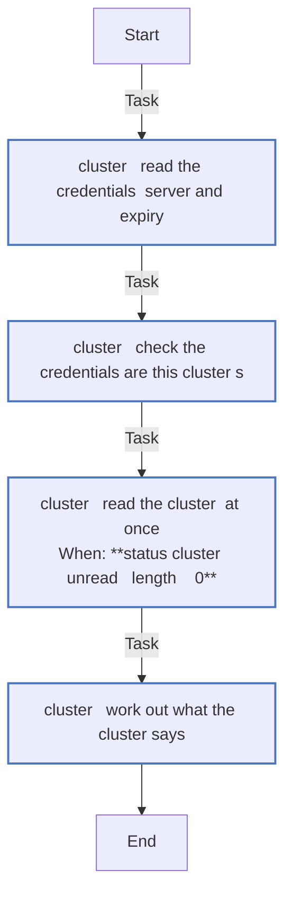
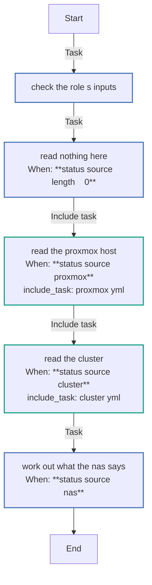
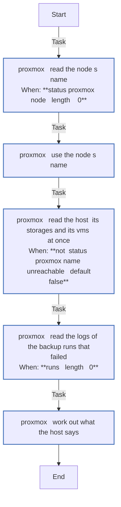
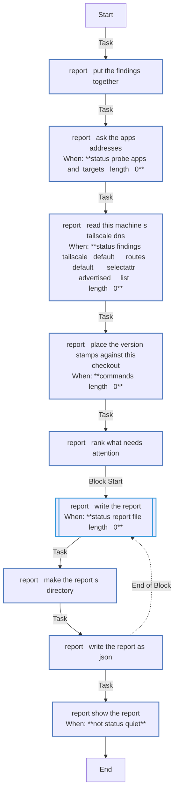

<!-- DOCSIBLE START -->

# 📃 Role overview

## status

Description: Read the homeserver's machines without changing them, and report what runs and what needs doing

<b>🧩 Argument Specifications in meta/argument_specs</b>

#### Key: main

**Description**: 
- Reads the host the play runs on, as status_source names it, and leaves what it found in the fact status_found for the report entry point. Every command goes through the role's module status_read, which runs them at once and refuses any that is not on its read list.
- On the Proxmox host (proxmox) it reads the host, its storages and the VMs of status_vms; every other VM is only counted.
- For the cluster (cluster), on this machine, it reads the nodes, the apps (each Ingress's Service, then the Deployment it selects, and every Deployment a Flux Kustomization under status_cluster_apps_path applies), Flux, the certificates, the nodes' kubelet statistics, Alertmanager's alerts, etcd's state and the newest commit of the branch Flux syncs. It reads the credentials under no_log, keeping only the server the kubeconfig names and when each client certificate expires, and reports another cluster's credentials rather than use them. It never reads a Secret.
- For the NAS (nas) it reads nothing itself, and works out what status_nas_state says, the result of truenas_info with its status option, which roles/truenas's status entry point reads in one login - the pools' health, capacity and last scrub, TrueNAS's alerts, the snapshot tasks' last runs, the NFS service.
- A host that does not answer is recorded as such, not a failure, so the report can say so.
- Refuses a section name that is not one of the report's.
- The defaults read nothing.

**Options**:

  - **status_source**
    - **Required**: false
    - **Type**: str
    - **Default**: 
  
    - **Description**: What the host is; empty reads nothing.
  
      - **Choices**:
    
          - 
    
          - proxmox
    
          - cluster
    
          - nas
    
  
  
  

  - **status_types**
    - **Required**: false
    - **Type**: list
    - **Default**: []
  
    - **Description**: The report's sections to read and show; empty means every one.
  
  
  

  - **status_vms**
    - **Required**: false
    - **Type**: list
    - **Default**: []
  
    - **Description**: The VMs this setup makes; every other VM on the host is only counted.
  
  
  
    
  

  - **status_setup**
    - **Required**: false
    - **Type**: dict
    - **Default**: {}
  
    - **Description**: What this setup has, as {nas, cluster, home_assistant}, for the report's first line.
  
  
  

  - **status_proxmox_node**
    - **Required**: false
    - **Type**: str
    - **Default**: 
  
    - **Description**: The Proxmox node's name; empty takes the host's short hostname.
  
  
  

  - **status_notes_marker**
    - **Required**: false
    - **Type**: str
    - **Default**: 
  
    - **Description**: The word that marks the version stamp's block in the Notes of the host and of this setup's VMs (roles/proxmox_notes), whose begin marker carries the commit; empty reads none.
  
  
  

  - **status_budget_storages**
    - **Required**: false
    - **Type**: list
    - **Default**: []
  
    - **Description**: Storages whose disk budget the report shows.
  
  
  

  - **status_storage_headroom_gib**
    - **Required**: false
    - **Type**: int
    - **Default**: 0
  
    - **Description**: GiB of a ZFS, directory or BTRFS storage kept out of its budget for the host's own files.
  
  
  

  - **status_reboot_required_file**
    - **Required**: false
    - **Type**: str
    - **Default**: 
  
    - **Description**: The file that says the host waits for a reboot; empty does not look.
  
  
  

  - **status_backup_jobs**
    - **Required**: false
    - **Type**: list
    - **Default**: []
  
    - **Description**: The backup jobs this setup has, as roles/proxmox_backup takes them ({id, schedule, storage, vmid}), checked against the host's; empty with VMs to back up says nothing is backed up.
  
  
  
    
  

  - **status_cluster_kubeconfig**
    - **Required**: false
    - **Type**: str
    - **Default**: 
  
    - **Description**: The kubeconfig the cluster is read with.
  
  
  

  - **status_cluster_talosconfig**
    - **Required**: false
    - **Type**: str
    - **Default**: 
  
    - **Description**: The talosconfig etcd's state is read with; a missing file reads none.
  
  
  

  - **status_cluster_server**
    - **Required**: false
    - **Type**: str
    - **Default**: 
  
    - **Description**: The API server the kubeconfig must name; another is reported and not read. Empty checks nothing.
  
  
  

  - **status_cluster_nodes**
    - **Required**: false
    - **Type**: list
    - **Default**: []
  
    - **Description**: The cluster's nodes, whose kubelet statistics give their memory and disks.
  
  
  
    
  

  - **status_cluster_apps_path**
    - **Required**: false
    - **Type**: str
    - **Default**: 
  
    - **Description**: The path in the repository under which Flux's Kustomizations apply the apps.
  
  
  

  - **status_cluster_annotation**
    - **Required**: false
    - **Type**: str
    - **Default**: 
  
    - **Description**: The annotation in which just suspend records an app's replicas, which marks it suspended.
  
  
  

  - **status_cluster_database_label**
    - **Required**: false
    - **Type**: str
    - **Default**: 
  
    - **Description**: The label (key=value) of an app's database, listed under the app.
  
  
  

  - **status_cluster_volumes**
    - **Required**: false
    - **Type**: dict
    - **Default**: {}
  
    - **Description**: The nodes' own volumes to show, as {mount path, name}.
  
  
  

  - **status_cluster_settings**
    - **Required**: false
    - **Type**: dict
    - **Default**: {}
  
    - **Description**: The ConfigMap of the cluster's settings, as {namespace, name, allowlist}, allowlist the key of Traefik's allowed range; empty reads none.
  
  
  

  - **status_cluster_alertmanager**
    - **Required**: false
    - **Type**: dict
    - **Default**: {}
  
    - **Description**: Alertmanager's pod, as {namespace, pod}, whose firing alerts amtool lists; empty reads none.
  
  
  

  - **status_cluster_flux_url**
    - **Required**: false
    - **Type**: str
    - **Default**: 
  
    - **Description**: The repository Flux syncs; empty does not compare its branch with what Flux applied.
  
  
  

  - **status_cluster_flux_ref**
    - **Required**: false
    - **Type**: str
    - **Default**: 
  
    - **Description**: The branch Flux syncs, as refs/heads/<name>.
  
  
  

  - **status_cluster_pins**
    - **Required**: false
    - **Type**: dict
    - **Default**: {}
  
    - **Description**: The versions the configuration pins, as {talos, kubernetes}, compared with what the nodes run.
  
  
  

  - **status_cluster_request_timeout**
    - **Required**: false
    - **Type**: int
    - **Default**: 10
  
    - **Description**: Seconds kubectl waits for the API server on each read.
  
  
  

  - **status_cluster_snapshot_dir**
    - **Required**: false
    - **Type**: str
    - **Default**: 
  
    - **Description**: The directory of the cluster's etcd snapshots, each named <anything>-<UTC time>.db (etcd-20261021T093000Z.db), whose newest the backups section shows; empty shows none.
  
  
  

  - **status_nas_state**
    - **Required**: false
    - **Type**: dict
    - **Default**: {}
  
    - **Description**: What truenas_info returned with its status option, or its failure; the NAS's findings.
  
  
  

  - **status_nas_release**
    - **Required**: false
    - **Type**: str
    - **Default**: 
  
    - **Description**: The TrueNAS release (major.minor) the NAS's configuration is written for; empty compares none.
  
  
  

  - **status_tailscale_state**
    - **Required**: false
    - **Type**: dict
    - **Default**: {}
  
    - **Description**: The Proxmox host's Tailscale, as roles/proxmox_tailscale's status entry point records it in proxmox_tailscale_status_state; empty when it is off.
  
  
  

  - **status_parallel**
    - **Required**: false
    - **Type**: int
    - **Default**: 8
  
    - **Description**: How many reads run at once on a host.
  
  
  

  - **status_timeout**
    - **Required**: false
    - **Type**: int
    - **Default**: 30
  
    - **Description**: Seconds each read may take.
  
  
  

  - **status_hosts**
    - **Required**: false
    - **Type**: list
    - **Default**: []
  
    - **Description**: The report entry point's hosts, whose findings it puts together.
  
  
  

  - **status_report_file**
    - **Required**: false
    - **Type**: str
    - **Default**: 
  
    - **Description**: Where the report entry point writes the report, as JSON; empty writes none.
  
  
  

  - **status_color**
    - **Required**: false
    - **Type**: bool
    - **Default**: False
  
    - **Description**: Whether the report entry point shows the report in colour.
  
  
  

  - **status_quiet**
    - **Required**: false
    - **Type**: bool
    - **Default**: False
  
    - **Description**: Whether the report entry point shows no report.
  
  
  

  - **status_probe_apps**
    - **Required**: false
    - **Type**: bool
    - **Default**: True
  
    - **Description**: Whether the report asks each app's addresses from this machine, a DNS lookup and one GET per URL.
  
  
  

  - **status_probe_timeout**
    - **Required**: false
    - **Type**: int
    - **Default**: 5
  
    - **Description**: Seconds each lookup and each request may take.
  
  
  

  - **status_admin**
    - **Required**: false
    - **Type**: list
    - **Default**: []
  
    - **Description**: The admin pages the report lists, each {name, url}; tailscale_node marks the page the Proxmox host serves itself, which its tailnet name reaches too.
  
  
  
    
  

  - **status_commands**
    - **Required**: false
    - **Type**: dict
    - **Default**: {}
  
    - **Description**: The commands the report suggests, by purpose: upgrade, resume (with {names}), talos_upgrade, credentials, allowlist, secrets, nas, nas_release, nas_network, backup, backup_target, etcd_snapshot, tailscale, tailscale_login, split_dns, deploy_host. One left out is suggested by text alone.
  
  
  

  - **status_deploy**
    - **Required**: false
    - **Type**: dict
    - **Default**: {}
  
    - **Description**: This checkout's version, {commit, describe, date}, which the report entry point places each machine's version stamp against; empty compares none.
  
  
  

  - **status_checkout**
    - **Required**: false
    - **Type**: str
    - **Default**: 
  
    - **Description**: The checkout's directory, where the report entry point asks git where a stamp's commit lies.
  
  
  

#### Key: report

**Description**: 
- Puts together what each host of status_hosts found (its status_found), ranks what needs attention, writes the report to status_report_file as JSON, mode 0600, and shows it as text, unless status_quiet.
- Writes the report in a dry run too, since just status runs as one and takes its exit code from the file.
- Unless status_probe_apps is off, first asks each app's addresses from this machine with the role's module status_probe, checking no certificate and sending no credentials.
- Places each machine's version stamp against status_deploy, with git merge-base --is-ancestor in status_checkout for a stamp of another commit.

**Options**:

  - **status_types**
    - **Required**: false
    - **Type**: list
    - **Default**: []
  
    - **Description**: The report's sections to show; empty means every one.
  
  
  

  - **status_setup**
    - **Required**: false
    - **Type**: dict
    - **Default**: {}
  
    - **Description**: What this setup has, as {nas, cluster, home_assistant}, for the report's first line.
  
  
  

  - **status_hosts**
    - **Required**: false
    - **Type**: list
    - **Default**: []
  
    - **Description**: The hosts whose findings the report puts together.
  
  
  

  - **status_report_file**
    - **Required**: false
    - **Type**: str
    - **Default**: 
  
    - **Description**: Where the report is written, as JSON; empty writes none.
  
  
  

  - **status_color**
    - **Required**: false
    - **Type**: bool
    - **Default**: False
  
    - **Description**: Whether the report is shown in colour.
  
  
  

  - **status_quiet**
    - **Required**: false
    - **Type**: bool
    - **Default**: False
  
    - **Description**: Whether no report is shown.
  
  
  

  - **status_probe_apps**
    - **Required**: false
    - **Type**: bool
    - **Default**: True
  
    - **Description**: Whether the report asks each app's addresses from this machine, a DNS lookup and one GET per URL.
  
  
  

  - **status_probe_timeout**
    - **Required**: false
    - **Type**: int
    - **Default**: 5
  
    - **Description**: Seconds each lookup and each request may take.
  
  
  

  - **status_admin**
    - **Required**: false
    - **Type**: list
    - **Default**: []
  
    - **Description**: The admin pages the report lists, each {name, url}; tailscale_node marks the page the Proxmox host serves itself, which its tailnet name reaches too.
  
  
  
    
  

  - **status_commands**
    - **Required**: false
    - **Type**: dict
    - **Default**: {}
  
    - **Description**: The commands the report suggests, by purpose: upgrade, resume (with {names}), talos_upgrade, credentials, allowlist, secrets, nas, nas_release, nas_network, backup, backup_target, etcd_snapshot, tailscale, tailscale_login, split_dns, deploy_host. One left out is suggested by text alone.
  
  
  

  - **status_deploy**
    - **Required**: false
    - **Type**: dict
    - **Default**: {}
  
    - **Description**: This checkout's version, {commit, describe, date}, which each machine's version stamp is placed against (current, behind, ahead, from another branch, from uncommitted files); empty compares none.
  
  
  

  - **status_checkout**
    - **Required**: false
    - **Type**: str
    - **Default**: 
  
    - **Description**: The checkout's directory, where git tells whether a stamp's commit comes before this one's.
  
  
  

  - **status_parallel**
    - **Required**: false
    - **Type**: int
    - **Default**: 8
  
    - **Description**: How many of git's reads, which place the version stamps, run at once.
  
  
  

  - **status_timeout**
    - **Required**: false
    - **Type**: int
    - **Default**: 30
  
    - **Description**: Seconds each of git's reads may take.
  
  
  

### Defaults

**These are static variables with lower priority**

#### File: defaults/main.yml

| Var          | Type         | Value       |
|--------------|--------------|-------------|
| [status_source](defaults/main.yml#L7)   | str |  |    
| [status_types](defaults/main.yml#L9)   | list | `[]` |    
| [status_vms](defaults/main.yml#L14)   | list | `[]` |    
| [status_setup](defaults/main.yml#L16)   | dict | `{}` |    
| [status_proxmox_node](defaults/main.yml#L18)   | str |  |    
| [status_notes_marker](defaults/main.yml#L22)   | str |  |    
| [status_deploy](defaults/main.yml#L23)   | dict | `{}` |    
| [status_checkout](defaults/main.yml#L24)   | str |  |    
| [status_budget_storages](defaults/main.yml#L26)   | list | `[]` |    
| [status_storage_headroom_gib](defaults/main.yml#L28)   | int | `0` |    
| [status_reboot_required_file](defaults/main.yml#L30)   | str |  |    
| [status_backup_jobs](defaults/main.yml#L34)   | list | `[]` |    
| [status_cluster_kubeconfig](defaults/main.yml#L37)   | str |  |    
| [status_cluster_talosconfig](defaults/main.yml#L38)   | str |  |    
| [status_cluster_server](defaults/main.yml#L39)   | str |  |    
| [status_cluster_nodes](defaults/main.yml#L41)   | list | `[]` |    
| [status_cluster_apps_path](defaults/main.yml#L44)   | str |  |    
| [status_cluster_annotation](defaults/main.yml#L45)   | str |  |    
| [status_cluster_database_label](defaults/main.yml#L46)   | str |  |    
| [status_cluster_volumes](defaults/main.yml#L48)   | dict | `{}` |    
| [status_cluster_settings](defaults/main.yml#L51)   | dict | `{}` |    
| [status_cluster_alertmanager](defaults/main.yml#L53)   | dict | `{}` |    
| [status_cluster_flux_url](defaults/main.yml#L55)   | str |  |    
| [status_cluster_flux_ref](defaults/main.yml#L56)   | str |  |    
| [status_cluster_pins](defaults/main.yml#L58)   | dict | `{}` |    
| [status_cluster_request_timeout](defaults/main.yml#L60)   | int | `10` |    
| [status_cluster_snapshot_dir](defaults/main.yml#L63)   | str |  |    
| [status_nas_state](defaults/main.yml#L66)   | dict | `{}` |    
| [status_nas_release](defaults/main.yml#L67)   | str |  |    
| [status_tailscale_state](defaults/main.yml#L69)   | dict | `{}` |    
| [status_parallel](defaults/main.yml#L71)   | int | `8` |    
| [status_timeout](defaults/main.yml#L72)   | int | `30` |    
| [status_hosts](defaults/main.yml#L75)   | list | `[]` |    
| [status_report_file](defaults/main.yml#L76)   | str |  |    
| [status_color](defaults/main.yml#L77)   | bool | `False` |    
| [status_quiet](defaults/main.yml#L78)   | bool | `False` |    
| [status_probe_apps](defaults/main.yml#L81)   | bool | `True` |    
| [status_probe_timeout](defaults/main.yml#L82)   | int | `5` |    
| [status_admin](defaults/main.yml#L85)   | list | `[]` |    
| [status_commands](defaults/main.yml#L93)   | dict | `{}` |    

### Tasks

#### File: tasks/cluster.yml

| Name | Module | Has Conditions |
| ---- | ------ | -------------- |
| cluster ¦ Read the credentials' server and expiry | ansible.builtin.set_fact | False |
| cluster ¦ Check the credentials are this cluster's | ansible.builtin.set_fact | False |
| cluster ¦ Read the cluster, at once | status_read | True |
| cluster ¦ Work out what the cluster says | ansible.builtin.set_fact | False |

#### File: tasks/main.yml

| Name | Module | Has Conditions | Tags |
| ---- | ------ | -------------- | -----|
| Check the role's inputs | ansible.builtin.assert | False | always |
| Read nothing here | ansible.builtin.set_fact | True |  |
| Read the Proxmox host | ansible.builtin.include_tasks | True |  |
| Read the cluster | ansible.builtin.include_tasks | True |  |
| Work out what the NAS says | ansible.builtin.set_fact | True |  |

#### File: tasks/proxmox.yml

| Name | Module | Has Conditions |
| ---- | ------ | -------------- |
| proxmox ¦ Read the node's name | status_read | True |
| proxmox ¦ Use the node's name | ansible.builtin.set_fact | False |
| proxmox ¦ Read the host, its storages and its VMs, at once | status_read | True |
| proxmox ¦ Read the logs of the backup runs that failed | status_read | True |
| proxmox ¦ Work out what the host says | ansible.builtin.set_fact | False |

#### File: tasks/report.yml

| Name | Module | Has Conditions |
| ---- | ------ | -------------- |
| report ¦ Put the findings together | ansible.builtin.set_fact | False |
| report ¦ Ask the apps' addresses | status_probe | True |
| report ¦ Read this machine's Tailscale DNS | status_read | True |
| report ¦ Place the version stamps against this checkout | status_read | True |
| report ¦ Rank what needs attention | ansible.builtin.set_fact | False |
| report ¦ Write the report | block | True |
| report ¦ Make the report's directory | ansible.builtin.file | False |
| report ¦ Write the report as JSON | ansible.builtin.copy | False |
| report ¦ Show the report | ansible.builtin.debug | True |

## Task Flow Graphs

### Graph for cluster.yml

### Graph for main.yml

### Graph for proxmox.yml

### Graph for report.yml

## Author Information
homeserver contributors

#### License

none

#### Minimum Ansible Version

2.21

#### Platforms

- **GenericLinux**: ['all']

#### Dependencies

No dependencies specified.
<!-- DOCSIBLE END -->
