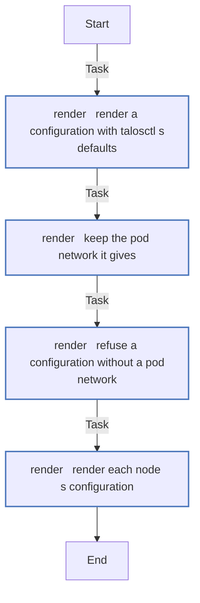

<!-- DOCSIBLE START -->

# 📃 Role overview

## talos

Description: Render Talos Linux machine configurations for the cluster's nodes

<b>🧩 Argument Specifications in meta/argument_specs</b>

#### Key: main

**Description**: 
- Runs on the controller with talosctl. render.yml renders each node's machine configuration from a secrets bundle and the patches, into a scratch directory the caller names (talos_workspace), for the nodes the caller lists (talos_render). It asks talosctl for the pod network its defaults give a cluster (talos_pod_subnets), which the patches may use.
- The defaults do nothing. README.md describes each variable.

**Options**:

  - **talos_cluster_name**
    - **Required**: false
    - **Type**: str
    - **Default**: 
  
    - **Description**: The cluster's name.
  
  
  

  - **talos_endpoint**
    - **Required**: false
    - **Type**: str
    - **Default**: 
  
    - **Description**: The Kubernetes API endpoint, https://<control plane address>:6443.
  
  
  

  - **talos_extra_sans**
    - **Required**: false
    - **Type**: list
    - **Default**: []
  
    - **Description**: Extra names for the API server's certificate.
  
  
  

  - **talos_contract**
    - **Required**: false
    - **Type**: str
    - **Default**: 
  
    - **Description**: The configuration contract talosctl renders for, such as v1.14.
  
  
  

  - **talos_patches_common**
    - **Required**: false
    - **Type**: list
    - **Default**: []
  
    - **Description**: Configuration patches for every node, as YAML documents in strings.
  
  
  

  - **talos_patches_controlplane**
    - **Required**: false
    - **Type**: list
    - **Default**: []
  
    - **Description**: Configuration patches for control planes.
  
  
  

  - **talos_patches_worker**
    - **Required**: false
    - **Type**: list
    - **Default**: []
  
    - **Description**: Configuration patches for workers.
  
  
  

### Defaults

**These are static variables with lower priority**

#### File: defaults/main.yml

| Var          | Type         | Value       |
|--------------|--------------|-------------|
| [talos_cluster_name](defaults/main.yml#L6)   | str |  |    
| [talos_endpoint](defaults/main.yml#L7)   | str |  |    
| [talos_extra_sans](defaults/main.yml#L9)   | list | `[]` |    
| [talos_contract](defaults/main.yml#L11)   | str |  |    
| [talos_patches_common](defaults/main.yml#L13)   | list | `[]` |    
| [talos_patches_controlplane](defaults/main.yml#L14)   | list | `[]` |    
| [talos_patches_worker](defaults/main.yml#L15)   | list | `[]` |    

### Tasks

#### File: tasks/render.yml

| Name | Module | Has Conditions |
| ---- | ------ | -------------- |
| render ¦ Render a configuration with talosctl's defaults | ansible.builtin.command | False |
| render ¦ Keep the pod network it gives | ansible.builtin.set_fact | False |
| render ¦ Refuse a configuration without a pod network | ansible.builtin.assert | False |
| render ¦ Render each node's configuration | ansible.builtin.command | False |

## Task Flow Graphs

### Graph for render.yml

## Author Information
homeserver contributors

#### License

none

#### Minimum Ansible Version

2.21

#### Platforms

- **GenericLinux**: ['all']

#### Dependencies

No dependencies specified.
<!-- DOCSIBLE END -->
