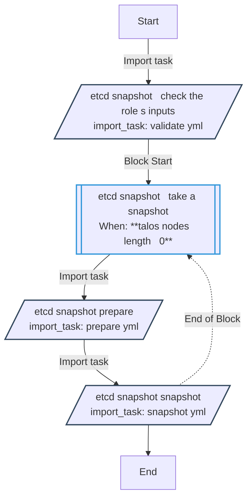
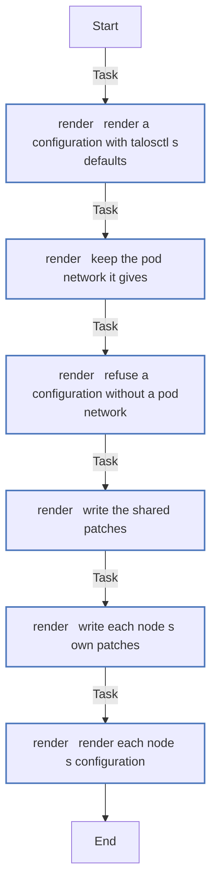
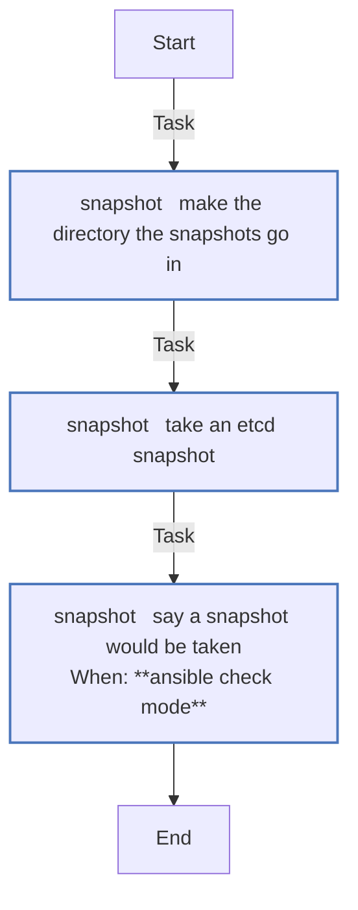
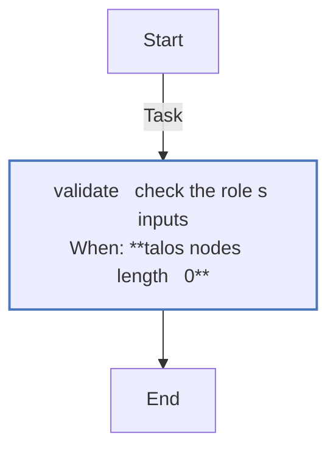

<!-- DOCSIBLE START -->

# 📃 Role overview

## talos

Description: Install Talos Linux on nodes in maintenance mode, keep their configuration, and bootstrap the cluster

<b>🧩 Argument Specifications in meta/argument_specs</b>

#### Key: main

**Description**: 
- Runs on the controller with talosctl. Renders each node's machine configuration from the secrets bundle and the patches, installs it on a node in maintenance mode and waits until its install status reads installed, and applies configuration drift to a configured node without rebooting it (Talos 1.14 applies any configuration that way); after a change to the control plane it says how to restart etcd.
- Renders a configured node with the versions it runs, never the pins, so a pin bump changes nothing until the upgrade entry point moves the node; a pending upgrade is reported.
- Bootstraps etcd once, recording it in talos_config_dir. With that record and etcd not running, it refuses to bootstrap again, which would make a new, empty cluster, unless talos_allow_bootstrap.
- With that record, refuses to install a node in maintenance mode that talos_reinstall does not name, since the configuration it would send holds the cluster's keys and nothing proves who answers at the address.
- Writes talosconfig and kubeconfig to talos_config_dir, outside the repository, and renews their client certificates before they expire. Refuses a talosconfig or kubeconfig there of another cluster (another endpoint, or another CA than the secrets bundle's).
- Checks that every user volume the patches declare is ready once the cluster is healthy.
- The defaults do nothing. README.md describes each variable.

**Options**:

  - **talos_cluster_name**
    - **Required**: false
    - **Type**: str
    - **Default**: 
  
    - **Description**: The cluster's name.
  
  
  

  - **talos_endpoint**
    - **Required**: false
    - **Type**: str
    - **Default**: 
  
    - **Description**: The Kubernetes API endpoint, https://<control plane address>:6443.
  
  
  

  - **talos_extra_sans**
    - **Required**: false
    - **Type**: list
    - **Default**: []
  
    - **Description**: Extra names for the API server's certificate.
  
  
  

  - **talos_version**
    - **Required**: false
    - **Type**: str
    - **Default**: 
  
    - **Description**: The Talos version a node is installed with, such as v1.14.2.
  
  
  

  - **talos_contract**
    - **Required**: false
    - **Type**: str
    - **Default**: 
  
    - **Description**: The configuration contract talosctl renders for, such as v1.14.
  
  
  

  - **talos_kubernetes_version**
    - **Required**: false
    - **Type**: str
    - **Default**: 
  
    - **Description**: The Kubernetes version a cluster is built with, such as 1.37.1.
  
  
  

  - **talos_secrets_file**
    - **Required**: false
    - **Type**: str
    - **Default**: 
  
    - **Description**: The file holding the secrets bundle (talosctl gen secrets), mode 0600, outside the repository.
  
  
  

  - **talos_nodes**
    - **Required**: false
    - **Type**: list
    - **Default**: []
  
    - **Description**: Nodes, each with name, role (controlplane or worker), address, schematic and patches.
  
  
  
    
  

  - **talos_schematics**
    - **Required**: false
    - **Type**: dict
    - **Default**: {}
  
    - **Description**: Image Factory schematics by name, each a list of official system extensions.
  
  
  

  - **talos_image_factory_url**
    - **Required**: false
    - **Type**: str
    - **Default**: https://factory.talos.dev
  
    - **Description**: The Image Factory, asked for each schematic's id.
  
  
  

  - **talos_patches_common**
    - **Required**: false
    - **Type**: list
    - **Default**: []
  
    - **Description**: Configuration patches for every node, as YAML documents in strings.
  
  
  

  - **talos_patches_controlplane**
    - **Required**: false
    - **Type**: list
    - **Default**: []
  
    - **Description**: Configuration patches for control planes.
  
  
  

  - **talos_patches_worker**
    - **Required**: false
    - **Type**: list
    - **Default**: []
  
    - **Description**: Configuration patches for workers.
  
  
  

  - **talos_config_dir**
    - **Required**: false
    - **Type**: str
    - **Default**: 
  
    - **Description**: Where talosconfig, kubeconfig, the bootstrapped marker and etcd snapshots live, outside the repository; one directory per cluster.
  
  
  

  - **talos_renew_before_days**
    - **Required**: false
    - **Type**: int
    - **Default**: 30
  
    - **Description**: Renew client certificates that expire within this many days.
  
  
  

  - **talos_health_timeout**
    - **Required**: false
    - **Type**: str
    - **Default**: 10m
  
    - **Description**: How long talosctl health waits.
  
  
  

  - **talos_probe_retries**
    - **Required**: false
    - **Type**: int
    - **Default**: 30
  
    - **Description**: How many times a real run asks a node that does not answer yet.
  
  
  

  - **talos_probe_delay**
    - **Required**: false
    - **Type**: int
    - **Default**: 10
  
    - **Description**: Seconds between those questions.
  
  
  

  - **talos_install_retries**
    - **Required**: false
    - **Type**: int
    - **Default**: 60
  
    - **Description**: How many times a real run reads an installing node's status before giving up.
  
  
  

  - **talos_allow_bootstrap**
    - **Required**: false
    - **Type**: bool
    - **Default**: False
  
    - **Description**: Bootstrap etcd again although this cluster was bootstrapped before, making a new, empty cluster.
  
  
  

  - **talos_reinstall**
    - **Required**: false
    - **Type**: list
    - **Default**: []
  
    - **Description**: The nodes, by name, that may be installed although the cluster was bootstrapped before (a list, or names joined by commas). A node in maintenance mode takes its configuration, the cluster's keys with it, from whoever sends it, unauthenticated, so once the cluster exists the role sends it only to a node named here.
  
  
  

  - **talos_keep_rendered**
    - **Required**: false
    - **Type**: bool
    - **Default**: False
  
    - **Description**: Keep each node's rendered configuration in talos_config_dir/rendered/ (mode 0600; it holds the secrets), to compare by hand with talosctl apply-config --dry-run.
  
  
  

#### Key: upgrade

**Description**: 
- Takes an etcd snapshot, upgrades each node whose Talos version or schematic differs from the pins, control planes first, then Kubernetes with talosctl upgrade-k8s. In check mode it shows the plan and the Kubernetes upgrade's own dry run.

**Options**:

  - **talos_cluster_name**
    - **Required**: false
    - **Type**: str
    - **Default**: 
  
    - **Description**: The cluster's name.
  
  
  

  - **talos_endpoint**
    - **Required**: false
    - **Type**: str
    - **Default**: 
  
    - **Description**: The Kubernetes API endpoint, https://<control plane address>:6443.
  
  
  

  - **talos_extra_sans**
    - **Required**: false
    - **Type**: list
    - **Default**: []
  
    - **Description**: Extra names for the API server's certificate.
  
  
  

  - **talos_version**
    - **Required**: false
    - **Type**: str
    - **Default**: 
  
    - **Description**: The Talos version a node is installed with, such as v1.14.2.
  
  
  

  - **talos_contract**
    - **Required**: false
    - **Type**: str
    - **Default**: 
  
    - **Description**: The configuration contract talosctl renders for, such as v1.14.
  
  
  

  - **talos_kubernetes_version**
    - **Required**: false
    - **Type**: str
    - **Default**: 
  
    - **Description**: The Kubernetes version a cluster is built with, such as 1.37.1.
  
  
  

  - **talos_secrets_file**
    - **Required**: false
    - **Type**: str
    - **Default**: 
  
    - **Description**: The file holding the secrets bundle (talosctl gen secrets), mode 0600, outside the repository.
  
  
  

  - **talos_nodes**
    - **Required**: false
    - **Type**: list
    - **Default**: []
  
    - **Description**: Nodes, each with name, role (controlplane or worker), address, schematic and patches.
  
  
  
    
  

  - **talos_schematics**
    - **Required**: false
    - **Type**: dict
    - **Default**: {}
  
    - **Description**: Image Factory schematics by name, each a list of official system extensions.
  
  
  

  - **talos_image_factory_url**
    - **Required**: false
    - **Type**: str
    - **Default**: https://factory.talos.dev
  
    - **Description**: The Image Factory, asked for each schematic's id.
  
  
  

  - **talos_patches_common**
    - **Required**: false
    - **Type**: list
    - **Default**: []
  
    - **Description**: Configuration patches for every node, as YAML documents in strings.
  
  
  

  - **talos_patches_controlplane**
    - **Required**: false
    - **Type**: list
    - **Default**: []
  
    - **Description**: Configuration patches for control planes.
  
  
  

  - **talos_patches_worker**
    - **Required**: false
    - **Type**: list
    - **Default**: []
  
    - **Description**: Configuration patches for workers.
  
  
  

  - **talos_config_dir**
    - **Required**: false
    - **Type**: str
    - **Default**: 
  
    - **Description**: Where talosconfig, kubeconfig, the bootstrapped marker and etcd snapshots live, outside the repository; one directory per cluster.
  
  
  

  - **talos_renew_before_days**
    - **Required**: false
    - **Type**: int
    - **Default**: 30
  
    - **Description**: Renew client certificates that expire within this many days.
  
  
  

  - **talos_health_timeout**
    - **Required**: false
    - **Type**: str
    - **Default**: 10m
  
    - **Description**: How long talosctl health waits.
  
  
  

  - **talos_probe_retries**
    - **Required**: false
    - **Type**: int
    - **Default**: 30
  
    - **Description**: How many times a real run asks a node that does not answer yet.
  
  
  

  - **talos_probe_delay**
    - **Required**: false
    - **Type**: int
    - **Default**: 10
  
    - **Description**: Seconds between those questions.
  
  
  

  - **talos_install_retries**
    - **Required**: false
    - **Type**: int
    - **Default**: 60
  
    - **Description**: How many times a real run reads an installing node's status before giving up.
  
  
  

  - **talos_allow_bootstrap**
    - **Required**: false
    - **Type**: bool
    - **Default**: False
  
    - **Description**: Bootstrap etcd again although this cluster was bootstrapped before, making a new, empty cluster.
  
  
  

  - **talos_reinstall**
    - **Required**: false
    - **Type**: list
    - **Default**: []
  
    - **Description**: The nodes, by name, that may be installed although the cluster was bootstrapped before (a list, or names joined by commas). A node in maintenance mode takes its configuration, the cluster's keys with it, from whoever sends it, unauthenticated, so once the cluster exists the role sends it only to a node named here.
  
  
  

  - **talos_keep_rendered**
    - **Required**: false
    - **Type**: bool
    - **Default**: False
  
    - **Description**: Keep each node's rendered configuration in talos_config_dir/rendered/ (mode 0600; it holds the secrets), to compare by hand with talosctl apply-config --dry-run.
  
  
  

#### Key: etcd-snapshot

**Description**: 

**Options**:

  - **talos_cluster_name**
    - **Required**: false
    - **Type**: str
    - **Default**: 
  
    - **Description**: The cluster's name.
  
  
  

  - **talos_endpoint**
    - **Required**: false
    - **Type**: str
    - **Default**: 
  
    - **Description**: The Kubernetes API endpoint, https://<control plane address>:6443.
  
  
  

  - **talos_extra_sans**
    - **Required**: false
    - **Type**: list
    - **Default**: []
  
    - **Description**: Extra names for the API server's certificate.
  
  
  

  - **talos_version**
    - **Required**: false
    - **Type**: str
    - **Default**: 
  
    - **Description**: The Talos version a node is installed with, such as v1.14.2.
  
  
  

  - **talos_contract**
    - **Required**: false
    - **Type**: str
    - **Default**: 
  
    - **Description**: The configuration contract talosctl renders for, such as v1.14.
  
  
  

  - **talos_kubernetes_version**
    - **Required**: false
    - **Type**: str
    - **Default**: 
  
    - **Description**: The Kubernetes version a cluster is built with, such as 1.37.1.
  
  
  

  - **talos_secrets_file**
    - **Required**: false
    - **Type**: str
    - **Default**: 
  
    - **Description**: The file holding the secrets bundle (talosctl gen secrets), mode 0600, outside the repository.
  
  
  

  - **talos_nodes**
    - **Required**: false
    - **Type**: list
    - **Default**: []
  
    - **Description**: Nodes, each with name, role (controlplane or worker), address, schematic and patches.
  
  
  
    
  

  - **talos_schematics**
    - **Required**: false
    - **Type**: dict
    - **Default**: {}
  
    - **Description**: Image Factory schematics by name, each a list of official system extensions.
  
  
  

  - **talos_image_factory_url**
    - **Required**: false
    - **Type**: str
    - **Default**: https://factory.talos.dev
  
    - **Description**: The Image Factory, asked for each schematic's id.
  
  
  

  - **talos_patches_common**
    - **Required**: false
    - **Type**: list
    - **Default**: []
  
    - **Description**: Configuration patches for every node, as YAML documents in strings.
  
  
  

  - **talos_patches_controlplane**
    - **Required**: false
    - **Type**: list
    - **Default**: []
  
    - **Description**: Configuration patches for control planes.
  
  
  

  - **talos_patches_worker**
    - **Required**: false
    - **Type**: list
    - **Default**: []
  
    - **Description**: Configuration patches for workers.
  
  
  

  - **talos_config_dir**
    - **Required**: false
    - **Type**: str
    - **Default**: 
  
    - **Description**: Where talosconfig, kubeconfig, the bootstrapped marker and etcd snapshots live, outside the repository; one directory per cluster.
  
  
  

  - **talos_renew_before_days**
    - **Required**: false
    - **Type**: int
    - **Default**: 30
  
    - **Description**: Renew client certificates that expire within this many days.
  
  
  

  - **talos_health_timeout**
    - **Required**: false
    - **Type**: str
    - **Default**: 10m
  
    - **Description**: How long talosctl health waits.
  
  
  

  - **talos_probe_retries**
    - **Required**: false
    - **Type**: int
    - **Default**: 30
  
    - **Description**: How many times a real run asks a node that does not answer yet.
  
  
  

  - **talos_probe_delay**
    - **Required**: false
    - **Type**: int
    - **Default**: 10
  
    - **Description**: Seconds between those questions.
  
  
  

  - **talos_install_retries**
    - **Required**: false
    - **Type**: int
    - **Default**: 60
  
    - **Description**: How many times a real run reads an installing node's status before giving up.
  
  
  

  - **talos_allow_bootstrap**
    - **Required**: false
    - **Type**: bool
    - **Default**: False
  
    - **Description**: Bootstrap etcd again although this cluster was bootstrapped before, making a new, empty cluster.
  
  
  

  - **talos_reinstall**
    - **Required**: false
    - **Type**: list
    - **Default**: []
  
    - **Description**: The nodes, by name, that may be installed although the cluster was bootstrapped before (a list, or names joined by commas). A node in maintenance mode takes its configuration, the cluster's keys with it, from whoever sends it, unauthenticated, so once the cluster exists the role sends it only to a node named here.
  
  
  

  - **talos_keep_rendered**
    - **Required**: false
    - **Type**: bool
    - **Default**: False
  
    - **Description**: Keep each node's rendered configuration in talos_config_dir/rendered/ (mode 0600; it holds the secrets), to compare by hand with talosctl apply-config --dry-run.
  
  
  

### Defaults

**These are static variables with lower priority**

#### File: defaults/main.yml

| Var          | Type         | Value       |
|--------------|--------------|-------------|
| [talos_cluster_name](defaults/main.yml#L6)   | str |  |    
| [talos_endpoint](defaults/main.yml#L7)   | str |  |    
| [talos_extra_sans](defaults/main.yml#L9)   | list | `[]` |    
| [talos_version](defaults/main.yml#L12)   | str |  |    
| [talos_contract](defaults/main.yml#L13)   | str |  |    
| [talos_kubernetes_version](defaults/main.yml#L14)   | str |  |    
| [talos_secrets_file](defaults/main.yml#L16)   | str |  |    
| [talos_nodes](defaults/main.yml#L19)   | list | `[]` |    
| [talos_schematics](defaults/main.yml#L21)   | dict | `{}` |    
| [talos_image_factory_url](defaults/main.yml#L22)   | str | `https://factory.talos.dev` |    
| [talos_patches_common](defaults/main.yml#L24)   | list | `[]` |    
| [talos_patches_controlplane](defaults/main.yml#L25)   | list | `[]` |    
| [talos_patches_worker](defaults/main.yml#L26)   | list | `[]` |    
| [talos_config_dir](defaults/main.yml#L29)   | str |  |    
| [talos_renew_before_days](defaults/main.yml#L31)   | int | `30` |    
| [talos_health_timeout](defaults/main.yml#L33)   | str | `10m` |    
| [talos_probe_retries](defaults/main.yml#L36)   | int | `30` |    
| [talos_probe_delay](defaults/main.yml#L37)   | int | `10` |    
| [talos_install_retries](defaults/main.yml#L38)   | int | `60` |    
| [talos_allow_bootstrap](defaults/main.yml#L40)   | bool | `False` |    
| [talos_reinstall](defaults/main.yml#L44)   | list | `[]` |    
| [talos_keep_rendered](defaults/main.yml#L47)   | bool | `False` |    

### Tasks

#### File: tasks/bootstrap.yml

| Name | Module | Has Conditions |
| ---- | ------ | -------------- |
| bootstrap ¦ Look for the record of an earlier bootstrap | ansible.builtin.stat | False |
| bootstrap ¦ Read etcd's state on the control plane | ansible.builtin.command | True |
| bootstrap ¦ Refuse to bootstrap a cluster that was bootstrapped before | ansible.builtin.assert | True |
| bootstrap ¦ Say the cluster would be bootstrapped | ansible.builtin.debug | True |
| bootstrap ¦ Bootstrap etcd on the control plane | ansible.builtin.command | True |
| bootstrap ¦ Record the bootstrap | ansible.builtin.copy | True |

#### File: tasks/etcd-snapshot.yml

| Name | Module | Has Conditions |
| ---- | ------ | -------------- |
| etcd-snapshot ¦ Check the role's inputs | ansible.builtin.import_tasks | False |
| etcd-snapshot ¦ Take a snapshot | block | True |
| etcd-snapshot ¦ Prepare | ansible.builtin.import_tasks | False |
| etcd-snapshot ¦ Snapshot | ansible.builtin.import_tasks | False |

#### File: tasks/main.yml

| Name | Module | Has Conditions |
| ---- | ------ | -------------- |
| Check the role's inputs | ansible.builtin.import_tasks | False |
| Build the cluster | block | True |
| Prepare | ansible.builtin.import_tasks | False |
| Look for the talosconfig | ansible.builtin.stat | False |
| Check the talosconfig's client certificate | ansible.builtin.command | True |
| Make the directory that holds the cluster's credentials | ansible.builtin.file | False |
| Write a talosconfig, or renew one that expires soon | ansible.builtin.copy | True |
| Work out what to render for each node | ansible.builtin.set_fact | False |
| Render the configurations | ansible.builtin.include_tasks | False |
| Keep the rendered configurations, when asked | ansible.builtin.copy | True |
| Say which configured nodes were left as they are | ansible.builtin.debug | True |
| Look for the record of the bootstrap | ansible.builtin.stat | False |
| Refuse to send a bootstrapped cluster's keys to a node the run does not name | ansible.builtin.assert | True |
| Say which nodes would be installed | ansible.builtin.debug | True |
| Install Talos on the nodes in maintenance mode | ansible.builtin.command | False |
| Wait for each node to install and boot from its system disk | ansible.builtin.command | True |
| Refuse to go on with a node that did not install | ansible.builtin.fail | True |
| Compare each configured node's configuration | ansible.builtin.command | False |
| Work out which nodes differ | ansible.builtin.set_fact | False |
| Show the nodes whose configuration differs | ansible.builtin.debug | True |
| Apply the configuration without a reboot | ansible.builtin.command | False |
| Refuse to go on when a configuration was not applied | ansible.builtin.fail | True |
| Bootstrap etcd, once | ansible.builtin.import_tasks | False |
| Wait for the cluster to be healthy | ansible.builtin.command | True |
| Read each node's volumes | ansible.builtin.command | True |
| Refuse a user volume that is not ready | ansible.builtin.fail | True |
| Check the kubeconfig's client certificate | ansible.builtin.command | True |
| Fetch a kubeconfig, or renew one that expires soon | ansible.builtin.command | True |
| Say the kubeconfig would be fetched or renewed | ansible.builtin.debug | True |
| Keep the kubeconfig readable by its owner alone | ansible.builtin.file | True |
| Report the versions running, and any upgrade the pins wait for | ansible.builtin.debug | False |

#### File: tasks/prepare.yml

| Name | Module | Has Conditions |
| ---- | ------ | -------------- |
| prepare ¦ Find the control plane and the workers | ansible.builtin.set_fact | False |
| prepare ¦ Read the workstation's talosctl version | ansible.builtin.command | False |
| prepare ¦ Refuse a talosctl of another minor release | ansible.builtin.assert | False |
| prepare ¦ Ask the Image Factory for each schematic's id | ansible.builtin.uri | True |
| prepare ¦ Keep the schematics' ids | ansible.builtin.set_fact | True |
| prepare ¦ Look for the secrets bundle | ansible.builtin.stat | False |
| prepare ¦ Refuse a missing secrets bundle | ansible.builtin.assert | False |
| prepare ¦ Refuse a secrets bundle others can read | ansible.builtin.assert | False |
| prepare ¦ Read the secrets bundle | ansible.builtin.slurp | False |
| prepare ¦ Keep it for this run | ansible.builtin.set_fact | False |
| prepare ¦ Refuse a file that is not a secrets bundle | ansible.builtin.assert | False |
| prepare ¦ Look for the credentials an earlier run kept | ansible.builtin.stat | False |
| prepare ¦ Compare them with this cluster | ansible.builtin.set_fact | False |
| prepare ¦ Refuse another cluster's credentials | ansible.builtin.assert | False |
| prepare ¦ Make a scratch directory | ansible.builtin.tempfile | False |
| prepare ¦ Use it | ansible.builtin.set_fact | False |
| prepare ¦ Write the secrets bundle there | ansible.builtin.copy | False |
| prepare ¦ Make a talosconfig for this run | ansible.builtin.command | False |
| prepare ¦ Give it the control plane as endpoint and node | ansible.builtin.command | False |
| prepare ¦ Find out what each node runs | ansible.builtin.import_tasks | True |

#### File: tasks/probe.yml

| Name | Module | Has Conditions |
| ---- | ------ | -------------- |
| probe ¦ Ask each node for its version, as a configured node | ansible.builtin.command | False |
| probe ¦ Ask the others, as a node in maintenance mode | ansible.builtin.command | False |
| probe ¦ Ask the rest once more, as configured nodes | ansible.builtin.command | False |
| probe ¦ Work out each node's state | ansible.builtin.set_fact | False |
| probe ¦ Refuse to go on without every node | ansible.builtin.assert | True |
| probe ¦ Read each configured node's schematic | ansible.builtin.command | False |
| probe ¦ Look for a kubeconfig | ansible.builtin.stat | False |
| probe ¦ Read the cluster's Kubernetes version | ansible.builtin.command | True |
| probe ¦ Keep each node's schematic and the cluster's Kubernetes version | ansible.builtin.set_fact | False |

#### File: tasks/render.yml

| Name | Module | Has Conditions |
| ---- | ------ | -------------- |
| render ¦ Render a configuration with talosctl's defaults | ansible.builtin.command | False |
| render ¦ Keep the pod network it gives | ansible.builtin.set_fact | False |
| render ¦ Refuse a configuration without a pod network | ansible.builtin.assert | False |
| render ¦ Write the shared patches | ansible.builtin.copy | False |
| render ¦ Write each node's own patches | ansible.builtin.copy | False |
| render ¦ Render each node's configuration | ansible.builtin.command | False |

#### File: tasks/snapshot.yml

| Name | Module | Has Conditions |
| ---- | ------ | -------------- |
| snapshot ¦ Make the directory the snapshots go in | ansible.builtin.file | False |
| snapshot ¦ Take an etcd snapshot | ansible.builtin.command | False |
| snapshot ¦ Say a snapshot would be taken | ansible.builtin.debug | True |

#### File: tasks/upgrade.yml

| Name | Module | Has Conditions |
| ---- | ------ | -------------- |
| upgrade ¦ Check the role's inputs | ansible.builtin.import_tasks | False |
| upgrade ¦ Move the cluster to the pins | block | True |
| upgrade ¦ Prepare | ansible.builtin.import_tasks | False |
| upgrade ¦ Refuse to upgrade a cluster that is not all up | ansible.builtin.assert | False |
| upgrade ¦ Work out what moves | ansible.builtin.set_fact | False |
| upgrade ¦ Show the plan | ansible.builtin.debug | False |
| upgrade ¦ Dry-run the Kubernetes upgrade | ansible.builtin.command | True |
| upgrade ¦ Show the Kubernetes upgrade's dry run | ansible.builtin.debug | True |
| upgrade ¦ Snapshot etcd first | ansible.builtin.import_tasks | True |
| upgrade ¦ Upgrade Talos, control plane first | ansible.builtin.command | False |
| upgrade ¦ Upgrade Kubernetes | ansible.builtin.command | True |
| upgrade ¦ Wait for the cluster to be healthy | ansible.builtin.command | True |

#### File: tasks/validate.yml

| Name | Module | Has Conditions | Tags |
| ---- | ------ | -------------- | -----|
| validate ¦ Check the role's inputs | ansible.builtin.assert | True |  |

## Task Flow Graphs

### Graph for bootstrap.yml

```mermaid
flowchart TD
Start
classDef block stroke:#3498db,stroke-width:2px;
classDef task stroke:#4b76bb,stroke-width:2px;
classDef includeTasks stroke:#16a085,stroke-width:2px;
classDef importTasks stroke:#34495e,stroke-width:2px;
classDef includeRole stroke:#2980b9,stroke-width:2px;
classDef importRole stroke:#699ba7,stroke-width:2px;
classDef includeVars stroke:#8e44ad,stroke-width:2px;
classDef rescue stroke:#665352,stroke-width:2px;

  Start-->|Task| bootstrap___Look_for_the_record_of_an_earlier_bootstrap0[bootstrap   look for the record of an earlier<br>bootstrap]:::task
  bootstrap___Look_for_the_record_of_an_earlier_bootstrap0-->|Task| bootstrap___Read_etcd_s_state_on_the_control_plane1[bootstrap   read etcd s state on the control plane<br>When: **talos marker stat exists and talos state talos<br>controlplane name  state     configured  or not<br>ansible check mode**]:::task
  bootstrap___Read_etcd_s_state_on_the_control_plane1-->|Task| bootstrap___Refuse_to_bootstrap_a_cluster_that_was_bootstrapped_before2[bootstrap   refuse to bootstrap a cluster that was<br>bootstrapped before<br>When: **talos etcd is not skipped**]:::task
  bootstrap___Refuse_to_bootstrap_a_cluster_that_was_bootstrapped_before2-->|Task| bootstrap___Say_the_cluster_would_be_bootstrapped3[bootstrap   say the cluster would be bootstrapped<br>When: **ansible check mode and not talos marker stat<br>exists or talos allow bootstrap   bool**]:::task
  bootstrap___Say_the_cluster_would_be_bootstrapped3-->|Task| bootstrap___Bootstrap_etcd_on_the_control_plane4[bootstrap   bootstrap etcd on the control plane<br>When: **not talos marker stat exists or  talos allow<br>bootstrap   bool and talos etcd stdout   default  <br>    talos service state     running**]:::task
  bootstrap___Bootstrap_etcd_on_the_control_plane4-->|Task| bootstrap___Record_the_bootstrap5[bootstrap   record the bootstrap<br>When: **talos bootstrap is not skipped**]:::task
  bootstrap___Record_the_bootstrap5-->End
```

### Graph for etcd-snapshot.yml

### Graph for main.yml

```mermaid
flowchart TD
Start
classDef block stroke:#3498db,stroke-width:2px;
classDef task stroke:#4b76bb,stroke-width:2px;
classDef includeTasks stroke:#16a085,stroke-width:2px;
classDef importTasks stroke:#34495e,stroke-width:2px;
classDef includeRole stroke:#2980b9,stroke-width:2px;
classDef importRole stroke:#699ba7,stroke-width:2px;
classDef includeVars stroke:#8e44ad,stroke-width:2px;
classDef rescue stroke:#665352,stroke-width:2px;

  Start-->|Import task| Check_the_role_s_inputs_validate_yml_0[/check the role s inputs<br>import_task: validate yml/]:::importTasks
  Check_the_role_s_inputs_validate_yml_0-->|Block Start| Build_the_cluster1_block_start_0[[build the cluster<br>When: **talos nodes   length   0**]]:::block
  Build_the_cluster1_block_start_0-->|Import task| Prepare_prepare_yml_0[/prepare<br>import_task: prepare yml/]:::importTasks
  Prepare_prepare_yml_0-->|Task| Look_for_the_talosconfig1[look for the talosconfig]:::task
  Look_for_the_talosconfig1-->|Task| Check_the_talosconfig_s_client_certificate2[check the talosconfig s client certificate<br>When: **talos talosconfig file stat exists**]:::task
  Check_the_talosconfig_s_client_certificate2-->|Task| Make_the_directory_that_holds_the_cluster_s_credentials3[make the directory that holds the cluster s<br>credentials]:::task
  Make_the_directory_that_holds_the_cluster_s_credentials3-->|Task| Write_a_talosconfig__or_renew_one_that_expires_soon4[write a talosconfig  or renew one that expires<br>soon<br>When: **not talos talosconfig file stat exists or talos<br>talosconfig cert rc    0**]:::task
  Write_a_talosconfig__or_renew_one_that_expires_soon4-->|Task| Work_out_what_to_render_for_each_node5[work out what to render for each node]:::task
  Work_out_what_to_render_for_each_node5-->|Include task| Render_the_configurations_render_yml_6[render the configurations<br>include_task: render yml]:::includeTasks
  Render_the_configurations_render_yml_6-->|Task| Keep_the_rendered_configurations__when_asked7[keep the rendered configurations  when asked<br>When: **talos keep rendered   bool**]:::task
  Keep_the_rendered_configurations__when_asked7-->|Task| Say_which_configured_nodes_were_left_as_they_are8[say which configured nodes were left as they are<br>When: **talos unrendered   length   0**]:::task
  Say_which_configured_nodes_were_left_as_they_are8-->|Task| Look_for_the_record_of_the_bootstrap9[look for the record of the bootstrap]:::task
  Look_for_the_record_of_the_bootstrap9-->|Task| Refuse_to_send_a_bootstrapped_cluster_s_keys_to_a_node_the_run_does_not_name10[refuse to send a bootstrapped cluster s keys to a<br>node the run does not name<br>When: **talos bootstrap record stat exists and not talos<br>allow bootstrap   bool**]:::task
  Refuse_to_send_a_bootstrapped_cluster_s_keys_to_a_node_the_run_does_not_name10-->|Task| Say_which_nodes_would_be_installed11[say which nodes would be installed<br>When: **ansible check mode**]:::task
  Say_which_nodes_would_be_installed11-->|Task| Install_Talos_on_the_nodes_in_maintenance_mode12[install talos on the nodes in maintenance mode]:::task
  Install_Talos_on_the_nodes_in_maintenance_mode12-->|Task| Wait_for_each_node_to_install_and_boot_from_its_system_disk13[wait for each node to install and boot from its<br>system disk<br>When: **not ansible check mode**]:::task
  Wait_for_each_node_to_install_and_boot_from_its_system_disk13-->|Task| Refuse_to_go_on_with_a_node_that_did_not_install14[refuse to go on with a node that did not install<br>When: **status phase     installed**]:::task
  Refuse_to_go_on_with_a_node_that_did_not_install14-->|Task| Compare_each_configured_node_s_configuration15[compare each configured node s configuration]:::task
  Compare_each_configured_node_s_configuration15-->|Task| Work_out_which_nodes_differ16[work out which nodes differ]:::task
  Work_out_which_nodes_differ16-->|Task| Show_the_nodes_whose_configuration_differs17[show the nodes whose configuration differs<br>When: **talos drifted   length   0**]:::task
  Show_the_nodes_whose_configuration_differs17-->|Task| Apply_the_configuration_without_a_reboot18[apply the configuration without a reboot]:::task
  Apply_the_configuration_without_a_reboot18-->|Task| Refuse_to_go_on_when_a_configuration_was_not_applied19[refuse to go on when a configuration was not<br>applied<br>When: **item rc    0**]:::task
  Refuse_to_go_on_when_a_configuration_was_not_applied19-->|Import task| Bootstrap_etcd__once_bootstrap_yml_20[/bootstrap etcd  once<br>import_task: bootstrap yml/]:::importTasks
  Bootstrap_etcd__once_bootstrap_yml_20-->|Task| Wait_for_the_cluster_to_be_healthy21[wait for the cluster to be healthy<br>When: **not ansible check mode**]:::task
  Wait_for_the_cluster_to_be_healthy21-->|Task| Read_each_node_s_volumes22[read each node s volumes<br>When: **not ansible check mode and item patches   default <br>     talos user volumes   length   0**]:::task
  Read_each_node_s_volumes22-->|Task| Refuse_a_user_volume_that_is_not_ready23[refuse a user volume that is not ready<br>When: **unready   length   0**]:::task
  Refuse_a_user_volume_that_is_not_ready23-->|Task| Check_the_kubeconfig_s_client_certificate24[check the kubeconfig s client certificate<br>When: **talos kubeconfig file stat exists**]:::task
  Check_the_kubeconfig_s_client_certificate24-->|Task| Fetch_a_kubeconfig__or_renew_one_that_expires_soon25[fetch a kubeconfig  or renew one that expires soon<br>When: **not talos kubeconfig file stat exists or talos<br>kubeconfig cert rc    0**]:::task
  Fetch_a_kubeconfig__or_renew_one_that_expires_soon25-->|Task| Say_the_kubeconfig_would_be_fetched_or_renewed26[say the kubeconfig would be fetched or renewed<br>When: **ansible check mode and  not talos kubeconfig file<br>stat exists or talos kubeconfig cert rc    0**]:::task
  Say_the_kubeconfig_would_be_fetched_or_renewed26-->|Task| Keep_the_kubeconfig_readable_by_its_owner_alone27[keep the kubeconfig readable by its owner alone<br>When: **not ansible check mode**]:::task
  Keep_the_kubeconfig_readable_by_its_owner_alone27-->|Task| Report_the_versions_running__and_any_upgrade_the_pins_wait_for28[report the versions running  and any upgrade the<br>pins wait for]:::task
  Report_the_versions_running__and_any_upgrade_the_pins_wait_for28-.->|End of Block| Build_the_cluster1_block_start_0
  Report_the_versions_running__and_any_upgrade_the_pins_wait_for28-->End
```

### Graph for prepare.yml

```mermaid
flowchart TD
Start
classDef block stroke:#3498db,stroke-width:2px;
classDef task stroke:#4b76bb,stroke-width:2px;
classDef includeTasks stroke:#16a085,stroke-width:2px;
classDef importTasks stroke:#34495e,stroke-width:2px;
classDef includeRole stroke:#2980b9,stroke-width:2px;
classDef importRole stroke:#699ba7,stroke-width:2px;
classDef includeVars stroke:#8e44ad,stroke-width:2px;
classDef rescue stroke:#665352,stroke-width:2px;

  Start-->|Task| prepare___Find_the_control_plane_and_the_workers0[prepare   find the control plane and the workers]:::task
  prepare___Find_the_control_plane_and_the_workers0-->|Task| prepare___Read_the_workstation_s_talosctl_version1[prepare   read the workstation s talosctl version]:::task
  prepare___Read_the_workstation_s_talosctl_version1-->|Task| prepare___Refuse_a_talosctl_of_another_minor_release2[prepare   refuse a talosctl of another minor<br>release]:::task
  prepare___Refuse_a_talosctl_of_another_minor_release2-->|Task| prepare___Ask_the_Image_Factory_for_each_schematic_s_id3[prepare   ask the image factory for each schematic<br>s id<br>When: **not talos prepare minimal   default false**]:::task
  prepare___Ask_the_Image_Factory_for_each_schematic_s_id3-->|Task| prepare___Keep_the_schematics__ids4[prepare   keep the schematics  ids<br>When: **not talos prepare minimal   default false**]:::task
  prepare___Keep_the_schematics__ids4-->|Task| prepare___Look_for_the_secrets_bundle5[prepare   look for the secrets bundle]:::task
  prepare___Look_for_the_secrets_bundle5-->|Task| prepare___Refuse_a_missing_secrets_bundle6[prepare   refuse a missing secrets bundle]:::task
  prepare___Refuse_a_missing_secrets_bundle6-->|Task| prepare___Refuse_a_secrets_bundle_others_can_read7[prepare   refuse a secrets bundle others can read]:::task
  prepare___Refuse_a_secrets_bundle_others_can_read7-->|Task| prepare___Read_the_secrets_bundle8[prepare   read the secrets bundle]:::task
  prepare___Read_the_secrets_bundle8-->|Task| prepare___Keep_it_for_this_run9[prepare   keep it for this run]:::task
  prepare___Keep_it_for_this_run9-->|Task| prepare___Refuse_a_file_that_is_not_a_secrets_bundle10[prepare   refuse a file that is not a secrets<br>bundle]:::task
  prepare___Refuse_a_file_that_is_not_a_secrets_bundle10-->|Task| prepare___Look_for_the_credentials_an_earlier_run_kept11[prepare   look for the credentials an earlier run<br>kept]:::task
  prepare___Look_for_the_credentials_an_earlier_run_kept11-->|Task| prepare___Compare_them_with_this_cluster12[prepare   compare them with this cluster]:::task
  prepare___Compare_them_with_this_cluster12-->|Task| prepare___Refuse_another_cluster_s_credentials13[prepare   refuse another cluster s credentials]:::task
  prepare___Refuse_another_cluster_s_credentials13-->|Task| prepare___Make_a_scratch_directory14[prepare   make a scratch directory]:::task
  prepare___Make_a_scratch_directory14-->|Task| prepare___Use_it15[prepare   use it]:::task
  prepare___Use_it15-->|Task| prepare___Write_the_secrets_bundle_there16[prepare   write the secrets bundle there]:::task
  prepare___Write_the_secrets_bundle_there16-->|Task| prepare___Make_a_talosconfig_for_this_run17[prepare   make a talosconfig for this run]:::task
  prepare___Make_a_talosconfig_for_this_run17-->|Task| prepare___Give_it_the_control_plane_as_endpoint_and_node18[prepare   give it the control plane as endpoint<br>and node]:::task
  prepare___Give_it_the_control_plane_as_endpoint_and_node18-->|Import task| prepare___Find_out_what_each_node_runs_probe_yml_19[/prepare   find out what each node runs<br>When: **not talos prepare minimal   default false**<br>import_task: probe yml/]:::importTasks
  prepare___Find_out_what_each_node_runs_probe_yml_19-->End
```

### Graph for probe.yml

```mermaid
flowchart TD
Start
classDef block stroke:#3498db,stroke-width:2px;
classDef task stroke:#4b76bb,stroke-width:2px;
classDef includeTasks stroke:#16a085,stroke-width:2px;
classDef importTasks stroke:#34495e,stroke-width:2px;
classDef includeRole stroke:#2980b9,stroke-width:2px;
classDef importRole stroke:#699ba7,stroke-width:2px;
classDef includeVars stroke:#8e44ad,stroke-width:2px;
classDef rescue stroke:#665352,stroke-width:2px;

  Start-->|Task| probe___Ask_each_node_for_its_version__as_a_configured_node0[probe   ask each node for its version  as a<br>configured node]:::task
  probe___Ask_each_node_for_its_version__as_a_configured_node0-->|Task| probe___Ask_the_others__as_a_node_in_maintenance_mode1[probe   ask the others  as a node in maintenance<br>mode]:::task
  probe___Ask_the_others__as_a_node_in_maintenance_mode1-->|Task| probe___Ask_the_rest_once_more__as_configured_nodes2[probe   ask the rest once more  as configured<br>nodes]:::task
  probe___Ask_the_rest_once_more__as_configured_nodes2-->|Task| probe___Work_out_each_node_s_state3[probe   work out each node s state]:::task
  probe___Work_out_each_node_s_state3-->|Task| probe___Refuse_to_go_on_without_every_node4[probe   refuse to go on without every node<br>When: **not ansible check mode**]:::task
  probe___Refuse_to_go_on_without_every_node4-->|Task| probe___Read_each_configured_node_s_schematic5[probe   read each configured node s schematic]:::task
  probe___Read_each_configured_node_s_schematic5-->|Task| probe___Look_for_a_kubeconfig6[probe   look for a kubeconfig]:::task
  probe___Look_for_a_kubeconfig6-->|Task| probe___Read_the_cluster_s_Kubernetes_version7[probe   read the cluster s kubernetes version<br>When: **talos kubeconfig file stat exists and talos<br>extensions results   length   0**]:::task
  probe___Read_the_cluster_s_Kubernetes_version7-->|Task| probe___Keep_each_node_s_schematic_and_the_cluster_s_Kubernetes_version8[probe   keep each node s schematic and the cluster<br>s kubernetes version]:::task
  probe___Keep_each_node_s_schematic_and_the_cluster_s_Kubernetes_version8-->End
```

### Graph for render.yml

### Graph for snapshot.yml

### Graph for upgrade.yml

```mermaid
flowchart TD
Start
classDef block stroke:#3498db,stroke-width:2px;
classDef task stroke:#4b76bb,stroke-width:2px;
classDef includeTasks stroke:#16a085,stroke-width:2px;
classDef importTasks stroke:#34495e,stroke-width:2px;
classDef includeRole stroke:#2980b9,stroke-width:2px;
classDef importRole stroke:#699ba7,stroke-width:2px;
classDef includeVars stroke:#8e44ad,stroke-width:2px;
classDef rescue stroke:#665352,stroke-width:2px;

  Start-->|Import task| upgrade___Check_the_role_s_inputs_validate_yml_0[/upgrade   check the role s inputs<br>import_task: validate yml/]:::importTasks
  upgrade___Check_the_role_s_inputs_validate_yml_0-->|Block Start| upgrade___Move_the_cluster_to_the_pins1_block_start_0[[upgrade   move the cluster to the pins<br>When: **talos nodes   length   0**]]:::block
  upgrade___Move_the_cluster_to_the_pins1_block_start_0-->|Import task| upgrade___Prepare_prepare_yml_0[/upgrade   prepare<br>import_task: prepare yml/]:::importTasks
  upgrade___Prepare_prepare_yml_0-->|Task| upgrade___Refuse_to_upgrade_a_cluster_that_is_not_all_up1[upgrade   refuse to upgrade a cluster that is not<br>all up]:::task
  upgrade___Refuse_to_upgrade_a_cluster_that_is_not_all_up1-->|Task| upgrade___Work_out_what_moves2[upgrade   work out what moves]:::task
  upgrade___Work_out_what_moves2-->|Task| upgrade___Show_the_plan3[upgrade   show the plan]:::task
  upgrade___Show_the_plan3-->|Task| upgrade___Dry_run_the_Kubernetes_upgrade4[upgrade   dry run the kubernetes upgrade<br>When: **ansible check mode and talos kubernetes upgrade**]:::task
  upgrade___Dry_run_the_Kubernetes_upgrade4-->|Task| upgrade___Show_the_Kubernetes_upgrade_s_dry_run5[upgrade   show the kubernetes upgrade s dry run<br>When: **talos k8s dry run is not skipped**]:::task
  upgrade___Show_the_Kubernetes_upgrade_s_dry_run5-->|Import task| upgrade___Snapshot_etcd_first_snapshot_yml_6[/upgrade   snapshot etcd first<br>When: **talos upgrades   length   0 or talos kubernetes<br>upgrade**<br>import_task: snapshot yml/]:::importTasks
  upgrade___Snapshot_etcd_first_snapshot_yml_6-->|Task| upgrade___Upgrade_Talos__control_plane_first7[upgrade   upgrade talos  control plane first]:::task
  upgrade___Upgrade_Talos__control_plane_first7-->|Task| upgrade___Upgrade_Kubernetes8[upgrade   upgrade kubernetes<br>When: **talos kubernetes upgrade**]:::task
  upgrade___Upgrade_Kubernetes8-->|Task| upgrade___Wait_for_the_cluster_to_be_healthy9[upgrade   wait for the cluster to be healthy<br>When: **not ansible check mode and  talos upgrades  <br>length   0 or talos kubernetes upgrade**]:::task
  upgrade___Wait_for_the_cluster_to_be_healthy9-.->|End of Block| upgrade___Move_the_cluster_to_the_pins1_block_start_0
  upgrade___Wait_for_the_cluster_to_be_healthy9-->End
```

### Graph for validate.yml

## Author Information
homeserver contributors

#### License

none

#### Minimum Ansible Version

2.21

#### Platforms

- **GenericLinux**: ['all']

#### Dependencies

No dependencies specified.
<!-- DOCSIBLE END -->
