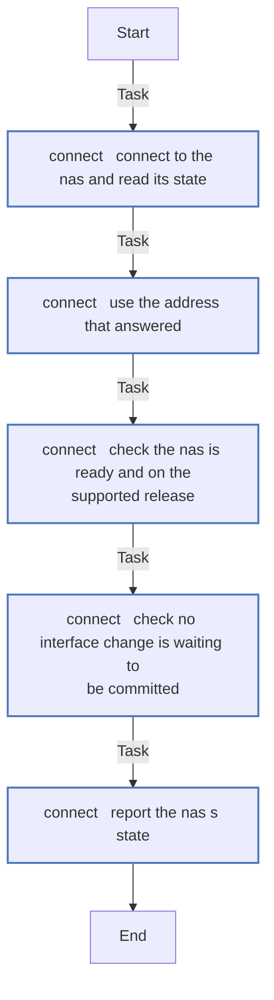
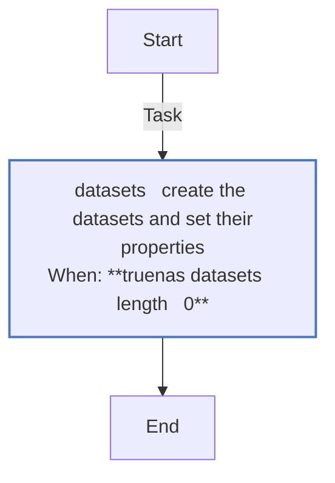
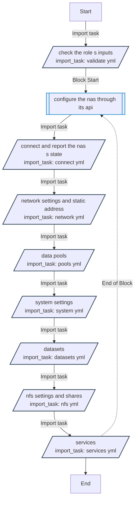
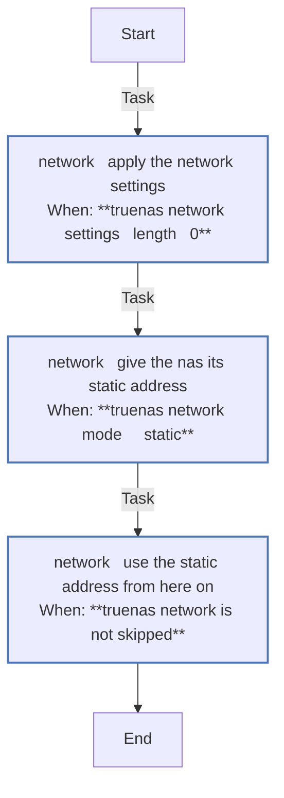
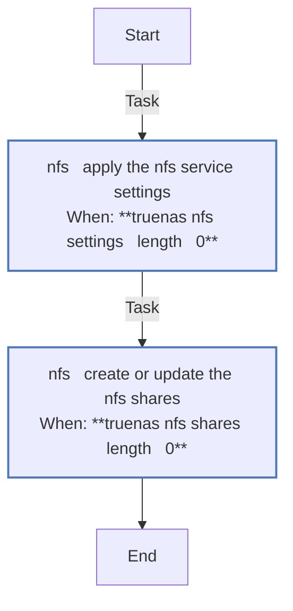
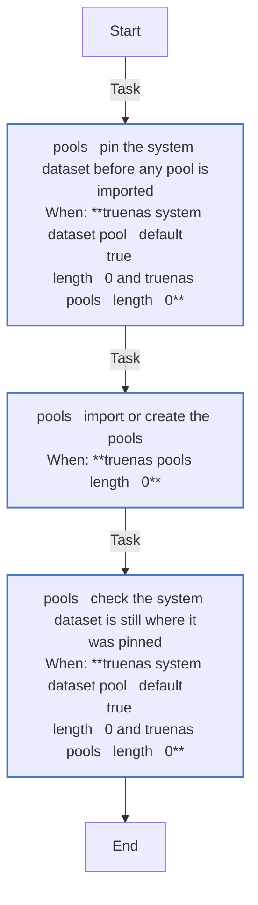
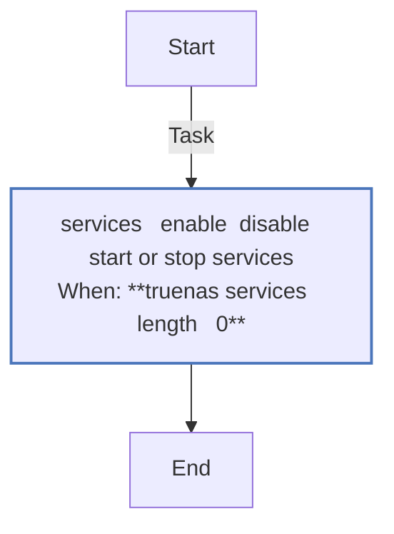
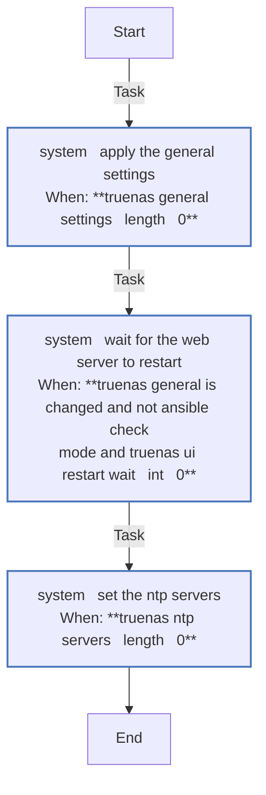
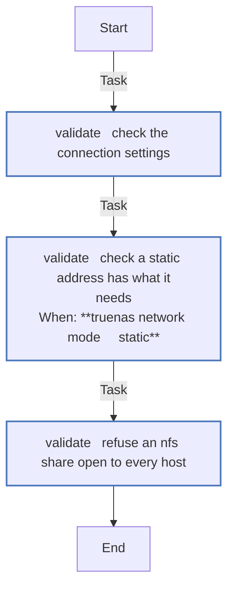

<!-- DOCSIBLE START -->

# 📃 Role overview

## truenas

Description: Configure TrueNAS Community Edition through its API - address, pools, datasets, NFS

<b>🧩 Argument Specifications in meta/argument_specs</b>

#### Key: main

**Description**: 
- Runs on the controller and talks to the NAS's JSON-RPC WebSocket API with an API key; nothing goes over SSH.
- Stages, each under its own tag - truenas_network (network settings, static address), truenas_pools (import or create, auto-trim, scrub), truenas_system (general settings, NTP), truenas_datasets, truenas_nfs (service settings, shares), truenas_services.
- The defaults change nothing. Every stage acts only on what its variables declare, and an empty list or dict (or a null value) leaves that part of the NAS alone.
- Never destroys, wipes, exports or upgrades a pool, never deletes a dataset, and refuses an NFS share without a host or network restriction.

**Options**:

  - **truenas_api_hosts**
    - **Required**: false
    - **Type**: list
    - **Default**: []
  
    - **Description**: Addresses to try in order; the first that answers is used.
  
  
  

  - **truenas_api_port**
    - **Required**: false
    - **Type**: int
    - **Default**: 443
  
    - **Description**: HTTPS port of the TrueNAS web server.
  
  
  

  - **truenas_api_key**
    - **Required**: false
    - **Type**: str
    - **Default**: 
  
    - **Description**: API key. Keep it in an ansible-vault file.
  
  
  

  - **truenas_validate_certs**
    - **Required**: false
    - **Type**: bool
    - **Default**: False
    - **Description**: 
  
  
  
  

  - **truenas_api_cert_sha256**
    - **Required**: false
    - **Type**: str
    - **Default**: 
  
    - **Description**: SHA-256 fingerprint of the NAS's certificate; when set, the API key goes only to that server.
  
  
  

  - **truenas_api_timeout**
    - **Required**: false
    - **Type**: int
    - **Default**: 120
  
    - **Description**: Seconds to wait for one API answer.
  
  
  

  - **truenas_api_connect_wait**
    - **Required**: false
    - **Type**: int
    - **Default**: 60
  
    - **Description**: Seconds to keep retrying a refused connection.
  
  
  

  - **truenas_api_job_timeout**
    - **Required**: false
    - **Type**: int
    - **Default**: 1800
  
    - **Description**: Seconds to wait for a job such as a pool import.
  
  
  

  - **truenas_api_login_wait**
    - **Required**: false
    - **Type**: int
    - **Default**: 75
  
    - **Description**: Seconds to wait out TrueNAS's login rate limit (20 logins per 60 s per client).
  
  
  

  - **truenas_supported_version**
    - **Required**: false
    - **Type**: str
    - **Default**: 25.10
  
    - **Description**: Major.minor release the role was written against.
  
  
  

  - **truenas_network_mode**
    - **Required**: false
    - **Type**: str
    - **Default**: dhcp
  
    - **Description**: static gives the interface truenas_static_address; dhcp leaves it alone.
  
      - **Choices**:
    
          - static
    
          - dhcp
    
  
  
  

  - **truenas_static_address**
    - **Required**: false
    - **Type**: str
    - **Default**: 
  
    - **Description**: Static IPv4 address in CIDR form.
  
  
  

  - **truenas_gateway**
    - **Required**: false
    - **Type**: str
    - **Default**: 
    - **Description**: 
  
  
  
  

  - **truenas_nameservers**
    - **Required**: false
    - **Type**: list
    - **Default**: []
  
    - **Description**: Up to three.
  
  
  

  - **truenas_interface**
    - **Required**: false
    - **Type**: str
    - **Default**: 
  
    - **Description**: Interface to configure. Empty means the one carrying the API connection.
  
  
  

  - **truenas_ipv6_auto**
    - **Required**: false
    - **Type**: bool
    - **Default**: none
  
    - **Description**: IPv6 autoconfiguration on the interface. Unset or null leaves it alone.
  
  
  

  - **truenas_checkin_timeout**
    - **Required**: false
    - **Type**: int
    - **Default**: 90
  
    - **Description**: Seconds TrueNAS waits for the new address to be confirmed before rolling back.
  
  
  

  - **truenas_static_address_conflict_check**
    - **Required**: false
    - **Type**: bool
    - **Default**: True
  
    - **Description**: Refuse a static address that another device already answers on.
  
  
  

  - **truenas_network_settings**
    - **Required**: false
    - **Type**: dict
    - **Default**: {}
  
    - **Description**: Fields for network.configuration.update, e.g. hostname and domain.
  
  
  

  - **truenas_pools**
    - **Required**: false
    - **Type**: list
    - **Default**: []
  
    - **Description**: Pools, each with name and (for creation) layout; optional autotrim, scrub, guid.
  
  
  
    
  

  - **truenas_pool_allow_create**
    - **Required**: false
    - **Type**: bool
    - **Default**: False
    - **Description**: 
  
  
  
  

  - **truenas_pool_disks**
    - **Required**: false
    - **Type**: dict
    - **Default**: {}
  
    - **Description**: Pool name to list of disk serials, used only to create a pool.
  
  
  

  - **truenas_pool_guids**
    - **Required**: false
    - **Type**: dict
    - **Default**: {}
  
    - **Description**: Pool name to GUID; a pool with another GUID is refused.
  
  
  

  - **truenas_pool_autotrim**
    - **Required**: false
    - **Type**: str
    - **Default**: 
  
    - **Description**: Auto-trim for pools that do not set their own. Empty leaves it alone.
  
      - **Choices**:
    
          - 
    
          - ON
    
          - OFF
    
  
  
  

  - **truenas_pool_scrub**
    - **Required**: false
    - **Type**: dict
    - **Default**: none
  
    - **Description**: Scrub task for pools that do not set their own. Unset or null leaves it alone.
  
  
  

  - **truenas_system_dataset_pool**
    - **Required**: false
    - **Type**: str
    - **Default**: boot-pool
  
    - **Description**: Pool to pin the system dataset to before importing pools (only when truenas_pools is set). Empty disables the pin.
  
  
  

  - **truenas_general_settings**
    - **Required**: false
    - **Type**: dict
    - **Default**: {}
  
    - **Description**: Fields for system.general.update, e.g. ui_httpsredirect and timezone.
  
  
  

  - **truenas_ui_restart_delay**
    - **Required**: false
    - **Type**: int
    - **Default**: 3
  
    - **Description**: Seconds after a general-settings update before the web server restarts.
  
  
  

  - **truenas_ui_restart_wait**
    - **Required**: false
    - **Type**: int
    - **Default**: 10
  
    - **Description**: Seconds to wait for that restart before the next call.
  
  
  

  - **truenas_ntp_servers**
    - **Required**: false
    - **Type**: list
    - **Default**: []
  
    - **Description**: NTP servers, each with address and optionally iburst, burst, prefer, minpoll, maxpoll.
  
  
  
    
  

  - **truenas_ntp_server_defaults**
    - **Required**: false
    - **Type**: dict
    - **Default**: {}
  
    - **Description**: Fields laid under every NTP server entry.
  
  
  

  - **truenas_datasets**
    - **Required**: false
    - **Type**: list
    - **Default**: []
  
    - **Description**: Datasets, each with name and properties as pool.dataset.create takes them.
  
  
  
    
  

  - **truenas_nfs_settings**
    - **Required**: false
    - **Type**: dict
    - **Default**: {}
  
    - **Description**: Fields for nfs.update, e.g. protocols.
  
  
  

  - **truenas_nfs_shares**
    - **Required**: false
    - **Type**: list
    - **Default**: []
  
    - **Description**: Shares, each with path and the fields of sharing.nfs.create.
  
  
  
    
  

  - **truenas_nfs_share_defaults**
    - **Required**: false
    - **Type**: dict
    - **Default**: {}
  
    - **Description**: Fields laid under every share.
  
  
  

  - **truenas_services**
    - **Required**: false
    - **Type**: dict
    - **Default**: {}
  
    - **Description**: Service name to {enabled, state}; state is started or stopped.
  
  
  

### Defaults

**These are static variables with lower priority**

#### File: defaults/main.yml

| Var          | Type         | Value       |
|--------------|--------------|-------------|
| [truenas_api_hosts](defaults/main.yml#L9)   | list | `[]` |    
| [truenas_api_port](defaults/main.yml#L11)   | int | `443` |    
| [truenas_api_key](defaults/main.yml#L12)   | str |  |    
| [truenas_validate_certs](defaults/main.yml#L13)   | bool | `False` |    
| [truenas_api_cert_sha256](defaults/main.yml#L17)   | str |  |    
| [truenas_api_timeout](defaults/main.yml#L20)   | int | `120` |    
| [truenas_api_connect_wait](defaults/main.yml#L21)   | int | `60` |    
| [truenas_api_job_timeout](defaults/main.yml#L22)   | int | `1800` |    
| [truenas_api_login_wait](defaults/main.yml#L23)   | int | `75` |    
| [truenas_supported_version](defaults/main.yml#L25)   | str | `25.10` |    
| [truenas_network_mode](defaults/main.yml#L29)   | str | `dhcp` |    
| [truenas_static_address](defaults/main.yml#L30)   | str |  |    
| [truenas_gateway](defaults/main.yml#L31)   | str |  |    
| [truenas_nameservers](defaults/main.yml#L32)   | list | `[]` |    
| [truenas_interface](defaults/main.yml#L34)   | str |  |    
| [truenas_ipv6_auto](defaults/main.yml#L36)   | NoneType | `None` |    
| [truenas_checkin_timeout](defaults/main.yml#L38)   | int | `90` |    
| [truenas_static_address_conflict_check](defaults/main.yml#L41)   | bool | `True` |    
| [truenas_network_settings](defaults/main.yml#L43)   | dict | `{}` |    
| [truenas_pools](defaults/main.yml#L49)   | list | `[]` |    
| [truenas_pool_allow_create](defaults/main.yml#L50)   | bool | `False` |    
| [truenas_pool_disks](defaults/main.yml#L52)   | dict | `{}` |    
| [truenas_pool_guids](defaults/main.yml#L53)   | dict | `{}` |    
| [truenas_pool_autotrim](defaults/main.yml#L55)   | str |  |    
| [truenas_pool_scrub](defaults/main.yml#L56)   | NoneType | `None` |    
| [truenas_system_dataset_pool](defaults/main.yml#L60)   | str | `boot-pool` |    
| [truenas_general_settings](defaults/main.yml#L64)   | dict | `{}` |    
| [truenas_ui_restart_delay](defaults/main.yml#L67)   | int | `3` |    
| [truenas_ui_restart_wait](defaults/main.yml#L68)   | int | `10` |    
| [truenas_ntp_servers](defaults/main.yml#L70)   | list | `[]` |    
| [truenas_ntp_server_defaults](defaults/main.yml#L71)   | dict | `{}` |    
| [truenas_datasets](defaults/main.yml#L76)   | list | `[]` |    
| [truenas_nfs_settings](defaults/main.yml#L80)   | dict | `{}` |    
| [truenas_nfs_shares](defaults/main.yml#L83)   | list | `[]` |    
| [truenas_nfs_share_defaults](defaults/main.yml#L85)   | dict | `{}` |    
| [truenas_services](defaults/main.yml#L89)   | dict | `{}` |    

### Tasks

#### File: tasks/connect.yml

| Name | Module | Has Conditions |
| ---- | ------ | -------------- |
| connect ¦ Connect to the NAS and read its state | truenas_info | False |
| connect ¦ Use the address that answered | ansible.builtin.set_fact | False |
| connect ¦ Check the NAS is ready and on the supported release | ansible.builtin.assert | False |
| connect ¦ Check no interface change is waiting to be committed | ansible.builtin.assert | False |
| connect ¦ Report the NAS's state | ansible.builtin.debug | False |

#### File: tasks/datasets.yml

| Name | Module | Has Conditions |
| ---- | ------ | -------------- |
| datasets ¦ Create the datasets and set their properties | truenas_dataset | True |

#### File: tasks/main.yml

| Name | Module | Has Conditions | Tags |
| ---- | ------ | -------------- | -----|
| Check the role's inputs | ansible.builtin.import_tasks | False | always |
| Configure the NAS through its API | block | False |  |
| Connect and report the NAS's state | ansible.builtin.import_tasks | False |  |
| Network settings and static address | ansible.builtin.import_tasks | False |  |
| Data pools | ansible.builtin.import_tasks | False |  |
| System settings | ansible.builtin.import_tasks | False |  |
| Datasets | ansible.builtin.import_tasks | False |  |
| NFS settings and shares | ansible.builtin.import_tasks | False |  |
| Services | ansible.builtin.import_tasks | False |  |

#### File: tasks/network.yml

| Name | Module | Has Conditions |
| ---- | ------ | -------------- |
| network ¦ Apply the network settings | truenas_config | True |
| network ¦ Give the NAS its static address | truenas_interface | True |
| network ¦ Use the static address from here on | ansible.builtin.set_fact | True |

#### File: tasks/nfs.yml

| Name | Module | Has Conditions |
| ---- | ------ | -------------- |
| nfs ¦ Apply the NFS service settings | truenas_config | True |
| nfs ¦ Create or update the NFS shares | truenas_resource | True |

#### File: tasks/pools.yml

| Name | Module | Has Conditions |
| ---- | ------ | -------------- |
| pools ¦ Pin the system dataset before any pool is imported | truenas_config | True |
| pools ¦ Import or create the pools | truenas_pool | True |
| pools ¦ Check the system dataset is still where it was pinned | truenas_config | True |

#### File: tasks/services.yml

| Name | Module | Has Conditions |
| ---- | ------ | -------------- |
| services ¦ Enable, disable, start or stop services | truenas_service | True |

#### File: tasks/system.yml

| Name | Module | Has Conditions |
| ---- | ------ | -------------- |
| system ¦ Apply the general settings | truenas_config | True |
| system ¦ Wait for the web server to restart | ansible.builtin.pause | True |
| system ¦ Set the NTP servers | truenas_resource | True |

#### File: tasks/validate.yml

| Name | Module | Has Conditions |
| ---- | ------ | -------------- |
| validate ¦ Check the connection settings | ansible.builtin.assert | False |
| validate ¦ Check a static address has what it needs | ansible.builtin.assert | True |
| validate ¦ Refuse an NFS share open to every host | ansible.builtin.assert | False |

## Task Flow Graphs

### Graph for connect.yml

### Graph for datasets.yml

### Graph for main.yml

### Graph for network.yml

### Graph for nfs.yml

### Graph for pools.yml

### Graph for services.yml

### Graph for system.yml

### Graph for validate.yml

## Author Information
homeserver contributors

#### License

none

#### Minimum Ansible Version

2.21

#### Platforms

- **GenericLinux**: ['all']

#### Dependencies

No dependencies specified.
<!-- DOCSIBLE END -->
